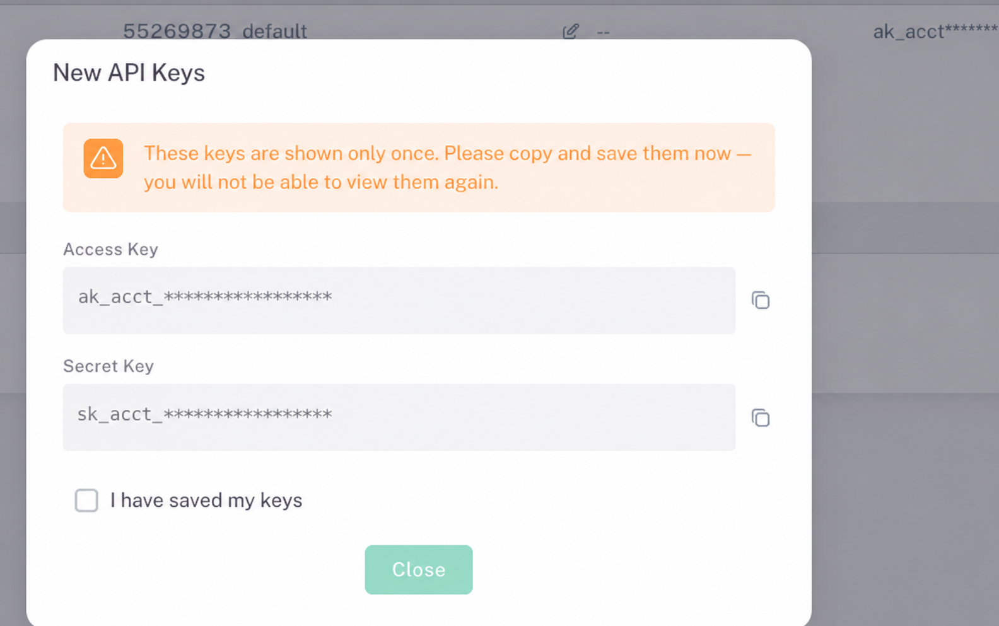
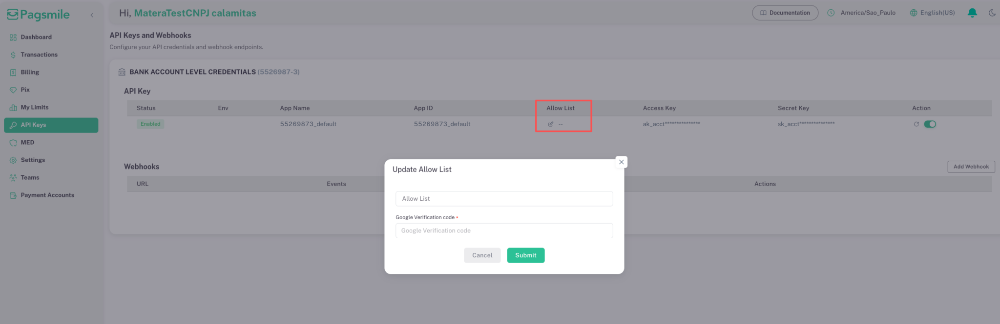

import { IpAllowlistHelper } from "/snippets/ip-allowlist-helper.jsx";
import { CredentialSetup } from "/snippets/credential-setup.jsx";

Every API request must come from an IP address on the credential's **Allow List** and carry a signature made with the credential's secret key. This guide takes you through the Pagsmile Banking dashboard: get your keys, allow your public IP addresses, and enter the keys in these docs once. After that, the signature tool on every API page uses your keys.

## Before you begin

- **Dashboard access.** Sign in to the dashboard of the environment you will call: [Sandbox](https://banking-sandbox.pagsmile.com.br) or [Production](https://banking.pagsmile.com.br/login). Each environment has its own keys, Allow Lists, and [base URL](/environments-and-credentials#environments).
- **Account MFA.** To enable, disable, or reset a key, or to update its Allow List, enter the 6-digit **Google Verification code**. Without account MFA, the dashboard shows **Account MFA required**. Set it up as described in [Enable API access](/quickstart#enable-api-access).
- **Open API.** In **Bank Account Level Credentials**, the **Open API** toggle must be on.

## Choose a credential

The **API Keys and Webhooks** page has one card per credential. Each card has its own key pair and its own **Allow List**, so configure every credential you use.

| Credential | Dashboard card (Portuguese UI) | Key prefixes | Use it for | Account headers |
| --- | --- | --- | --- | --- |
| Bank account level | **Bank Account Level Credentials** (**Credenciais da conta bancária**), shown with the account number | `ak_acct_`, `sk_acct_` | Operations on that one account: balance, statement, Pix, QR codes, TED, refunds, MED, and Pix keys, plus event subscriptions for that account | Omit `X-ISPB` and `X-Account-Number` |
| User level | **User Level Credentials (OpenVA & Onboarding)** (**Credenciais do usuário (OpenVA e Onboarding)**) | `ak_user_`, `sk_user_` | Managed accounts and event subscriptions, plus operations on any account the user can access | Send both headers for account operations; omit them for managed-account and event-subscription operations |

See [Credentials and account selection](/environments-and-credentials#credentials-and-account-selection) for the complete header rules.

## Set up access

<Steps>
  <Step title="Open the API Keys page">
    1. In the dashboard, check the selected account at the bottom of the sidebar. Select **Switch account** to change it.
    2. Select **API Keys** in the sidebar to open **API Keys and Webhooks**.
  </Step>
  <Step title="Get your access key and secret key">
    The dashboard shows a new key pair only once. Afterwards, the table shows masked values such as `ak_acct***`.

    - **No key yet:** in the credential's card, select **Enable Access Key** and enter the Google Verification code.
    - **Key pair already stored:** keep it and continue with the next step.
    - **Lost or exposed secret key:** select the reset icon (circular arrow) in the **Action** column. **Reset API Key** invalidates the current key immediately. Enter the Google Verification code to confirm.

    In **New API Keys**, copy the **Access Key** and the **Secret Key** with their copy icons and store them in your secret manager. Select **I have saved my keys**, then **Close**.

    <Warning>
      A reset stops every server that still uses the old key pair. Deploy the new pair right after you reset it.
    </Warning>

    Check that the key's **Status** is **Enabled**. If it shows **Disabled**, turn on the switch next to the reset icon in the **Action** column. In **Enable API Key**, enter the Google Verification code to confirm, then check that **Status** shows **Enabled**. This switch controls the key only. It's separate from the **Open API** toggle of the bank account.

    <Frame caption="Save API credentials, full keys masked">
      
    </Frame>
  </Step>
  <Step title="Find your public IP addresses">
    The helper in the next step shows this computer's public IP as the Pagsmile API sees it. Allow that address to test from this browser: **Test connection**, **Send to Sandbox**, and the API playground send their requests from here.

    Your servers usually reach the API from other addresses. Run this command on each server that calls the API. The API host replies with the source address it sees for your request.

    <CodeGroup>

    ```bash Linux and macOS
    curl -s https://ebanking-openapi-sandbox.pagsmile.com.br/cdn-cgi/trace | grep '^ip='
    curl -4 -s https://ebanking-openapi-sandbox.pagsmile.com.br/cdn-cgi/trace | grep '^ip='
    ```

    ```powershell Windows
    curl.exe -s https://ebanking-openapi-sandbox.pagsmile.com.br/cdn-cgi/trace | findstr /b "ip="
    curl.exe -4 -s https://ebanking-openapi-sandbox.pagsmile.com.br/cdn-cgi/trace | findstr /b "ip="
    ```

    </CodeGroup>

    The first command shows the address your server uses by default; the second forces IPv4. For production, replace the host with `ebanking-openapi.pagsmile.com.br`.

    Run the command a few times. If the address changes, your network sends traffic through several public addresses: add each one. Allow a CIDR range only when your network or cloud provider confirms that the range is dedicated to your egress. For a stable list, give your servers a fixed egress IP, such as a NAT gateway with a static address.

    Use the public egress address. In a cloud network, that is usually the NAT gateway's address. Addresses inside a private network, such as an office network or a VPC, never reach the API.

    <Warning>
      The API hostnames resolve to both IPv4 and IPv6 addresses, so a server with IPv6 connectivity can reach the API over IPv6. The dashboard's **Allow List** field removes letters, so IPv6 addresses that contain `a` to `f` can't be saved. Configure your HTTP client to use IPv4 (for example, `curl -4`) and allow the IPv4 address, or contact Pagsmile support.
    </Warning>
  </Step>
  <Step title="Add the addresses to the Allow List">
    1. In the credential's card, select the pencil icon in the **Allow List** column.
    2. In **Update Allow List**, copy the field's current value into **Current list in the dashboard** in the helper below.
    3. Enter your server addresses in **IP addresses or CIDR ranges to add**. To test from this browser, also select **Add to list** next to the address under **Your public IP**. If an IPv6 address has no **Add to list** button, the dashboard can't store it: test from a network that uses IPv4, run the generated cURL command with `curl -4` on this computer, or contact Pagsmile support.
    4. Select **Copy** in the helper and replace the field's content with the copied value.
    5. Enter the 6-digit **Google Verification code** and submit. The dashboard shows **Allow List updated successfully.**

    <Frame caption="Edit Allow List and submit the verification code">
      
    </Frame>

    <IpAllowlistHelper />

    The API applies these rules to the Allow List:

    - Separate entries with commas. Spaces around an entry are ignored.
    - An entry is an exact address or a CIDR range: an address, a slash, and the prefix length. The API compares an exact IPv6 entry as text, so write it in compressed form or as a `/128` range.
    - An empty Allow List rejects every request with `4004103`. A source address that matches no entry also returns `4004103`; the current message doesn't show the address.
    - `0.0.0.0/0` allows every IPv4 address. Use exact addresses or narrow ranges in production.
  </Step>
  <Step title="Enter your keys in these docs">
    <CredentialSetup />

    - Paste each key pair into its card and select **Save in this tab**. The tool trims surrounding spaces and saves a card only when its keys have the card's prefix, aren't swapped, and contain only letters, digits, underscores, and hyphens. After you edit a saved card, select **Save in this tab** again before you copy the variables or test the connection.
    - For user-level credentials, you can add a default account for account operations. Use an account the user can access, such as one returned by `POST /v3/onboarding/managed_accounts/list`; other accounts return `4004003`. Enter `X-Account-Number` without the hyphen: the dashboard shows `1234567-8`, and the header value is `12345678`.
    - The keys stay only in this tab's memory. Reloading or closing the tab clears them, other tabs don't see them, and **Clear** removes them right away. The docs don't write keys to cookies or browser storage.
    - The tool generates `PAGSMILE_BASE_URL`, `PAGSMILE_AK`, and `PAGSMILE_SK` for bash and PowerShell. The server-side request samples in these docs read these variables.

    Use Sandbox keys to try requests here. Never put credentials in your application's front-end code.
  </Step>
  <Step title="Test the connection">
    In the Sandbox, select **Test connection** in the tool. It sends one signed read request from this browser:

    | Credential | Test request |
    | --- | --- |
    | Bank account level | `POST /v3/bank_account` with `{}` (account details and balance) |
    | User level | `POST /v3/onboarding/managed_accounts/list` with the first page of one item |

    The browser test uses this computer's IP address, so allow it first. To test a server, set the variables there and run the [first request sample](/quickstart#send-your-first-signed-request).

    | Result | Meaning | What to do |
    | --- | --- | --- |
    | `code` `200` | Key, signature, and IP were accepted | Continue with the [API reference](/api-reference/overview) |
    | `code` `401` | The API doesn't recognize the AK. The response is HTTP 200 with the message `User is invalid` | Check the selected environment and paste the complete AK from **New API Keys**. The table shows only a masked value |
    | `code` `4004103` | Source IP isn't on the Allow List | Browser test: add the address under **Your public IP**. If it's already listed, select **Detect again**: the network can leave from more than one address, so add each confirmed address or test from a fixed outgoing IP. If it's an IPv6 address with letters, the dashboard can't store it, so test over IPv4 or contact Pagsmile support. Server request: add the address that the server command shows and check whether the client used IPv6 |
    | `code` `4004107` | Signature is invalid | Check that the SK belongs to the AK and that you sign the exact body bytes |
    | `code` `4004105` | Timestamp is invalid or expired | Sync the clock; send the current Unix time in milliseconds |
    | `code` `4004106` | Nonce was already used | Generate a new nonce and signature for every attempt |
    | `code` `4004101` | The `X-Client-ID` header is missing | Send every header in [Sign requests](/environments-and-credentials#sign-requests) |
    | `code` `4004102` | `X-Timestamp`, `X-Nonce`, or `X-Signature` is missing, or the timestamp isn't a number | Send every header in [Sign requests](/environments-and-credentials#sign-requests), with the timestamp in Unix milliseconds |
    | `code` `4004003` | Permission denied | Check that the key **Status** is **Enabled**. If it's **Disabled**, turn on its switch in the **Action** column. Also check the **Open API** toggle and the credential type. With user-level credentials, check that the user can access the account in `X-Account-Number` |
    | HTTP 403 with `error code: 1010` | The edge rejected the client's `User-Agent` | Send a descriptive `User-Agent` header; see [Authentication errors](/environments-and-credentials#authentication-errors) |
  </Step>
</Steps>

## Use your keys on every API page

Each API page has a signature tool. When you have saved keys in this tab, it fills them in automatically:

- **Account operations** use your bank-account-level credential first. With a user-level credential, the tool adds the default account's `X-ISPB` and `X-Account-Number`.
- **Managed-account operations** use only the user-level credential. **Event-subscription operations** accept either credential. Neither sends account headers.
- **Generate headers and cURL** creates a cURL command in bash syntax; on Windows, run it in Git Bash or WSL. Its signature is valid for 5 minutes and for one request.
- **Send to Sandbox** sends that request from this browser and shows the response. Write operations change Sandbox data.

The API playground on each API page also sends requests directly from this browser, without a proxy. Allow the address that the helper detects for the API host you select in the playground. If a playground request returns `4004103`, select **Detect again** and allow each address it shows. Paste the headers from **Generate headers and cURL** into its fields.

Browsers can't send everything that the API accepts. The API's cross-origin (CORS) policy doesn't allow `X-ISPB` or `X-Account-Number` from browsers in **Send to Sandbox** or in the API playground. For account operations with a user-level credential, copy the cURL command and run it on your server.

<Visibility for="agents">
| Tool | Behavior |
| --- | --- |
| IP allowlist helper | When the page opens, reads the `ip=` line of `https://ebanking-openapi-sandbox.pagsmile.com.br/cdn-cgi/trace` and `https://ebanking-openapi.pagsmile.com.br/cdn-cgi/trace`: the address each API host sees for this browser. Shows every detected address. Only addresses without letters get an **Add to list** button and appear in the input placeholder; an IPv6 address with letters shows the IPv4 and support guidance instead. Merges new and existing entries, removes duplicates, and outputs a comma-separated list only when every entry is valid. Rejects invalid IPv4, IPv6, and CIDR syntax, and IPv6 entries with letters, which the dashboard field can't store; warns about private or reserved addresses, `/0` ranges, and uncompressed exact IPv6 entries. |
| Credential setup | Stores bank-account-level and user-level AK/SK, the environment, and an optional default `X-ISPB` and `X-Account-Number` in the tab's memory only. Generates `PAGSMILE_BASE_URL`, `PAGSMILE_AK`, and `PAGSMILE_SK` for bash and PowerShell. In the Sandbox, tests `POST /v3/bank_account` or `POST /v3/onboarding/managed_accounts/list` from the browser. |
| Signature tool | Uses the saved credential that matches the operation, signs one POST request, outputs a cURL command with a `User-Agent` header and, in the Sandbox without account headers, sends the request from the browser. |
| API playground | Configured with `api.playground.proxy: false`: sends each request directly from the browser to the selected server, so the API checks this browser's public IP. A request with `X-ISPB` or `X-Account-Number` fails the CORS preflight, and the playground shows `unable to complete request`. |
</Visibility>

## Related

<CardGroup cols={2}>
  <Card title="Quickstart" icon="rocket" href="/quickstart">
    Register your account, enable Open API, and send your first request.
  </Card>
  <Card title="Credentials and signing" icon="key" href="/environments-and-credentials">
    Header rules, the string to sign, and test vectors.
  </Card>
  <Card title="Error catalog" icon="triangle-exclamation" href="/api-reference/error-catalog">
    Business codes and how to handle them.
  </Card>
  <Card title="Account models" icon="sitemap" href="/account-models">
    How users, accounts, and managed accounts relate.
  </Card>
</CardGroup>
