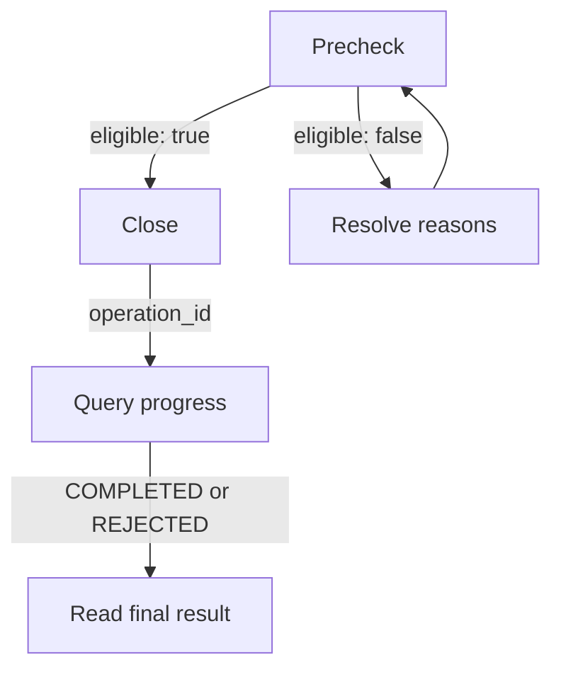
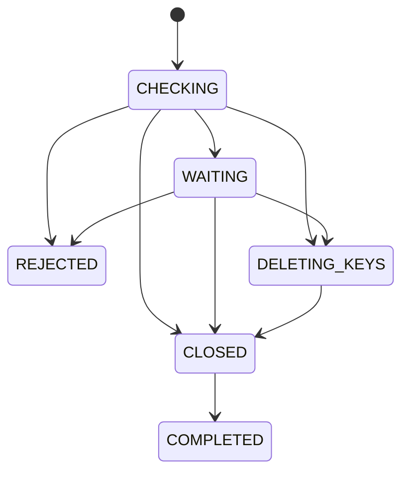

Close a managed account by checking eligibility, submitting one closure request and following its operation ID. Only CLOSED or COMPLETED confirms account closure.

## Closure workflow

| Endpoint | What it does |
| --- | --- |
| [Check eligibility](/api-reference/accounts/close-account/check-eligibility) | Checks current conditions without changing the account. |
| [Close account](/api-reference/accounts/close-account/close-account) | Records an idempotent closure operation. |
| [Get closure progress](/api-reference/accounts/close-account/get-closure-progress) | Reads progress without executing or retrying closure. |

Keep the same account and deletion option in the precheck and closure request. Precheck approval reports current eligibility, without reserving or confirming closure.

## Prepare for closure

Merchant closure supports MOR, VA and PA managed accounts whose bank account status is ACTIVE. It does not accept master accounts (`MA_MOR`).

Use ACCOUNT credentials for the authorized account, or USER credentials with signed `X-ISPB` and `X-Account-Number` headers. PLATFORM credentials cannot call these endpoints.

Before applying, resolve nonzero balances, frozen funds, open child accounts, outstanding payer MED cases, infraction reports and unpaid fee bills.

While closure is in progress, the account cannot send or receive new payments, even if its bank account status remains ACTIVE.

Existing payments, refunds, disputes, account openings and fee collections can delay closure. Failed or unconfirmed checks require waiting or verification rather than approval.

The total balance, available funds and frozen funds must all be zero. Closure checks those funds; it does not transfer a remaining balance for you.

## Closure states

| Status | Meaning | What it proves | Next step |
| --- | --- | --- | --- |
| `1` CHECKING | Eligibility checks running | Request recorded | Read reasons and next action |
| `2` WAITING | Obligations or verification pending | Closure not confirmed | Follow `next_action` |
| `3` DELETING_KEYS | Authorized key deletion underway | Deletion has started | Keep querying this operation |
| `4` CLOSED | Account closed, cleanup pending | Bank account is closed | Wait for cleanup completion |
| `5` COMPLETED | Closure and cleanup finished | Operation finished | Keep the final record |
| `6` REJECTED | Eligibility blocks closure | No closure by this operation | Check current account state |

WAITING can require operations review as well as waiting for existing obligations. Read `reasons[].kind` and `next_action` before deciding whether to wait or contact support.

With only blocking eligibility reasons, the operation becomes REJECTED before key deletion starts. After deletion starts, new problems require verification instead of rejection.

## Pix keys and irreversible closure

<Warning>Account closure is irreversible once CLOSED. Automatic Pix key deletion can begin before the account reaches CLOSED.</Warning>

Delete active keys first or send `auto_delete_active_pix_keys` as `true` when you submit closure. The precheck evaluates that option without deleting keys or saving permission.

The server rechecks eligibility after key deletion. If deletion remains unconfirmed after a timeout, the original operation stays under verification.

After CLOSED, cleanup closes the managed identity, updates default-account selection, retires Pix keys, sets active account limits to zero and removes account fee configurations.

It also deactivates account webhook subscriptions and ACCOUNT credentials. Cleanup failures do not reopen the account; wait for COMPLETED to confirm all processing finished.

## Retries and access after closure

Keep the idempotency key and original intent after a timeout. If you saved the operation ID, query it; otherwise resend the original closure request.

REJECTED releases this operation's temporary closure restriction. It does not prove the current account state; another operation may already have closed the account.

Check `account_status` in the progress response. Reapply with a new idempotency key only if the account remains ACTIVE and eligible after you resolve the reasons.

Use authorized USER credentials to query after ACCOUNT credentials are deactivated. Historical queries still require the same owner and valid account bindings.

All JSON business results return HTTP 200. Read `code` first, then the eligibility or operation status, and include `xxx-log-id` when contacting support.

## Related

<CardGroup cols={2}>
  <Card title="Check eligibility" icon="list-check" href="/api-reference/accounts/close-account/check-eligibility">
    Identify blockers without changing the account.
  </Card>
  <Card title="Get closure progress" icon="clock" href="/api-reference/accounts/close-account/get-closure-progress">
    Confirm closure and cleanup.
  </Card>
</CardGroup>
