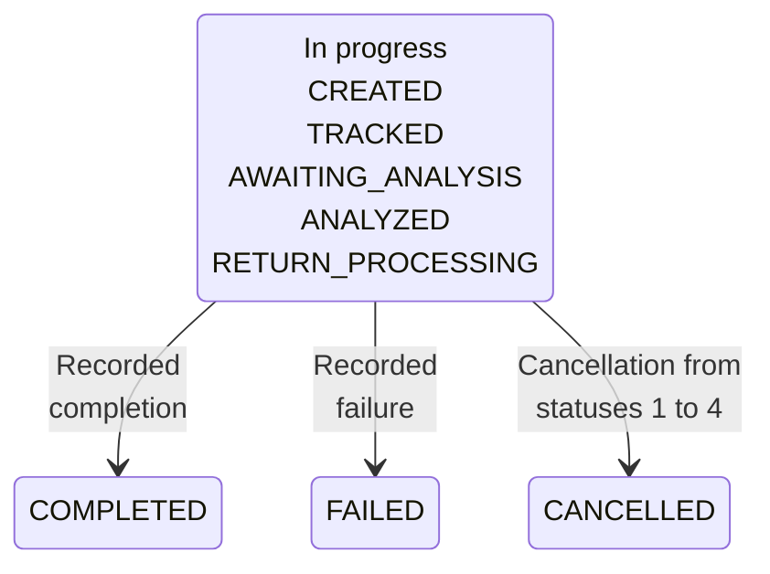

MED handles disputes about an original Pix payment and tracks funds recovery. A case status alone does not prove that money was blocked or returned.

## How MED fits together

<Tooltip tip="Mecanismo Especial de Devolução: the Pix special return mechanism for fraud disputes.">MED</Tooltip> links a payer's case to the original Pix payment. Infraction reports concern the receiving account's analysis and funds blocking.

<Steps>
  <Step title="Identify the original Pix payment">
    Confirm the disputed payment and its `end_to_end_id`. Use the payer account that owns the payment.
  </Step>
  <Step title="Create the case">
    Submit the fraud situation and processing option. Save `data.med_case.case_id` from the response.
  </Step>
  <Step title="Track progress and funds">
    Query the case, read its status and compare requested, blocked and returned amounts. Check actual funds outcomes separately.
  </Step>
</Steps>

## API operations

| Endpoint | What it does |
| --- | --- |
| [Create MED case](/api-reference/med/create-med-case) | Open a case for the original Pix payment. |
| [List MED cases](/api-reference/med/list-med-cases) | Find cases in the selected account context. |
| [Get MED case details](/api-reference/med/get-med-case-details) | Read case status and recovery amounts. |
| [Cancel MED case](/api-reference/med/cancel-med-case) | Request cancellation of an eligible case. |
| [List infraction reports](/api-reference/med/list-infraction-reports) | Find reports for the receiving account. |
| [Get infraction report details](/api-reference/med/get-infraction-report-details) | Inspect an accessible report and blocking information. |

## Before you call

<Tabs>
  <Tab title="ACCOUNT" icon="building-columns">
    Use the credential bound to the relevant account. Omit account headers, or send both `X-ISPB` and `X-Account-Number` with matching account values.
  </Tab>
  <Tab title="USER" icon="user">
    Send both `X-ISPB` and `X-Account-Number` for an account owned by the USER. Include both in the [signature](/environments-and-credentials#sign-requests).
  </Tab>
  <Tab title="PLATFORM" icon="server">
    <Warning>PLATFORM credentials cannot call these operations. Use ACCOUNT or USER credentials for the relevant account.</Warning>
  </Tab>
</Tabs>

Creation requires an original Pix payment that can be retrieved with its amount and transaction ID. The original payer account must not be closing or closed.

Case access does not grant access to the receiving account's linked tasks. The case detail and cancellation responses leave `infractions`, `refunds` and `fund_dispositions` empty.

Their `timeline` is also empty when linked tasks or funds records exist. An empty array does not mean that no related activity occurred.

## Case lifecycle

The diagram groups the supported case statuses. It does not require every case to pass through every intermediate status.

| Status | Meaning | What it proves | Next step |
| --- | --- | --- | --- |
| `0` UNSPECIFIED | No defined status | No workflow outcome | Query the case |
| `1` CREATED | Case created | A case exists | Track its status |
| `2` TRACKED | Recovery being tracked | Processing has started | Query progress |
| `3` AWAITING_ANALYSIS | Awaiting receiving-side analysis | Analysis is pending | Wait and query |
| `4` ANALYZED | Analysis completed | A decision can proceed | Track return processing |
| `5` RETURN_PROCESSING | Returns being processed | Return processing is ongoing | Check returned amounts |
| `6` COMPLETED | Workflow completed | Case processing finished | Verify actual recovery |
| `7` CANCELLED | Workflow cancelled | Cancellation is recorded | Verify funds release |
| `8` FAILED | Workflow failed | Case processing failed | Inspect the case |

Cancellation eligibility is narrower than the set of in-progress statuses. `can_cancel` is `true` only for CREATED, TRACKED, AWAITING_ANALYSIS and ANALYZED.

Check the latest case details before [cancelling](/api-reference/med/cancel-med-case). Releasing blocked funds can finish after the cancellation response.

## Balance and recovery

A block restricts funds availability; it is not a return. Compare `requested_amount`, `blocked_amount_total` and `returned_amount_total`, which are decimal strings in BRL.

Neither a successful create response nor COMPLETED proves full recovery. Recovery can be partial even when `automatic_refund` is `true`.

When MED-related restrictions prevent a payout, its business `code` can be `4004003` with this message:

> Your account has no available balance. Please check your MEDs or available balance.

That result uses HTTP 200. Check your MED cases and [account balance](/api-reference/accounts/get-account-balance) before another payout attempt.

## Related

<CardGroup cols={2}>
  <Card title="Create MED case" icon="shield-halved" href="/api-reference/med/create-med-case">
    Open a dispute linked to the original Pix payment.
  </Card>
  <Card title="Get MED case details" icon="magnifying-glass" href="/api-reference/med/get-med-case-details">
    Track status and recovery amounts.
  </Card>
  <Card title="List infraction reports" icon="list" href="/api-reference/med/list-infraction-reports">
    Query reports with the receiving account context.
  </Card>
  <Card title="Pix refunds" icon="rotate-left" href="/api-reference/refunds/overview">
    Use the separate flow for an ordinary Pix refund.
  </Card>
</CardGroup>
