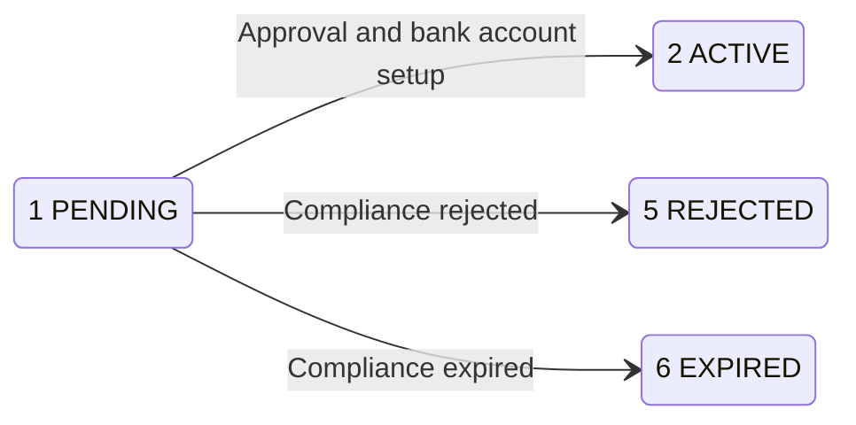

Managed account onboarding lets you create MOR, VA and PA accounts under a USER. Confirm the account's current status and bank account details before using it.

## Opening workflow

<Steps>
  <Step title="Choose the account model">
    Compare MOR, VA and PA in [Account models](/account-models), then use the matching request variant in [Create managed account](/api-reference/onboarding/create-managed-account).
  </Step>
  <Step title="Confirm the opening fee and balance">
    Contact Pagsmile Support to confirm the fee is configured. Ask the owning MA account holder to confirm enough available balance on the MA for MOR and VA, or on the selected direct parent for PA. See [Account-opening fees](/api-reference/onboarding/create-managed-account#account-opening-fees) for the fee errors and how to retry.
  </Step>
  <Step title="Configure KYB callbacks for VA or PA">
    Register your HTTPS callback URL for **VA ACCOUNT KYB** under the owning USER before creating the account. [Webhook setup](/api-reference/onboarding/kyb-callbacks#before-you-receive-callbacks)
  </Step>
  <Step title="Create the managed account">
    Sign the request with the owning USER credential. Keep the returned `reference_id` to query the account later.

    MOR creation reuses the parent MA's approved compliance evidence without starting a fresh review. VA and PA submit their own compliance information.
  </Step>
  <Step title="Complete any hosted submission">
    If creation returns a `verification_url`, direct the applicant to that URL. A compliance status of `PENDING_SUBMISSION` indicates that submission is still required.
  </Step>
  <Step title="Confirm the account state">
    Use [Get managed account](/api-reference/onboarding/get-managed-account) to check the current status and bank account information.

    A successful creation response or an `APPROVED` [KYB callback](/api-reference/onboarding/kyb-callbacks) does not replace this check. Confirm an account whose `status` is `2` (ACTIVE).
  </Step>
</Steps>

## API operations

All three operations use POST with a JSON body. Their account scope comes from the owning USER, not bank account targeting headers.

| Endpoint | What it does |
| --- | --- |
| [Create managed account](/api-reference/onboarding/create-managed-account) | Create MOR, VA or PA with `/v3/onboarding/managed_accounts/create`. |
| [Get managed account](/api-reference/onboarding/get-managed-account) | Read one account with `/v3/onboarding/managed_accounts/detail`. |
| [List managed accounts](/api-reference/onboarding/list-managed-accounts) | List the USER's visible managed accounts with `/v3/onboarding/managed_accounts/list`. |

## Before you call

<Tabs>
  <Tab title="USER" icon="user">
    Use the credential of the USER that owns the accounts. Omit `X-ISPB` and `X-Account-Number` for creation, details and listing.

    The USER must have managed account creation enabled. Creation requires exactly one valid MA whose status is ACTIVE and whose bank account is active.

    Follow [Sign requests](/environments-and-credentials#sign-requests) for the headers and HMAC-SHA256 signature.
  </Tab>
  <Tab title="ACCOUNT" icon="building-columns">
    <Warning>ACCOUNT credentials cannot call these managed account onboarding operations. Use the owning USER credential.</Warning>
  </Tab>
  <Tab title="PLATFORM" icon="server">
    <Warning>PLATFORM credentials cannot call these managed account onboarding operations. Use the owning USER credential.</Warning>
  </Tab>
</Tabs>

## Account lifecycle statuses

Account status is numeric. Compliance status describes the review separately; approval does not, by itself, prove account activation.

The diagram shows outcomes of a pending opening. Creation can return an outcome already reached; read current account details to confirm it.

| Status | Meaning | What it proves | Next step |
| --- | --- | --- | --- |
| `0` UNSPECIFIED | No mapped account status | No usable lifecycle result | Check details and contact support |
| `1` PENDING | KYB or setup pending | Activation not confirmed | Complete submission or query details |
| `2` ACTIVE | Account activated | Activation recorded | Check bank account information |
| `3` FROZEN | Account frozen | Frozen state recorded | Pause use and contact support |
| `4` CLOSED | Account closed | Closed state recorded | Do not treat as active |
| `5` REJECTED | Account opening rejected | Rejection recorded | Check compliance result |
| `6` EXPIRED | Account opening expired | Expiration recorded | Check details and contact support |

A hosted submission pending state belongs to compliance: `PENDING_SUBMISSION`. Do not treat that string as the numeric account status.

## Related

<CardGroup cols={2}>
  <Card title="Create managed account" icon="plus" href="/api-reference/onboarding/create-managed-account">
    Choose the MOR, VA or PA request variant.
  </Card>
  <Card title="KYB callbacks" icon="bell" href="/api-reference/onboarding/kyb-callbacks">
    Receive and verify compliance updates.
  </Card>
  <Card title="Get managed account" icon="magnifying-glass" href="/api-reference/onboarding/get-managed-account">
    Confirm the current status and bank account details.
  </Card>
  <Card title="Account models" icon="layer-group" href="/account-models">
    Compare the account models before creating an account.
  </Card>
</CardGroup>
