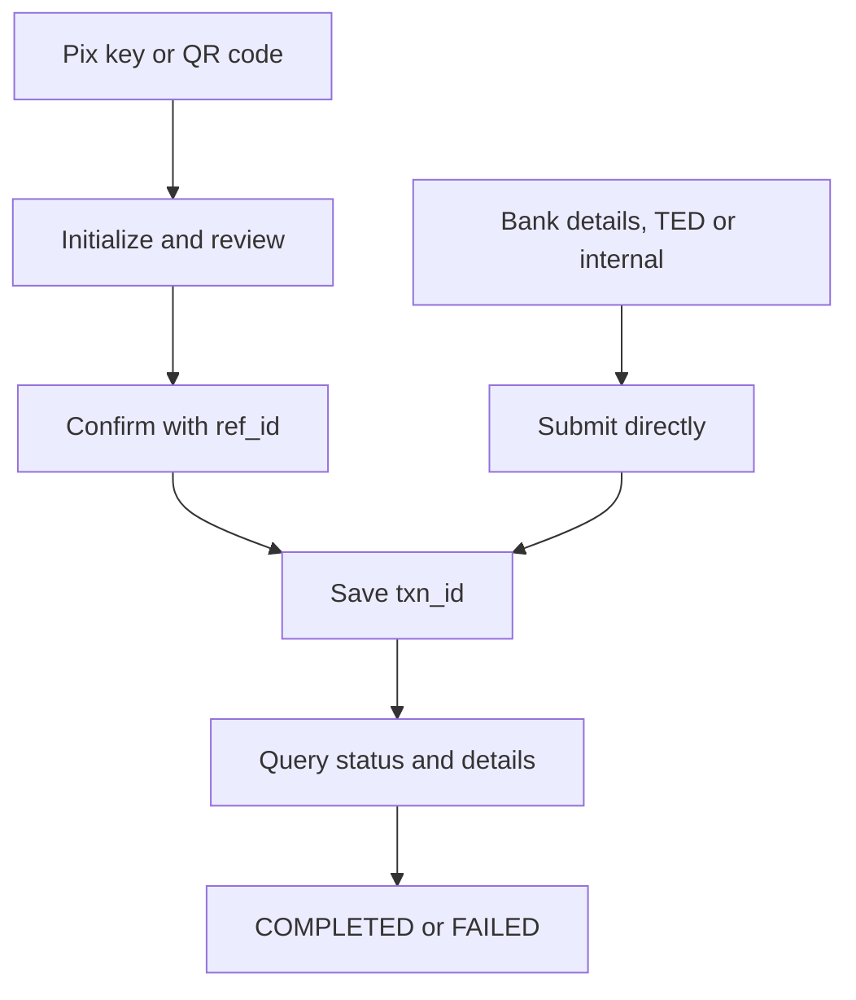

Send outgoing payments through Pix, TED or internal transfer. Save the submitted payment's `txn_id` and confirm its result before you send another payment.

## Choose a payment path

| Path | What you provide | Submission |
| --- | --- | --- |
| [Pix key](/api-reference/payout/pix/initialize-pix-key-payment) | Payee's Pix key | Initialize, then confirm |
| [Pix QR code](/api-reference/payout/pix/initialize-qr-code-payment) | Pix QR code content | Initialize, then confirm |
| [Pix bank details](/api-reference/payout/pix/pay-with-bank-account-details) | Payee's bank account details | Submit directly |
| [TED](/api-reference/payout/ted/initiate-ted-payment) | Account at another institution | Submit directly |
| [Internal transfer](/api-reference/payout/book-transfer/initiate-internal-transfer) | Account at the same institution | Submit directly |

<Tooltip tip="Transferência Eletrônica Disponível, a bank transfer between institutions.">TED</Tooltip> requires a payee bank different from the payer bank. Internal transfer requires the same bank.

Send amounts as decimal strings in BRL, for example `"10.50"`. Each submission endpoint documents its account and amount requirements.

## Before you call

<Tabs>
  <Tab title="ACCOUNT" icon="building-columns">
    Use the account bound to your AK. Omit both `X-ISPB` and `X-Account-Number`, or send both with values matching the bound account.
  </Tab>
  <Tab title="USER" icon="user">
    Send both `X-ISPB` and `X-Account-Number` to select an account owned by the USER. Include both headers in the [signature](/environments-and-credentials#sign-requests).
  </Tab>
  <Tab title="PLATFORM" icon="server">
    <Warning>PLATFORM credentials cannot submit these payments. Use ACCOUNT or USER credentials for the payer account.</Warning>
  </Tab>
</Tabs>

## Submit and track

Pix key and QR code payments have two steps. Initialization returns `ref_id` and payee details; confirmation submits the payment using that reference.

Pix bank-account payments, TED and internal transfers do not use a separate confirmation endpoint.

A response whose `code` is `200` confirms acceptance of the API request. It does not prove the payment completed. Read `data.txn_status` and retain `data.txn_id`.

## Read the payment status

| Status | Meaning | What it proves | Next step |
| --- | --- | --- | --- |
| `1` TXN_STATUS_PENDING | Awaiting processing | No completion evidence | Query the original payment |
| `5` TXN_STATUS_PROCESSING | Processing | No completion evidence | Query the original payment |
| `2` TXN_STATUS_COMPLETED | Payment completed | Successful payment result | Reconcile the matching statement |
| `3` TXN_STATUS_FAILED | Recorded failure | Failure recorded locally | Reconcile before any replacement |

The [status endpoint](/api-reference/payout/get-payment-status) returns the payment status. The [details endpoint](/api-reference/payout/get-payment-details) returns information about the identified payment.

For Pix, `FAILED` records a Pagsmile failure; it does not prove that funds did not move at the bank. Reconcile payment details and the matching statement entry before creating any replacement payment. See [Get payment status](/api-reference/payout/get-payment-status) for the two-hour rule.

For Pix, a [result callback](/api-reference/payout/pix/callbacks) also reports the recorded payment outcome.

## Handle an unknown result

Treat a timeout, a lost response or an HTTP 5xx response as an unknown payment result. Apply the same rule to a system error that leaves the payment outcome unclear.

JSON business results, including system errors, return HTTP 200. Read the envelope's `code` and `message`; do not confuse a business error code with an HTTP status.

Retain the original order and payment identifiers. Query the original [payment status](/api-reference/payout/get-payment-status) before considering another submission. Do not create a new payment while the original outcome remains unknown.

Use `data.txn_id` when the submission response includes it. If you use the [statement](/api-reference/accounts/get-account-statement), select the entry that matches the payment, not the first entry.

If you cannot identify the original payment, contact support before considering another submission.

When you contact support, include the environment, endpoint, original request identifiers and response header `xxx-log-id`. Mask sensitive data and never send your SK.

## Related

<CardGroup cols={2}>
  <Card title="Pix payment paths" icon="qrcode" href="/api-reference/payout/pix/overview">
    Compare the three Pix payment flows.
  </Card>
  <Card title="Get payment status" icon="clock" href="/api-reference/payout/get-payment-status">
    Track the original transaction.
  </Card>
  <Card title="Get payment details" icon="file-lines" href="/api-reference/payout/get-payment-details">
    Inspect the payment result.
  </Card>
  <Card title="Reconciliation" icon="scale-balanced" href="/api-reference/reconciliation">
    Match payments to statement entries.
  </Card>
</CardGroup>
