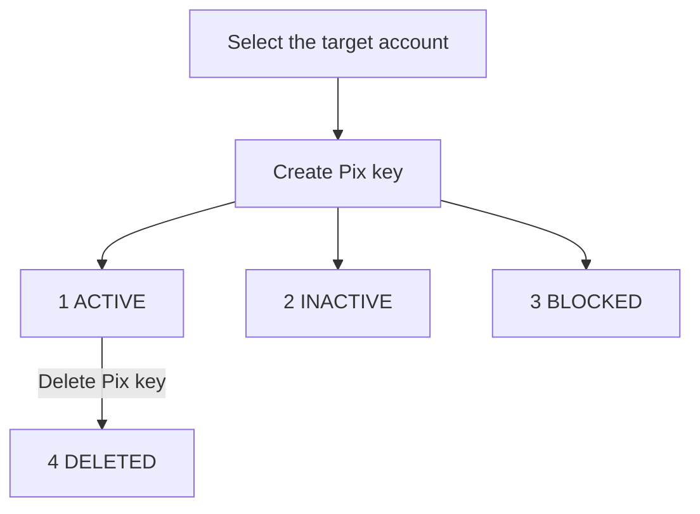

A Pix key identifies the account that receives a payment. Create and delete keys for your target account, and share only keys whose `status` is `1` (ACTIVE).

## Key lifecycle

Creation returns the registered key and its status. Keep the returned key, especially when you request a random key, and check the status before sharing it.

The diagram shows creation results and deletion of an active key. It does not promise an automatic transition from INACTIVE or BLOCKED to ACTIVE.

## API operations

| Endpoint | What it does |
| --- | --- |
| [Create Pix key](/api-reference/pix-keys/create-pix-key) | Registers a key for the target account and returns its status. |
| [Delete Pix key](/api-reference/pix-keys/delete-pix-key) | Checks current ownership and removes a registered key. |
| [Get account balance](/api-reference/accounts/get-account-balance) | Returns the account's ACTIVE keys in `data.pix_keys`. |

## Before you call

<Tabs>
  <Tab title="ACCOUNT" icon="building-columns">
    Create or delete keys on the account bound to your credential. You may omit `X-ISPB` and `X-Account-Number`. If you send them, send both, and both must match the bound account.
  </Tab>
  <Tab title="USER" icon="user">
    Send both `X-ISPB` and `X-Account-Number` to select an active account owned by the USER. Include both headers in the [signature](/environments-and-credentials#sign-requests).
  </Tab>
  <Tab title="PLATFORM" icon="server">
    <Warning>PLATFORM credentials cannot create or delete Pix keys. Use the ACCOUNT or USER credential for the account that owns the key.</Warning>
  </Tab>
</Tabs>

## Key types and format limits

Creation takes `pix_key_type`. Deletion takes `pix_key` and infers its type from the value.

| `pix_key_type` | Type | Key value |
| --- | --- | --- |
| `1` | <Tooltip tip="Cadastro de Pessoas Físicas, the Brazilian individual taxpayer ID.">CPF</Tooltip> | 11 digits |
| `2` | <Tooltip tip="Cadastro Nacional da Pessoa Jurídica, the Brazilian company taxpayer ID.">CNPJ</Tooltip> | 12 letters or digits, then 2 digits |
| `3` | Email | At most 77 characters |
| `4` | Phone | Brazilian number with `+55` |
| `5` | <Tooltip tip="Endereço Virtual de Pagamento, a random UUID key.">EVP</Tooltip> | 36-character lowercase UUID |

For EVP creation, omit `pix_key_value` or send an empty string to generate a key. Use the returned `data.pix_key` in later requests.

See [creation formats](/api-reference/pix-keys/create-pix-key#key-formats) and [deletion formats](/api-reference/pix-keys/delete-pix-key#key-formats) for the exact validation rules. The phone formats differ between these operations.

## Statuses

| Status | Meaning | What it proves | Next step |
| --- | --- | --- | --- |
| `0` UNSPECIFIED | No status specified | No usability confirmation | Check the operation result |
| `1` ACTIVE | Active registration | Key can receive Pix | Share the key with payers |
| `2` INACTIVE | Inactive registration | Key is not usable | Do not share it |
| `3` BLOCKED | Pending or blocked | Key is not active | Do not share it |
| `4` DELETED | Key removed | Registration was deleted | Remove it from payment instructions |

BLOCKED can include pending registration or identity validation. It does not, by itself, indicate a fraud block.

The delete response does not return a status field. When its `code` is `200`, keep the returned key and deletion timestamp as the operation result.

## Check keys and handle uncertain results

Use [Get account balance](/api-reference/accounts/get-account-balance) to read `data.pix_keys`. This list contains only ACTIVE keys, so it is not a history of every key status.

<Note>The account query can succeed with an empty key list when key retrieval fails. An empty list alone does not prove that creation failed or deletion succeeded.</Note>

Keep the creation or deletion response alongside the account query. If a timeout hides the result, check the account before retrying the operation.

Neither operation has an idempotency key. Retrying an EVP creation can create another random key. A repeated deletion can return a different result.

## Related

<CardGroup cols={2}>
  <Card title="Create Pix key" icon="key" href="/api-reference/pix-keys/create-pix-key">
    Register a key and interpret its creation status.
  </Card>
  <Card title="Delete Pix key" icon="trash-can" href="/api-reference/pix-keys/delete-pix-key">
    Remove a registered key and handle uncertain results.
  </Card>
</CardGroup>
