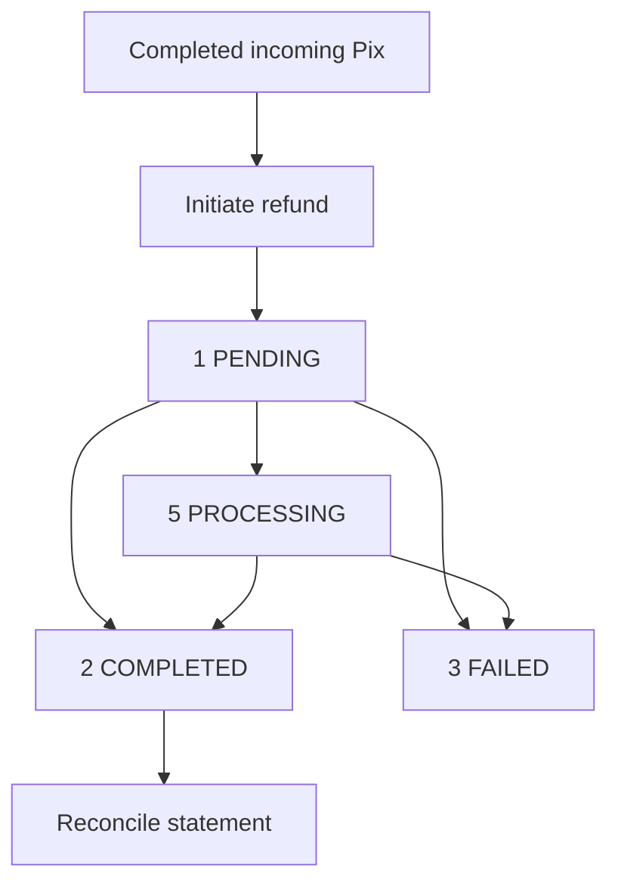

You refund an incoming Pix payment from the original payee account. Request acceptance does not prove that funds were returned.

## How it works

Save `refund_id`, `settlement_refund_id` and the original settlement ID before tracking the result. Keep a separate record for each refund.

## Endpoints

| Endpoint | What it does |
| --- | --- |
| [Initiate Pix refund](/api-reference/refunds/initiate-pix-refund) | Submits a full or partial refund |
| [Get refund details](/api-reference/refunds/get-refund-details) | Returns recorded amount, parties and status |
| [Get refund status](/api-reference/refunds/get-refund-status) | Checks and may refresh non-terminal status |
| [Refund callbacks](/api-reference/refunds/callbacks) | Delivers signed results to subscribed accounts |

## Full and partial refunds

The original Pix payment must be completed and have a positive remaining returnable amount. The refunding account must be the original payee.

You can refund the remaining amount at once or make partial refunds. Each request needs its own `merchant_order_id`.

The remaining amount excludes completed refunds, chargeback returns and amounts reserved for pending returns. Negative results are treated as zero.

The deadline is 90 days after the original transaction's initiation time. Requests after that deadline are rejected.

Send `amount` as a positive decimal string in BRL, exactly representable with two decimal places. It must not exceed the remaining returnable amount.

## Credentials and account

Use ACCOUNT for the original payee account, or USER with that account's `X-ISPB` and `X-Account-Number`. PLATFORM credentials are not accepted.

Keep the same account context when tracking the refund you sent. The account receiving the refund has limited visibility before completion.

## Lifecycle

| Status | Meaning | What it proves | Next step |
| --- | --- | --- | --- |
| `0` UNSPECIFIED | Unknown state | No completion evidence | Check details |
| `1` PENDING | Request accepted | Acceptance only | Query the same refund |
| `5` PROCESSING | Outcome not yet confirmed | No completion evidence | Query as refund sender |
| `2` COMPLETED | Refund completed | Completion recorded | Match amount in statement |
| `3` FAILED | Refund failed | Failure recorded | Check details and callback |

A completed partial refund also has status `2` (COMPLETED). That confirms completion of this refund, not a full refund of the original payment.

A sender-side status check attempts to refresh non-terminal states. If refresh fails, a successful response can still contain the last recorded status.

For the recipient, every non-completed refund appears as `5` (PROCESSING), including failed refunds. Use the sender account to track the actual outcome.

## Retries and reconciliation

After a timeout or temporary error, query the existing refund. Do not submit another request with a new ID before resolving the outcome.

Duplicate checking uses only `merchant_order_id`, without account or USER scope. IDs are reserved for 48 hours; the original response is not replayed.

Do not reuse IDs after that period. UTC date rules still apply; see [Initiate Pix refund](/api-reference/refunds/initiate-pix-refund).

A not-found result immediately after acceptance can be temporary. Keep the identifiers and query the same refund again.

If you received no identifiers, retain the request, account, amount and time. Include `xxx-log-id` when you contact support.

Match the refund to its [statement entry](/api-reference/accounts/get-account-statement). Use `parent_txn_id` and `parent_settlement_id` to link the original payment.

The details response does not populate `original_settlement_id`. Configure [callbacks](/api-reference/refunds/callbacks), or query status when a notification does not arrive.

## Related

<CardGroup cols={2}>
  <Card title="Initiate Pix refund" icon="rotate-left" href="/api-reference/refunds/initiate-pix-refund">
    Return a completed incoming Pix payment.
  </Card>
  <Card title="Reconciliation" icon="list-check" href="/api-reference/reconciliation">
    Match the refund to statement records.
  </Card>
</CardGroup>
