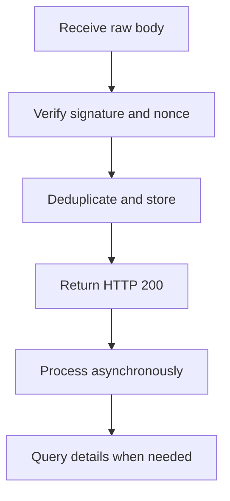

Webhooks send signed notifications to your callback URL. Verify each request, store it reliably and return HTTP `200` before you process it asynchronously.

## Receive an event

Follow [Verify callbacks](/environments-and-credentials#verify-callbacks) for signature verification and replay protection. Keep the raw body unchanged until verification finishes.

## Subscriptions and credentials

A subscription associates an event type, callback URL and signing credential with its owner. Keep the subscription active and the signing credential available.

<Tabs>
  <Tab title="ACCOUNT" icon="building-columns">
    Transaction subscriptions belong to the account bound to your credential. If you send `account_number`, it must match that account.
  </Tab>
  <Tab title="USER" icon="user">
    For transaction subscriptions, send `account_number` in the JSON body to identify an account you can access. Do not use account-target headers to select it.

    The subscription is shared across eligible accounts; `account_number` does not bind it to one account.

    Managed-account KYB subscriptions use the USER scope without `account_number`.
  </Tab>
  <Tab title="PLATFORM" icon="server">
    Use PLATFORM credentials for master-account KYB subscriptions, without `account_number`.

    <Warning>PLATFORM credentials cannot create transaction subscriptions. Use ACCOUNT or USER credentials for payment and refund events.</Warning>
  </Tab>
</Tabs>

The API accepts these numeric `event_type` values. Callback payloads use named transaction enums, not these numeric subscription values.

| `event_type` | Event | Payload reference |
| --- | --- | --- |
| `1` PIX_IN | Incoming payment | [Transaction callbacks](/api-reference/webhooks/transaction-callbacks) |
| `2` PIX_OUT | Outgoing payment | [Transaction callbacks](/api-reference/webhooks/transaction-callbacks) |
| `3` REFUND_IN | Incoming refund | [Refund callbacks](/api-reference/refunds/callbacks) |
| `4` REFUND_OUT | Outgoing refund | [Refund callbacks](/api-reference/refunds/callbacks) |
| `5` VA_ACCOUNT_KYB | Managed-account KYB | [KYB callbacks](/api-reference/onboarding/kyb-callbacks) |
| `6` MASTER_ACCOUNT_KYB | Master-account KYB | The managed-account guide does not cover this payload contract. Obtain it from Pagsmile. |

`0` means UNSPECIFIED and is not accepted when you create a subscription. For transactions, inspect `payment_method` to identify the payment rail.

## Manage subscriptions

| Endpoint | What it does |
| --- | --- |
| [Create event subscription](/api-reference/webhooks/create-event-subscription) | Register an event and callback URL |
| [List event subscriptions](/api-reference/webhooks/list-event-subscriptions) | Find subscriptions in your scope |
| [Get event subscription](/api-reference/webhooks/get-event-subscription) | Read a subscription |
| [Update event subscription](/api-reference/webhooks/update-event-subscription) | Change the URL or status |
| [Deactivate event subscription](/api-reference/webhooks/deactivate-event-subscription) | Stop an active subscription |

## Acknowledge transaction callbacks

Only the final HTTP `200` response acknowledges receipt. HTTP `201`, `202`, `204` and other non-200 statuses do not acknowledge it.

The response body content does not determine success. A response-reading error or timeout still counts as a failure, even after HTTP `200`.

The default transaction callback timeout is 3 seconds, including response reading. Return promptly after durable storage; do not wait for business processing.

## Transaction delivery and retries

For the same account and event, delivery selects only the first matching `ACTIVE` ACCOUNT subscription across applications, in creation order.

Creating another `ACTIVE` ACCOUNT subscription does not send callbacks to all matching subscriptions. If a callback is missing, check existing receivers for that account and event.

ACCOUNT and USER transaction deliveries allow up to 8 HTTP attempts by default: one initial attempt and 7 retries.

The normal delays are `5`, `10`, `20`, `30`, `60`, `120` and `240` seconds, in that order. These are scheduled delays; actual delivery can occur later.

<AccordionGroup>
  <Accordion title="Responses that stop retries" icon="ban">
    HTTP `400`, `401`, `403`, `404`, `405`, `406`, `410`, `414`, `415`, `422`, `431` and `451` stop retries.

    HTTP `413` also stops retries unless it includes a valid `Retry-After` header. Other non-200 responses and network failures retain bounded retries.
  </Accordion>
  <Accordion title="Use Retry-After for temporary overload" icon="clock">
    With HTTP `413` or `429`, send `Retry-After` as integer seconds from `0` to `900`, or an HTTP date within 900 seconds.

    A valid header extends the delay only when it exceeds the normal interval. Missing or invalid values do not extend it.
  </Accordion>
  <Accordion title="Keep pending USER deliveries valid" icon="sliders">
    A pending USER transaction delivery is cancelled if the subscription becomes inactive or its saved configuration changes.

    This includes the callback URL, subscription revision and signing credential.

    If an account-access check is denied, the delivery is cancelled and the shared USER subscription can be disabled. Disabling it also stops callbacks for other eligible accounts.

    Query the subscription status, resolve the access problem and reactivate the subscription when appropriate.
  </Accordion>
</AccordionGroup>

If no matching callback URL exists when an ACCOUNT transaction notification is prepared, HTTP retries are not scheduled automatically.

These rules describe transaction delivery. Use the [managed-account KYB callback reference](/api-reference/onboarding/kyb-callbacks) for `VA_ACCOUNT_KYB` payloads.

## Duplicates, ordering and recovery

For USER transactions, deduplicate by `delivery_id`. For ACCOUNT transactions, use the subscription event type and `txn_id`, scoped to your receiving account.

Return HTTP `200` for duplicates already stored. Enforce business idempotency too, especially if you subscribe through both ACCOUNT and USER credentials.

Do not depend on arrival order. Query the transaction or refund details when a callback is missing or conflicts with your stored result.

Do not recreate a payment or refund to recover a missing callback. Use the original transaction identifier to query its details.

For delivery failures, check your callback URL, credential, signature path, durable storage and final HTTP response. Contact support if you need delivery investigation or resend assistance.

## Related

<CardGroup cols={2}>
  <Card title="Transaction callbacks" icon="arrows-rotate" href="/api-reference/webhooks/transaction-callbacks">
    Read ACCOUNT and USER payloads and their signature-path differences.
  </Card>
  <Card title="Create event subscription" icon="plus" href="/api-reference/webhooks/create-event-subscription">
    Register the events you need.
  </Card>
  <Card title="Verify callbacks" icon="shield-check" href="/environments-and-credentials#verify-callbacks">
    Verify raw bodies and prevent replays.
  </Card>
  <Card title="Reconciliation" icon="list-check" href="/api-reference/reconciliation">
    Match notifications with transaction details and statements.
  </Card>
</CardGroup>
