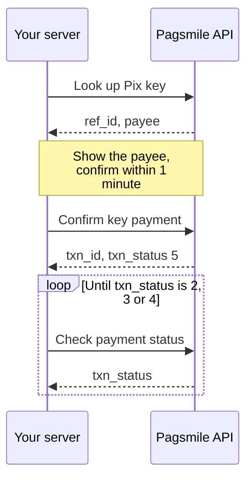
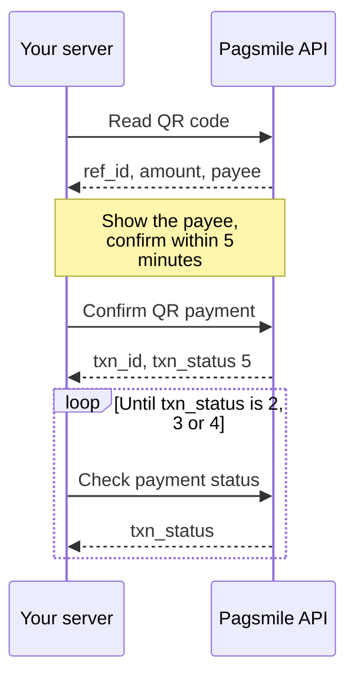
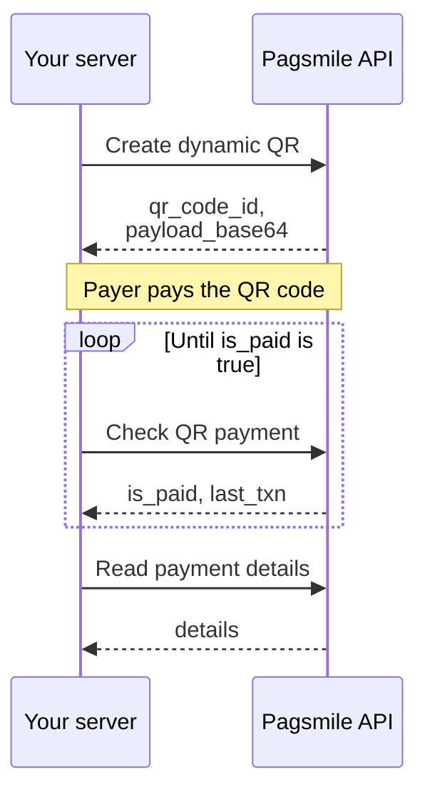
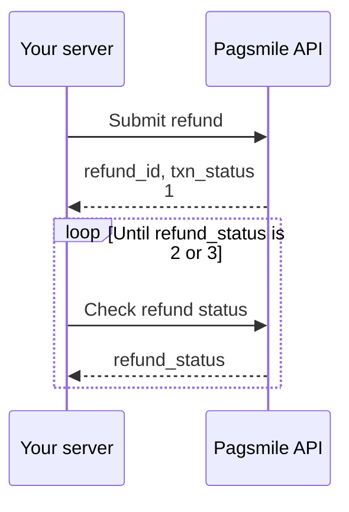
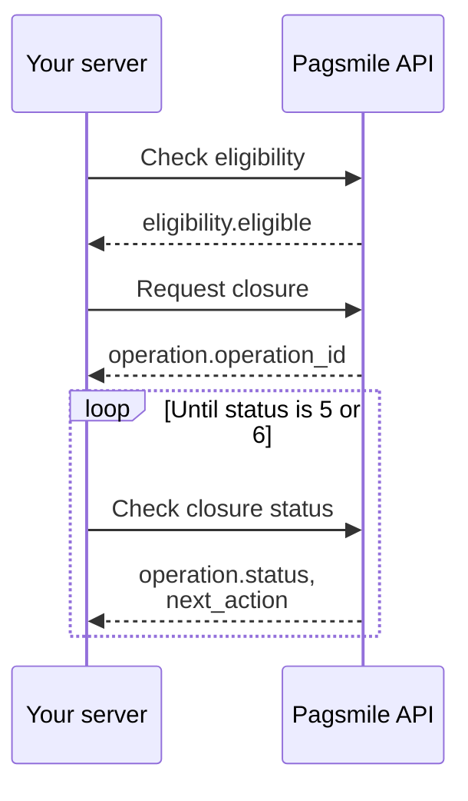

These workflows show the order of calls for common Pagsmile Open API tasks and the field each step passes to the next. Each one is also defined in a machine-readable [Arazzo 1.0](https://spec.openapis.org/arazzo/latest.html) file that points to the OpenAPI 3.2 description by `operationId`.

## Machine-readable files

The documentation repository contains the OpenAPI and Arazzo files below. Each Arazzo file references the OpenAPI description in the same language, so load both into a workflow runner or test tool that supports Arazzo. The files carry no credentials: your runner must [sign every request](/environments-and-credentials#sign-requests).

<Tree>
  <Tree.Folder name="openapi" defaultOpen>
    <Tree.File name="en.json" />
    <Tree.File name="pt-br.json" />
  </Tree.Folder>
  <Tree.Folder name="arazzo" defaultOpen>
    <Tree.File name="pagsmile-workflows.en.arazzo.yaml" highlight />
    <Tree.File name="pagsmile-workflows.pt-br.arazzo.yaml" />
  </Tree.Folder>
</Tree>

| File | Contents |
| --- | --- |
| `openapi/en.json` | OpenAPI 3.2 description, English |
| `openapi/pt-br.json` | OpenAPI 3.2 description, Brazilian Portuguese |
| `arazzo/pagsmile-workflows.en.arazzo.yaml` | The five workflows on this page |

<Accordion title="Complete Arazzo file" icon="file-arrow-down">

```yaml pagsmile-workflows.en.arazzo.yaml
arazzo: 1.0.1
info:
  title: Pagsmile Open API workflows
  summary: Multi-step flows for Pix payouts, pay-ins, refunds and account closure.
  description: Each step calls an operation from the Pagsmile Open API description. Sign every request as described in Environments
    and credentials; these files carry no credentials. Business errors return HTTP 200, so success criteria also check the
    body `code`.
  version: 1.0.0
sourceDescriptions:
- name: pagsmileOpenApi
  url: ../openapi/en.json
  type: openapi
workflows:
- workflowId: pixKeyPayout
  summary: Look up a Pix key, confirm the payment and wait for a final status.
  description: Use this flow when the payer gives you a Pix key. Show the returned payee to the payer before you confirm.
    For Pix payouts, `3` FAILED means a failure recorded by Pagsmile; it does not prove that funds did not move at the bank.
    Reconcile payment details and the matching statement entry before creating any replacement payment. See [Get payment status](/api-reference/payout/get-payment-status)
    for the two-hour rule. If submission times out, a status call fails or polling reaches its limit, do not restart the payment
    or refund with a new `merchant_order_id`. Keep the original identifiers and account context. Continue querying the existing
    operation, or reconcile its callback or statement entry. If submission returned no identifiers, preserve the original
    request and contact support with `xxx-log-id`. Retry exhaustion means the outcome remains unresolved; ending this workflow
    does not fail or cancel an accepted financial operation.
  inputs:
    type: object
    required:
    - pix_key
    - amount
    - merchant_order_id
    properties:
      pix_key:
        type: string
        description: Recipient Pix key.
      amount:
        type: string
        description: Amount in BRL, decimal string.
      merchant_order_id:
        type: string
        description: Your unique order ID.
  steps:
  - stepId: lookUpPixKey
    description: Look up the key. `ref_id` is valid for one minute.
    operationId: initializePixKeyPayment
    requestBody:
      contentType: application/json
      payload:
        pix_key: $inputs.pix_key
        amount: $inputs.amount
    successCriteria:
    - condition: $statusCode == 200
    - condition: $response.body#/code == 200
    onFailure:
    - name: stop
      type: end
    outputs:
      ref_id: $response.body#/data/ref_id
      payee_name: $response.body#/data/payee/name
  - stepId: confirmPixKeyPayout
    description: Submit the payment. A `txn_status` of `5` (`PROCESSING`) means the payment was accepted, but this status
      does not prove settlement.
    operationId: confirmPixKeyPayment
    requestBody:
      contentType: application/json
      payload:
        ref_id: $steps.lookUpPixKey.outputs.ref_id
        merchant_order_id: $inputs.merchant_order_id
        amount: $inputs.amount
    successCriteria:
    - condition: $statusCode == 200
    - condition: $response.body#/code == 200
    onFailure:
    - name: stop
      type: end
    outputs:
      txn_id: $response.body#/data/txn_id
      txn_status: $response.body#/data/txn_status
  - stepId: waitForPixKeyPayout
    description: 'Poll until `txn_status` is final: `2` COMPLETED, `3` FAILED or `4` CANCELLED.'
    operationId: getPaymentStatus
    requestBody:
      contentType: application/json
      payload:
        txn_id: $steps.confirmPixKeyPayout.outputs.txn_id
    successCriteria:
    - condition: $statusCode == 200
    - condition: $response.body#/code == 200
    - condition: $response.body#/data/txn_status >= 2 && $response.body#/data/txn_status <= 4
    onFailure:
    - name: retryWhileNotFinal
      type: retry
      retryAfter: 5
      retryLimit: 12
      criteria:
      - condition: $response.body#/code == 200
    - name: stop
      type: end
    outputs:
      txn_status: $response.body#/data/txn_status
  outputs:
    txn_id: $steps.confirmPixKeyPayout.outputs.txn_id
    txn_status: $steps.waitForPixKeyPayout.outputs.txn_status
- workflowId: qrCodePayout
  summary: Decode a Pix QR code payload, confirm the payment and wait for a final status.
  description: Use this flow when the payer scans or pastes a Pix QR code. The amount rules depend on the QR code type; see
    [Confirm QR code payment](/api-reference/payout/pix/confirm-qr-code-payment). For Pix payouts, `3` FAILED means a failure
    recorded by Pagsmile; it does not prove that funds did not move at the bank. Reconcile payment details and the matching
    statement entry before creating any replacement payment. See [Get payment status](/api-reference/payout/get-payment-status)
    for the two-hour rule. If submission times out, a status call fails or polling reaches its limit, do not restart the payment
    or refund with a new `merchant_order_id`. Keep the original identifiers and account context. Continue querying the existing
    operation, or reconcile its callback or statement entry. If submission returned no identifiers, preserve the original
    request and contact support with `xxx-log-id`. Retry exhaustion means the outcome remains unresolved; ending this workflow
    does not fail or cancel an accepted financial operation.
  inputs:
    type: object
    required:
    - qr_code_payload
    - amount
    - merchant_order_id
    properties:
      qr_code_payload:
        type: string
        description: Base64 Pix QR code payload.
      amount:
        type: string
        description: Amount in BRL, decimal string.
      merchant_order_id:
        type: string
        description: Your unique order ID.
  steps:
  - stepId: readQrCode
    description: Read the QR code. `ref_id` is valid for five minutes.
    operationId: initializeQrCodePayment
    requestBody:
      contentType: application/json
      payload:
        qr_code_payload: $inputs.qr_code_payload
    successCriteria:
    - condition: $statusCode == 200
    - condition: $response.body#/code == 200
    onFailure:
    - name: stop
      type: end
    outputs:
      ref_id: $response.body#/data/ref_id
      qr_amount: $response.body#/data/amount
      payee_name: $response.body#/data/payee/name
  - stepId: confirmQrCodePayout
    description: Submit the payment with the same payer account.
    operationId: confirmQrCodePayment
    requestBody:
      contentType: application/json
      payload:
        ref_id: $steps.readQrCode.outputs.ref_id
        amount: $inputs.amount
        merchant_order_id: $inputs.merchant_order_id
    successCriteria:
    - condition: $statusCode == 200
    - condition: $response.body#/code == 200
    onFailure:
    - name: stop
      type: end
    outputs:
      txn_id: $response.body#/data/txn_id
      txn_status: $response.body#/data/txn_status
  - stepId: waitForQrCodePayout
    description: Poll until `txn_status` is `2`, `3` or `4`.
    operationId: getPaymentStatus
    requestBody:
      contentType: application/json
      payload:
        txn_id: $steps.confirmQrCodePayout.outputs.txn_id
    successCriteria:
    - condition: $statusCode == 200
    - condition: $response.body#/code == 200
    - condition: $response.body#/data/txn_status >= 2 && $response.body#/data/txn_status <= 4
    onFailure:
    - name: retryWhileNotFinal
      type: retry
      retryAfter: 5
      retryLimit: 12
      criteria:
      - condition: $response.body#/code == 200
    - name: stop
      type: end
    outputs:
      txn_status: $response.body#/data/txn_status
  outputs:
    txn_id: $steps.confirmQrCodePayout.outputs.txn_id
    txn_status: $steps.waitForQrCodePayout.outputs.txn_status
- workflowId: dynamicQrPayin
  summary: Create a dynamic Pix QR code, wait until it is paid and read the payment.
  description: Use this flow to charge a fixed amount. Base64-decode `data.payload_base64` into UTF-8 Pix payment text. Present
    the decoded text as the Pix copy-and-paste code, or encode that same text in a locally generated QR image. If submission
    times out, a status call fails or polling reaches its limit, do not restart the payment or refund with a new `merchant_order_id`.
    Keep the original identifiers and account context. Continue querying the existing operation, or reconcile its callback
    or statement entry. If submission returned no identifiers, preserve the original request and contact support with `xxx-log-id`.
    Retry exhaustion means the outcome remains unresolved; ending this workflow does not fail or cancel an accepted financial
    operation.
  inputs:
    type: object
    required:
    - amount
    - city
    - pix_key
    - merchant_order_id
    properties:
      amount:
        type: string
        description: Amount in BRL, at most two decimal places.
      city:
        type: string
        description: Merchant city shown in the QR code.
      pix_key:
        type: string
        description: Your receiving Pix key.
      merchant_order_id:
        type: string
        description: Your unique order ID.
  steps:
  - stepId: generate
    description: Create the QR code and keep `qr_code_id`. Base64-decode `data.payload_base64` into UTF-8 Pix payment text
      for copy-and-paste and local QR image generation.
    operationId: generateDynamicQrCode
    requestBody:
      contentType: application/json
      payload:
        amount: $inputs.amount
        city: $inputs.city
        pix_key: $inputs.pix_key
        merchant_order_id: $inputs.merchant_order_id
    successCriteria:
    - condition: $statusCode == 200
    - condition: $response.body#/code == 200
    onFailure:
    - name: stop
      type: end
    outputs:
      qr_code_id: $response.body#/data/qr_code_id
      payload_base64: $response.body#/data/payload_base64
  - stepId: waitForPayment
    description: Poll until `is_paid` is `true`. `false` does not prove that no payment arrived.
    operationId: getQrCodeDetails
    requestBody:
      contentType: application/json
      payload:
        qr_code_id: $steps.generate.outputs.qr_code_id
    successCriteria:
    - condition: $statusCode == 200
    - condition: $response.body#/code == 200
    - condition: $response.body#/data/is_paid == true
    onFailure:
    - name: retryWhileNotFinal
      type: retry
      retryAfter: 10
      retryLimit: 30
      criteria:
      - condition: $response.body#/code == 200
    - name: stop
      type: end
    outputs:
      txn_id: $response.body#/data/last_txn/txn_id
  - stepId: readPayment
    description: Read the incoming payment, including payer and fees.
    operationId: getTransactionDetails
    requestBody:
      contentType: application/json
      payload:
        txn_id: $steps.waitForPayment.outputs.txn_id
    successCriteria:
    - condition: $statusCode == 200
    - condition: $response.body#/code == 200
    onFailure:
    - name: stop
      type: end
    outputs:
      txn_status: $response.body#/data/details/txn_status
      amount: $response.body#/data/details/amount
  outputs:
    qr_code_id: $steps.generate.outputs.qr_code_id
    txn_id: $steps.waitForPayment.outputs.txn_id
- workflowId: pixRefund
  summary: Refund a received Pix payment and wait for a final refund status.
  description: Use this flow to return all or part of a Pix payment you received. Identify the payment by its settlement ID.
    If submission times out, a status call fails or polling reaches its limit, do not restart the payment or refund with a
    new `merchant_order_id`. Keep the original identifiers and account context. Continue querying the existing operation,
    or reconcile its callback or statement entry. If submission returned no identifiers, preserve the original request and
    contact support with `xxx-log-id`. Retry exhaustion means the outcome remains unresolved; ending this workflow does not
    fail or cancel an accepted financial operation.
  inputs:
    type: object
    required:
    - original_settlement_id
    - amount
    - merchant_order_id
    properties:
      original_settlement_id:
        type: string
        description: Settlement ID of the payment you received.
      amount:
        type: string
        description: Refund amount in BRL, decimal string.
      merchant_order_id:
        type: string
        description: Your unique refund order ID.
  steps:
  - stepId: submitRefund
    description: Submit the refund. A `txn_status` of `1` (`PENDING`) means the refund was accepted, but this status does
      not prove the amount was returned.
    operationId: initiatePixRefund
    requestBody:
      contentType: application/json
      payload:
        original_settlement_id: $inputs.original_settlement_id
        merchant_order_id: $inputs.merchant_order_id
        amount: $inputs.amount
    successCriteria:
    - condition: $statusCode == 200
    - condition: $response.body#/code == 200
    onFailure:
    - name: stop
      type: end
    outputs:
      refund_id: $response.body#/data/refund_id
  - stepId: waitForRefund
    description: Poll until `refund_status` is `2` COMPLETED or `3` FAILED.
    operationId: getRefundStatus
    requestBody:
      contentType: application/json
      payload:
        refund_id: $steps.submitRefund.outputs.refund_id
    successCriteria:
    - condition: $statusCode == 200
    - condition: $response.body#/code == 200
    - condition: $response.body#/data/refund_status == 2 || $response.body#/data/refund_status == 3
    onFailure:
    - name: retryWhileNotFinal
      type: retry
      retryAfter: 5
      retryLimit: 12
      criteria:
      - condition: $response.body#/code == 200
    - name: stop
      type: end
    outputs:
      refund_status: $response.body#/data/refund_status
  outputs:
    refund_id: $steps.submitRefund.outputs.refund_id
    refund_status: $steps.waitForRefund.outputs.refund_status
- workflowId: accountClosure
  summary: Check closure eligibility, request closure and track it to a final status.
  description: Use this flow to close an account you manage. Stop after the check if `eligible` is `false` and resolve the
    returned reasons first.
  inputs:
    type: object
    required:
    - account_number
    - reason
    - idempotency_key
    properties:
      account_number:
        type: string
        description: Account to close, with leading zeros.
      reason:
        type: integer
        description: 'Closure reason: 1, 2 or 3.'
      idempotency_key:
        type: string
        description: Your idempotency key, at most 128 bytes.
  steps:
  - stepId: checkClosureEligibility
    description: Continue only when `eligible` is `true`.
    operationId: checkEligibility
    requestBody:
      contentType: application/json
      payload:
        account_number: $inputs.account_number
        auto_delete_active_pix_keys: false
    successCriteria:
    - condition: $statusCode == 200
    - condition: $response.body#/code == 200
    - condition: $response.body#/data/eligibility/eligible == true
    onFailure:
    - name: stop
      type: end
    outputs:
      eligible: $response.body#/data/eligibility/eligible
  - stepId: requestClosure
    description: Request closure and keep `operation_id`. Reusing the key returns the same operation.
    operationId: closeAccount
    requestBody:
      contentType: application/json
      payload:
        account_number: $inputs.account_number
        reason: $inputs.reason
        idempotency_key: $inputs.idempotency_key
    successCriteria:
    - condition: $statusCode == 200
    - condition: $response.body#/code == 200
    onFailure:
    - name: stop
      type: end
    outputs:
      operation_id: $response.body#/data/operation/operation_id
  - stepId: waitForClosure
    description: Poll until `status` is `5` COMPLETED or `6` REJECTED. `4` CLOSED can still have cleanup left.
    operationId: getClosureProgress
    requestBody:
      contentType: application/json
      payload:
        account_number: $inputs.account_number
        operation_id: $steps.requestClosure.outputs.operation_id
    successCriteria:
    - condition: $statusCode == 200
    - condition: $response.body#/code == 200
    - condition: $response.body#/data/operation/status == 5 || $response.body#/data/operation/status == 6
    onFailure:
    - name: retryWhileNotFinal
      type: retry
      retryAfter: 30
      retryLimit: 20
      criteria:
      - condition: $response.body#/code == 200
    - name: stop
      type: end
    outputs:
      status: $response.body#/data/operation/status
      next_action: $response.body#/data/operation/next_action
  outputs:
    operation_id: $steps.requestClosure.outputs.operation_id
    status: $steps.waitForClosure.outputs.status
```

</Accordion>

## How the steps decide

Every step succeeds only when the response is HTTP 200 **and** the body `code` is `200`, because business errors also return HTTP 200. Polling steps add a final-status condition. When the call works but the status is not final yet, the step retries. Any other failure ends the workflow execution; read `code` and `message` before deciding how to recover.

If submission times out, a status call fails or polling reaches its limit, do not restart the payment or refund with a new `merchant_order_id`. Keep the original identifiers and account context. Continue querying the existing operation, or reconcile its callback or statement entry. If submission returned no identifiers, preserve the original request and contact support with `xxx-log-id`. Retry exhaustion means the outcome remains unresolved; ending this workflow does not fail or cancel an accepted financial operation.

<Note>
  The retry intervals are examples. Use longer, increasing delays in production, and stop polling once you receive the callback.
</Note>

## Pay to a Pix key

Use this flow when the payer gives you a Pix key. Show the returned payee to the payer before you confirm.

For Pix payouts, `3` FAILED means a failure recorded by Pagsmile; it does not prove that funds did not move at the bank. Reconcile payment details and the matching statement entry before creating any replacement payment. See [Get payment status](/api-reference/payout/get-payment-status) for the two-hour rule.



<Steps>
  <Step title="Initialize Pix key payment">
    [`POST /v3/transfers/pix/key-initiate`](/api-reference/payout/pix/initialize-pix-key-payment). Look up the key. `ref_id` is valid for one minute.

    - **Sends:** `pix_key`, `amount`
    - **Keeps:** `ref_id`, `payee_name`
    - **Moves on when:** HTTP 200 and `code` is `200`.
  </Step>
  <Step title="Confirm Pix key payment">
    [`POST /v3/transfers/pix/key-confirm`](/api-reference/payout/pix/confirm-pix-key-payment). Submit the payment. A `txn_status` of `5` (`PROCESSING`) means the payment was accepted, but this status does not prove settlement.

    - **Sends:** `ref_id`, `merchant_order_id`, `amount`
    - **Keeps:** `txn_id`, `txn_status`
    - **Moves on when:** HTTP 200 and `code` is `200`.
  </Step>
  <Step title="Get payment status">
    [`POST /v3/transfers/status/check`](/api-reference/payout/get-payment-status). Poll until `txn_status` is final: `2` COMPLETED, `3` FAILED or `4` CANCELLED.

    - **Sends:** `txn_id`
    - **Keeps:** `txn_status`
    - **Moves on when:** HTTP 200 and `code` is `200`, and `txn_status` is `2`, `3` or `4`.
    - **Retries (example):** Every 5 s, up to 12 times, while `code` is `200` and the completion condition is unmet.
  </Step>
</Steps>

Callbacks are the main signal for the final result: [Pix payout callbacks](/api-reference/payout/pix/callbacks). Keep the polling step as a fallback.

<Accordion title="Arazzo definition: pixKeyPayout" icon="file-code">

```yaml pixKeyPayout.arazzo.yaml
workflowId: pixKeyPayout
summary: Look up a Pix key, confirm the payment and wait for a final status.
description: Use this flow when the payer gives you a Pix key. Show the returned payee to the payer before you confirm.
  For Pix payouts, `3` FAILED means a failure recorded by Pagsmile; it does not prove that funds did not move at
  the bank. Reconcile payment details and the matching statement entry before creating any replacement payment.
  See [Get payment status](/api-reference/payout/get-payment-status) for the two-hour rule. If submission times
  out, a status call fails or polling reaches its limit, do not restart the payment or refund with a new `merchant_order_id`.
  Keep the original identifiers and account context. Continue querying the existing operation, or reconcile its
  callback or statement entry. If submission returned no identifiers, preserve the original request and contact
  support with `xxx-log-id`. Retry exhaustion means the outcome remains unresolved; ending this workflow does not
  fail or cancel an accepted financial operation.
inputs:
  type: object
  required:
  - pix_key
  - amount
  - merchant_order_id
  properties:
    pix_key:
      type: string
      description: Recipient Pix key.
    amount:
      type: string
      description: Amount in BRL, decimal string.
    merchant_order_id:
      type: string
      description: Your unique order ID.
steps:
- stepId: lookUpPixKey
  description: Look up the key. `ref_id` is valid for one minute.
  operationId: initializePixKeyPayment
  requestBody:
    contentType: application/json
    payload:
      pix_key: $inputs.pix_key
      amount: $inputs.amount
  successCriteria:
  - condition: $statusCode == 200
  - condition: $response.body#/code == 200
  onFailure:
  - name: stop
    type: end
  outputs:
    ref_id: $response.body#/data/ref_id
    payee_name: $response.body#/data/payee/name
- stepId: confirmPixKeyPayout
  description: Submit the payment. A `txn_status` of `5` (`PROCESSING`) means the payment was accepted, but this
    status does not prove settlement.
  operationId: confirmPixKeyPayment
  requestBody:
    contentType: application/json
    payload:
      ref_id: $steps.lookUpPixKey.outputs.ref_id
      merchant_order_id: $inputs.merchant_order_id
      amount: $inputs.amount
  successCriteria:
  - condition: $statusCode == 200
  - condition: $response.body#/code == 200
  onFailure:
  - name: stop
    type: end
  outputs:
    txn_id: $response.body#/data/txn_id
    txn_status: $response.body#/data/txn_status
- stepId: waitForPixKeyPayout
  description: 'Poll until `txn_status` is final: `2` COMPLETED, `3` FAILED or `4` CANCELLED.'
  operationId: getPaymentStatus
  requestBody:
    contentType: application/json
    payload:
      txn_id: $steps.confirmPixKeyPayout.outputs.txn_id
  successCriteria:
  - condition: $statusCode == 200
  - condition: $response.body#/code == 200
  - condition: $response.body#/data/txn_status >= 2 && $response.body#/data/txn_status <= 4
  onFailure:
  - name: retryWhileNotFinal
    type: retry
    retryAfter: 5
    retryLimit: 12
    criteria:
    - condition: $response.body#/code == 200
  - name: stop
    type: end
  outputs:
    txn_status: $response.body#/data/txn_status
outputs:
  txn_id: $steps.confirmPixKeyPayout.outputs.txn_id
  txn_status: $steps.waitForPixKeyPayout.outputs.txn_status
```

</Accordion>

## Pay a Pix QR code

Use this flow when the payer scans or pastes a Pix QR code. The amount rules depend on the QR code type; see [Confirm QR code payment](/api-reference/payout/pix/confirm-qr-code-payment).

For Pix payouts, `3` FAILED means a failure recorded by Pagsmile; it does not prove that funds did not move at the bank. Reconcile payment details and the matching statement entry before creating any replacement payment. See [Get payment status](/api-reference/payout/get-payment-status) for the two-hour rule.



<Steps>
  <Step title="Initialize QR code payment">
    [`POST /v3/transfers/pix/qr-code-initiate`](/api-reference/payout/pix/initialize-qr-code-payment). Read the QR code. `ref_id` is valid for five minutes.

    - **Sends:** `qr_code_payload`
    - **Keeps:** `ref_id`, `qr_amount`, `payee_name`
    - **Moves on when:** HTTP 200 and `code` is `200`.
  </Step>
  <Step title="Confirm QR code payment">
    [`POST /v3/transfers/pix/qr-code-confirm`](/api-reference/payout/pix/confirm-qr-code-payment). Submit the payment with the same payer account.

    - **Sends:** `ref_id`, `amount`, `merchant_order_id`
    - **Keeps:** `txn_id`, `txn_status`
    - **Moves on when:** HTTP 200 and `code` is `200`.
  </Step>
  <Step title="Get payment status">
    [`POST /v3/transfers/status/check`](/api-reference/payout/get-payment-status). Poll until `txn_status` is `2`, `3` or `4`.

    - **Sends:** `txn_id`
    - **Keeps:** `txn_status`
    - **Moves on when:** HTTP 200 and `code` is `200`, and `txn_status` is `2`, `3` or `4`.
    - **Retries (example):** Every 5 s, up to 12 times, while `code` is `200` and the completion condition is unmet.
  </Step>
</Steps>

Callbacks are the main signal for the final result: [Pix payout callbacks](/api-reference/payout/pix/callbacks). Keep the polling step as a fallback.

<Accordion title="Arazzo definition: qrCodePayout" icon="file-code">

```yaml qrCodePayout.arazzo.yaml
workflowId: qrCodePayout
summary: Decode a Pix QR code payload, confirm the payment and wait for a final status.
description: Use this flow when the payer scans or pastes a Pix QR code. The amount rules depend on the QR code
  type; see [Confirm QR code payment](/api-reference/payout/pix/confirm-qr-code-payment). For Pix payouts, `3` FAILED
  means a failure recorded by Pagsmile; it does not prove that funds did not move at the bank. Reconcile payment
  details and the matching statement entry before creating any replacement payment. See [Get payment status](/api-reference/payout/get-payment-status)
  for the two-hour rule. If submission times out, a status call fails or polling reaches its limit, do not restart
  the payment or refund with a new `merchant_order_id`. Keep the original identifiers and account context. Continue
  querying the existing operation, or reconcile its callback or statement entry. If submission returned no identifiers,
  preserve the original request and contact support with `xxx-log-id`. Retry exhaustion means the outcome remains
  unresolved; ending this workflow does not fail or cancel an accepted financial operation.
inputs:
  type: object
  required:
  - qr_code_payload
  - amount
  - merchant_order_id
  properties:
    qr_code_payload:
      type: string
      description: Base64 Pix QR code payload.
    amount:
      type: string
      description: Amount in BRL, decimal string.
    merchant_order_id:
      type: string
      description: Your unique order ID.
steps:
- stepId: readQrCode
  description: Read the QR code. `ref_id` is valid for five minutes.
  operationId: initializeQrCodePayment
  requestBody:
    contentType: application/json
    payload:
      qr_code_payload: $inputs.qr_code_payload
  successCriteria:
  - condition: $statusCode == 200
  - condition: $response.body#/code == 200
  onFailure:
  - name: stop
    type: end
  outputs:
    ref_id: $response.body#/data/ref_id
    qr_amount: $response.body#/data/amount
    payee_name: $response.body#/data/payee/name
- stepId: confirmQrCodePayout
  description: Submit the payment with the same payer account.
  operationId: confirmQrCodePayment
  requestBody:
    contentType: application/json
    payload:
      ref_id: $steps.readQrCode.outputs.ref_id
      amount: $inputs.amount
      merchant_order_id: $inputs.merchant_order_id
  successCriteria:
  - condition: $statusCode == 200
  - condition: $response.body#/code == 200
  onFailure:
  - name: stop
    type: end
  outputs:
    txn_id: $response.body#/data/txn_id
    txn_status: $response.body#/data/txn_status
- stepId: waitForQrCodePayout
  description: Poll until `txn_status` is `2`, `3` or `4`.
  operationId: getPaymentStatus
  requestBody:
    contentType: application/json
    payload:
      txn_id: $steps.confirmQrCodePayout.outputs.txn_id
  successCriteria:
  - condition: $statusCode == 200
  - condition: $response.body#/code == 200
  - condition: $response.body#/data/txn_status >= 2 && $response.body#/data/txn_status <= 4
  onFailure:
  - name: retryWhileNotFinal
    type: retry
    retryAfter: 5
    retryLimit: 12
    criteria:
    - condition: $response.body#/code == 200
  - name: stop
    type: end
  outputs:
    txn_status: $response.body#/data/txn_status
outputs:
  txn_id: $steps.confirmQrCodePayout.outputs.txn_id
  txn_status: $steps.waitForQrCodePayout.outputs.txn_status
```

</Accordion>

## Collect with a dynamic QR code

Use this flow to charge a fixed amount. Base64-decode `data.payload_base64` into UTF-8 Pix payment text. Present the decoded text as the Pix copy-and-paste code, or encode that same text in a locally generated QR image.



<Steps>
  <Step title="Generate dynamic QR code">
    [`POST /v3/qr_code/generate/dynamic`](/api-reference/payin/generate-dynamic-qr-code). Create the QR code and keep `qr_code_id`. Base64-decode `data.payload_base64` into UTF-8 Pix payment text for copy-and-paste and local QR image generation.

    - **Sends:** `amount`, `city`, `pix_key`, `merchant_order_id`
    - **Keeps:** `qr_code_id`, `payload_base64`
    - **Moves on when:** HTTP 200 and `code` is `200`.
  </Step>
  <Step title="Get QR code details">
    [`POST /v3/qr_code/details`](/api-reference/payin/get-qr-code-details). Poll until `is_paid` is `true`. `false` does not prove that no payment arrived.

    - **Sends:** `qr_code_id`
    - **Keeps:** `txn_id`
    - **Moves on when:** HTTP 200 and `code` is `200`, and `is_paid` is `true`.
    - **Retries (example):** Every 10 s, up to 30 times, while `code` is `200` and the completion condition is unmet.
  </Step>
  <Step title="Get transaction details">
    [`POST /v3/charges/details`](/api-reference/payin/get-transaction-details). Read the incoming payment, including payer and fees.

    - **Sends:** `txn_id`
    - **Keeps:** `txn_status`, `amount`
    - **Moves on when:** HTTP 200 and `code` is `200`.
  </Step>
</Steps>

Callbacks are the main signal for the final result: [Pay-in callbacks](/api-reference/payin/callbacks). Keep the polling step as a fallback.

<Accordion title="Arazzo definition: dynamicQrPayin" icon="file-code">

```yaml dynamicQrPayin.arazzo.yaml
workflowId: dynamicQrPayin
summary: Create a dynamic Pix QR code, wait until it is paid and read the payment.
description: Use this flow to charge a fixed amount. Base64-decode `data.payload_base64` into UTF-8 Pix payment
  text. Present the decoded text as the Pix copy-and-paste code, or encode that same text in a locally generated
  QR image. If submission times out, a status call fails or polling reaches its limit, do not restart the payment
  or refund with a new `merchant_order_id`. Keep the original identifiers and account context. Continue querying
  the existing operation, or reconcile its callback or statement entry. If submission returned no identifiers, preserve
  the original request and contact support with `xxx-log-id`. Retry exhaustion means the outcome remains unresolved;
  ending this workflow does not fail or cancel an accepted financial operation.
inputs:
  type: object
  required:
  - amount
  - city
  - pix_key
  - merchant_order_id
  properties:
    amount:
      type: string
      description: Amount in BRL, at most two decimal places.
    city:
      type: string
      description: Merchant city shown in the QR code.
    pix_key:
      type: string
      description: Your receiving Pix key.
    merchant_order_id:
      type: string
      description: Your unique order ID.
steps:
- stepId: generate
  description: Create the QR code and keep `qr_code_id`. Base64-decode `data.payload_base64` into UTF-8 Pix payment
    text for copy-and-paste and local QR image generation.
  operationId: generateDynamicQrCode
  requestBody:
    contentType: application/json
    payload:
      amount: $inputs.amount
      city: $inputs.city
      pix_key: $inputs.pix_key
      merchant_order_id: $inputs.merchant_order_id
  successCriteria:
  - condition: $statusCode == 200
  - condition: $response.body#/code == 200
  onFailure:
  - name: stop
    type: end
  outputs:
    qr_code_id: $response.body#/data/qr_code_id
    payload_base64: $response.body#/data/payload_base64
- stepId: waitForPayment
  description: Poll until `is_paid` is `true`. `false` does not prove that no payment arrived.
  operationId: getQrCodeDetails
  requestBody:
    contentType: application/json
    payload:
      qr_code_id: $steps.generate.outputs.qr_code_id
  successCriteria:
  - condition: $statusCode == 200
  - condition: $response.body#/code == 200
  - condition: $response.body#/data/is_paid == true
  onFailure:
  - name: retryWhileNotFinal
    type: retry
    retryAfter: 10
    retryLimit: 30
    criteria:
    - condition: $response.body#/code == 200
  - name: stop
    type: end
  outputs:
    txn_id: $response.body#/data/last_txn/txn_id
- stepId: readPayment
  description: Read the incoming payment, including payer and fees.
  operationId: getTransactionDetails
  requestBody:
    contentType: application/json
    payload:
      txn_id: $steps.waitForPayment.outputs.txn_id
  successCriteria:
  - condition: $statusCode == 200
  - condition: $response.body#/code == 200
  onFailure:
  - name: stop
    type: end
  outputs:
    txn_status: $response.body#/data/details/txn_status
    amount: $response.body#/data/details/amount
outputs:
  qr_code_id: $steps.generate.outputs.qr_code_id
  txn_id: $steps.waitForPayment.outputs.txn_id
```

</Accordion>

## Refund a Pix payment

Use this flow to return all or part of a Pix payment you received. Identify the payment by its settlement ID.



<Steps>
  <Step title="Initiate Pix refund">
    [`POST /v3/refunds/pix`](/api-reference/refunds/initiate-pix-refund). Submit the refund. A `txn_status` of `1` (`PENDING`) means the refund was accepted, but this status does not prove the amount was returned.

    - **Sends:** `original_settlement_id`, `merchant_order_id`, `amount`
    - **Keeps:** `refund_id`
    - **Moves on when:** HTTP 200 and `code` is `200`.
  </Step>
  <Step title="Get refund status">
    [`POST /v3/refunds/status/check`](/api-reference/refunds/get-refund-status). Poll until `refund_status` is `2` COMPLETED or `3` FAILED.

    - **Sends:** `refund_id`
    - **Keeps:** `refund_status`
    - **Moves on when:** HTTP 200 and `code` is `200`, and `refund_status` is `2` or `3`.
    - **Retries (example):** Every 5 s, up to 12 times, while `code` is `200` and the completion condition is unmet.
  </Step>
</Steps>

Callbacks are the main signal for the final result: [Refund callbacks](/api-reference/refunds/callbacks). Keep the polling step as a fallback.

<Accordion title="Arazzo definition: pixRefund" icon="file-code">

```yaml pixRefund.arazzo.yaml
workflowId: pixRefund
summary: Refund a received Pix payment and wait for a final refund status.
description: Use this flow to return all or part of a Pix payment you received. Identify the payment by its settlement
  ID. If submission times out, a status call fails or polling reaches its limit, do not restart the payment or refund
  with a new `merchant_order_id`. Keep the original identifiers and account context. Continue querying the existing
  operation, or reconcile its callback or statement entry. If submission returned no identifiers, preserve the original
  request and contact support with `xxx-log-id`. Retry exhaustion means the outcome remains unresolved; ending this
  workflow does not fail or cancel an accepted financial operation.
inputs:
  type: object
  required:
  - original_settlement_id
  - amount
  - merchant_order_id
  properties:
    original_settlement_id:
      type: string
      description: Settlement ID of the payment you received.
    amount:
      type: string
      description: Refund amount in BRL, decimal string.
    merchant_order_id:
      type: string
      description: Your unique refund order ID.
steps:
- stepId: submitRefund
  description: Submit the refund. A `txn_status` of `1` (`PENDING`) means the refund was accepted, but this status
    does not prove the amount was returned.
  operationId: initiatePixRefund
  requestBody:
    contentType: application/json
    payload:
      original_settlement_id: $inputs.original_settlement_id
      merchant_order_id: $inputs.merchant_order_id
      amount: $inputs.amount
  successCriteria:
  - condition: $statusCode == 200
  - condition: $response.body#/code == 200
  onFailure:
  - name: stop
    type: end
  outputs:
    refund_id: $response.body#/data/refund_id
- stepId: waitForRefund
  description: Poll until `refund_status` is `2` COMPLETED or `3` FAILED.
  operationId: getRefundStatus
  requestBody:
    contentType: application/json
    payload:
      refund_id: $steps.submitRefund.outputs.refund_id
  successCriteria:
  - condition: $statusCode == 200
  - condition: $response.body#/code == 200
  - condition: $response.body#/data/refund_status == 2 || $response.body#/data/refund_status == 3
  onFailure:
  - name: retryWhileNotFinal
    type: retry
    retryAfter: 5
    retryLimit: 12
    criteria:
    - condition: $response.body#/code == 200
  - name: stop
    type: end
  outputs:
    refund_status: $response.body#/data/refund_status
outputs:
  refund_id: $steps.submitRefund.outputs.refund_id
  refund_status: $steps.waitForRefund.outputs.refund_status
```

</Accordion>

## Close an account

Use this flow to close an account you manage. Stop after the check if `eligible` is `false` and resolve the returned reasons first.



<Steps>
  <Step title="Check account closure eligibility">
    [`POST /v3/bank_account/close/precheck`](/api-reference/accounts/close-account/check-eligibility). Continue only when `eligible` is `true`.

    - **Sends:** `account_number`, `auto_delete_active_pix_keys`
    - **Keeps:** `eligible`
    - **Moves on when:** HTTP 200 and `code` is `200`, and `eligible` is `true`.
  </Step>
  <Step title="Close account">
    [`POST /v3/bank_account/close`](/api-reference/accounts/close-account/close-account). Request closure and keep `operation_id`. Reusing the key returns the same operation.

    - **Sends:** `account_number`, `reason`, `idempotency_key`
    - **Keeps:** `operation_id`
    - **Moves on when:** HTTP 200 and `code` is `200`.
  </Step>
  <Step title="Get account closure progress">
    [`POST /v3/bank_account/close/query`](/api-reference/accounts/close-account/get-closure-progress). Poll until `status` is `5` COMPLETED or `6` REJECTED. `4` CLOSED can still have cleanup left.

    - **Sends:** `account_number`, `operation_id`
    - **Keeps:** `status`, `next_action`
    - **Moves on when:** HTTP 200 and `code` is `200`, and `status` is `5` or `6`.
    - **Retries (example):** Every 30 s, up to 20 times, while `code` is `200` and the completion condition is unmet.
  </Step>
</Steps>

This flow has no callback; poll the progress endpoint.

<Accordion title="Arazzo definition: accountClosure" icon="file-code">

```yaml accountClosure.arazzo.yaml
workflowId: accountClosure
summary: Check closure eligibility, request closure and track it to a final status.
description: Use this flow to close an account you manage. Stop after the check if `eligible` is `false` and resolve
  the returned reasons first.
inputs:
  type: object
  required:
  - account_number
  - reason
  - idempotency_key
  properties:
    account_number:
      type: string
      description: Account to close, with leading zeros.
    reason:
      type: integer
      description: 'Closure reason: 1, 2 or 3.'
    idempotency_key:
      type: string
      description: Your idempotency key, at most 128 bytes.
steps:
- stepId: checkClosureEligibility
  description: Continue only when `eligible` is `true`.
  operationId: checkEligibility
  requestBody:
    contentType: application/json
    payload:
      account_number: $inputs.account_number
      auto_delete_active_pix_keys: false
  successCriteria:
  - condition: $statusCode == 200
  - condition: $response.body#/code == 200
  - condition: $response.body#/data/eligibility/eligible == true
  onFailure:
  - name: stop
    type: end
  outputs:
    eligible: $response.body#/data/eligibility/eligible
- stepId: requestClosure
  description: Request closure and keep `operation_id`. Reusing the key returns the same operation.
  operationId: closeAccount
  requestBody:
    contentType: application/json
    payload:
      account_number: $inputs.account_number
      reason: $inputs.reason
      idempotency_key: $inputs.idempotency_key
  successCriteria:
  - condition: $statusCode == 200
  - condition: $response.body#/code == 200
  onFailure:
  - name: stop
    type: end
  outputs:
    operation_id: $response.body#/data/operation/operation_id
- stepId: waitForClosure
  description: Poll until `status` is `5` COMPLETED or `6` REJECTED. `4` CLOSED can still have cleanup left.
  operationId: getClosureProgress
  requestBody:
    contentType: application/json
    payload:
      account_number: $inputs.account_number
      operation_id: $steps.requestClosure.outputs.operation_id
  successCriteria:
  - condition: $statusCode == 200
  - condition: $response.body#/code == 200
  - condition: $response.body#/data/operation/status == 5 || $response.body#/data/operation/status == 6
  onFailure:
  - name: retryWhileNotFinal
    type: retry
    retryAfter: 30
    retryLimit: 20
    criteria:
    - condition: $response.body#/code == 200
  - name: stop
    type: end
  outputs:
    status: $response.body#/data/operation/status
    next_action: $response.body#/data/operation/next_action
outputs:
  operation_id: $steps.requestClosure.outputs.operation_id
  status: $steps.waitForClosure.outputs.status
```

</Accordion>

## Related

<CardGroup cols={2}>
  <Card title="Environments and credentials" icon="key" href="/environments-and-credentials">Sign each step and choose the account.</Card>
  <Card title="Error catalog" icon="triangle-exclamation" href="/api-reference/error-catalog">What each `code` means and whether to retry.</Card>
</CardGroup>
