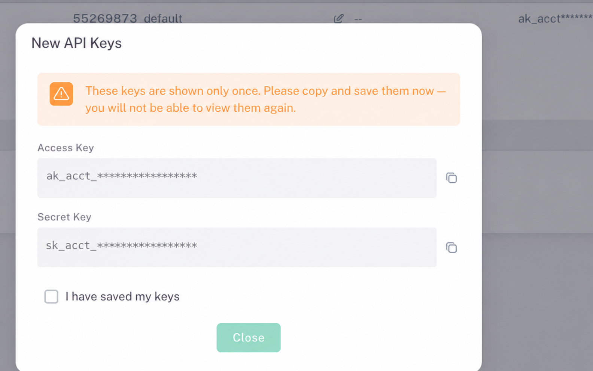
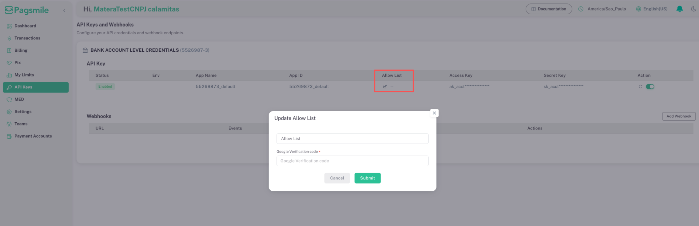

import { IpAllowlistHelper } from "/snippets/ip-allowlist-helper.jsx";
import { CredentialSetup } from "/snippets/credential-setup.jsx";

Toda requisição à API precisa vir de um IP que esteja na **Lista de IPs Permitidos** da credencial e levar uma assinatura feita com a chave secreta dessa credencial. Este guia percorre o painel Pagsmile Banking: obtenha suas chaves do Sandbox, permita seus IPs públicos e informe as chaves do Sandbox uma vez nesta documentação. Depois disso, a ferramenta de assinatura de cada página da API usa suas chaves do Sandbox.

<Note>
  A entrada de credenciais, as ferramentas de assinatura e os testes online desta documentação são **exclusivos do Sandbox**. Os endereços da API de Produção são apenas para consulta. Mantenha AK/SK de Produção no gerenciador de segredos do seu servidor; não as informe aqui.
</Note>

## Antes de começar

- **Acesso ao painel do Sandbox.** Entre no [painel do Sandbox](https://banking-sandbox.pagsmile.com.br) para obter as credenciais usadas neste guia. Cada ambiente tem suas próprias chaves, Listas de IPs Permitidos e [URL base](/pt-br/environments-and-credentials#ambientes). Configure as credenciais de Produção separadamente no seu servidor.
- **MFA da conta.** Para ativar, desativar ou redefinir uma chave, ou para atualizar a Lista de IPs Permitidos dela, informe o **Código de verificação do Google** de 6 dígitos. Sem o MFA da conta, o painel mostra **MFA da conta obrigatório**. Configure-o conforme [Habilitar o acesso à API](/pt-br/quickstart#habilitar-o-acesso-à-api).
- **API Aberta.** Em **Credenciais da conta bancária**, o botão **API Aberta** (**Open API**) precisa estar ativado.

## Escolher uma credencial

A página **Chaves de API e Webhooks** tem um cartão por credencial. Cada cartão tem seu próprio par de chaves e sua própria **Lista de IPs Permitidos**; configure todas as credenciais que você usa.

| Credencial | Cartão no painel (interface em inglês) | Prefixos das chaves | Use para | Cabeçalhos de conta |
| --- | --- | --- | --- | --- |
| Nível da conta bancária | **Credenciais da conta bancária** (**Bank Account Level Credentials**), exibido com o número da conta | `ak_acct_`, `sk_acct_` | Operações nessa conta: saldo, extrato, Pix, QR codes, TED, devoluções, MED e chaves Pix, além de assinaturas de eventos dessa conta | Omita `X-ISPB` e `X-Account-Number` |
| Nível do usuário | **Credenciais do usuário (OpenVA e Onboarding)** (**User Level Credentials (OpenVA & Onboarding)**) | `ak_user_`, `sk_user_` | Contas gerenciadas e assinaturas de eventos, além de operações em qualquer conta que o usuário acessa | Envie os dois cabeçalhos em operações de conta; omita-os em operações de contas gerenciadas e de assinaturas de eventos |

Consulte [Credenciais e seleção de conta](/pt-br/environments-and-credentials#credenciais-e-seleção-de-conta) para todas as regras de cabeçalhos.

## Configurar o acesso

<Steps>
  <Step title="Abrir a página Chaves API">
    1. No painel, confira a conta selecionada na parte inferior do menu lateral. Selecione **Trocar conta** para mudá-la.
    2. Selecione **Chaves API** no menu lateral para abrir **Chaves de API e Webhooks**.
  </Step>
  <Step title="Obter a chave de acesso e a chave secreta">
    O painel mostra um novo par de chaves uma única vez. Depois, a tabela mostra valores mascarados como `ak_acct***`.

    - **Ainda sem chave:** no cartão da credencial, selecione **Ativar chave de acesso** e informe o código de verificação do Google.
    - **Par de chaves já guardado:** mantenha-o e siga para o próximo passo.
    - **Chave secreta perdida ou exposta:** selecione o ícone de redefinição (seta circular) na coluna **Ação**. **Redefinir chave de API** invalida a chave atual imediatamente. Informe o código de verificação do Google para confirmar.

    Em **Novas chaves de API**, copie a **Chave de Acesso** e a **Chave Secreta** com os ícones de cópia e guarde-as no seu gerenciador de segredos. Marque **Eu salvei minhas chaves** e selecione **Fechar**.

    <Warning>
      A redefinição interrompe todo servidor que ainda usa o par de chaves antigo. Implante o novo par logo depois de redefinir.
    </Warning>

    Confira se o **Status** da chave é **Habilitado**. Se aparecer **Desabilitado**, ative o botão ao lado do ícone de redefinição na coluna **Ação**. Em **Ativar chave de API**, informe o código de verificação do Google para confirmar e confira se o **Status** mostra **Habilitado**. Esse botão controla só a chave e é diferente do botão **API Aberta** (**Open API**) da conta bancária.

    <Frame caption="Salvar as credenciais de API, com as chaves completas mascaradas">
      
    </Frame>
  </Step>
  <Step title="Descobrir seus IPs públicos">
    O assistente do próximo passo mostra o IP público deste computador como a API da Pagsmile o vê. Permita esse endereço para testar a partir deste navegador: **Testar conexão**, **Enviar ao Sandbox** e o Playground da API enviam as requisições daqui.

    Seus servidores costumam chegar à API por outros endereços. Execute este comando em cada servidor que chama a API. O host da API responde com o endereço de origem que ele vê na sua requisição.

    <CodeGroup>

    ```bash Linux e macOS
    curl -s https://ebanking-openapi-sandbox.pagsmile.com.br/cdn-cgi/trace | grep '^ip='
    curl -4 -s https://ebanking-openapi-sandbox.pagsmile.com.br/cdn-cgi/trace | grep '^ip='
    ```

    ```powershell Windows
    curl.exe -s https://ebanking-openapi-sandbox.pagsmile.com.br/cdn-cgi/trace | findstr /b "ip="
    curl.exe -4 -s https://ebanking-openapi-sandbox.pagsmile.com.br/cdn-cgi/trace | findstr /b "ip="
    ```

    </CodeGroup>

    O primeiro comando mostra o endereço que o servidor usa por padrão; o segundo força IPv4. Em Produção, troque o host por `ebanking-openapi.pagsmile.com.br`.

    Execute o comando algumas vezes. Se o endereço mudar, sua rede envia tráfego por vários endereços públicos: adicione cada um. Permita uma faixa CIDR só quando o seu provedor de rede ou de nuvem confirmar que a faixa é exclusiva da sua saída. Para manter a lista estável, use um IP de saída fixo nos servidores, como um NAT gateway com endereço estático.

    Use o endereço público de saída. Em uma rede de nuvem, normalmente é o endereço do NAT gateway. Endereços de uma rede privada, como a rede do escritório ou uma VPC, nunca chegam à API.

    <Warning>
      Os hosts da API resolvem para endereços IPv4 e IPv6, então um servidor com conectividade IPv6 pode chegar à API por IPv6. O campo **Lista de IPs Permitidos** do painel remove letras, por isso endereços IPv6 que contêm `a` a `f` não podem ser salvos. Configure seu cliente HTTP para usar IPv4 (por exemplo, `curl -4`) e permita o endereço IPv4, ou fale com o suporte da Pagsmile.
    </Warning>
  </Step>
  <Step title="Adicionar os endereços à Lista de IPs Permitidos">
    1. No cartão da credencial, selecione o ícone de lápis na coluna **Lista de IPs Permitidos**.
    2. Em **Atualizar Lista de IPs Permitidos**, copie o valor atual do campo para **Lista atual no painel** no assistente abaixo.
    3. Informe os endereços dos seus servidores em **IPs ou faixas CIDR para adicionar**. Para testar a partir deste navegador, selecione também **Adicionar à lista** ao lado do endereço em **Seu IP público**. Se um endereço IPv6 não tiver o botão **Adicionar à lista**, o painel não consegue salvá-lo: teste a partir de uma rede IPv4, execute neste computador o comando cURL gerado com `curl -4` ou fale com o suporte da Pagsmile.
    4. Selecione **Copiar** no assistente e substitua o conteúdo do campo pelo valor copiado.
    5. Informe o **Código de verificação do Google** de 6 dígitos e envie. O painel mostra **Lista de IPs Permitidos atualizada com sucesso.**

    <Frame caption="Editar a Lista de IPs Permitidos e enviar o código de verificação">
      
    </Frame>

    <IpAllowlistHelper lang="pt" />

    A API aplica estas regras à Lista de IPs Permitidos:

    - Separe as entradas com vírgulas. Espaços ao redor de uma entrada são ignorados.
    - Uma entrada é um endereço exato ou uma faixa CIDR: um endereço, uma barra e o tamanho do prefixo. A API compara uma entrada IPv6 exata como texto; escreva-a na forma compacta ou como uma faixa `/128`.
    - Uma Lista de IPs Permitidos vazia rejeita todas as requisições com `4004103`. Um endereço de origem que não corresponde a nenhuma entrada também retorna `4004103`; a mensagem atual não mostra o endereço.
    - `0.0.0.0/0` permite qualquer endereço IPv4. Em Produção, use endereços exatos ou faixas estreitas.
  </Step>
  <Step title="Informar as chaves do Sandbox nesta documentação">
    <CredentialSetup lang="pt" />

    - Cole cada par de chaves no cartão correspondente e selecione **Salvar nesta aba**. A ferramenta remove espaços nas pontas e só salva um cartão quando as chaves têm o prefixo do cartão, não estão invertidas e contêm só letras, dígitos, sublinhados e hifens. Se você editar um cartão salvo, selecione **Salvar nesta aba** de novo antes de copiar as variáveis ou testar a conexão.
    - Nas credenciais do usuário, você pode adicionar uma conta padrão para operações de conta. Use uma conta que o usuário acessa, como uma retornada por `POST /v3/onboarding/managed_accounts/list`; outras contas retornam `4004003`. Informe `X-Account-Number` sem o hífen: o painel mostra `1234567-8`, e o valor do cabeçalho é `12345678`.
    - As chaves ficam só na memória desta aba. Recarregar ou fechar a aba as apaga, outras abas não as veem, e **Limpar** as remove na hora. A documentação não grava chaves em cookies nem no armazenamento do navegador.
    - A ferramenta gera `PAGSMILE_BASE_URL`, `PAGSMILE_AK` e `PAGSMILE_SK` para bash e PowerShell. Os exemplos de requisição para servidor desta documentação leem essas variáveis.

    Informe apenas AK/SK do Sandbox. O ambiente é fixo no Sandbox; o endereço de Produção é informativo e não oferece campos de credenciais nem controles de teste. Nunca inclua credenciais no código de front-end da sua aplicação.
  </Step>
  <Step title="Testar a conexão">
    No Sandbox, selecione **Testar conexão** na ferramenta. Ela envia uma requisição de leitura assinada a partir deste navegador:

    | Credencial | Requisição de teste |
    | --- | --- |
    | Nível da conta bancária | `POST /v3/bank_account` com `{}` (dados e saldo da conta) |
    | Nível do usuário | `POST /v3/onboarding/managed_accounts/list` com a primeira página de um item |

    O teste no navegador usa o IP deste computador; permita-o primeiro. Para testar um servidor, defina as variáveis nele e execute o [exemplo da primeira requisição](/pt-br/quickstart#enviar-sua-primeira-requisição-assinada).

    | Resultado | Significado | O que fazer |
    | --- | --- | --- |
    | `code` `200` | Chave, assinatura e IP foram aceitos | Continue na [referência da API](/pt-br/api-reference/overview) |
    | `code` `401` | A API não reconhece a AK. A resposta é HTTP 200 com a mensagem `User is invalid` | Confira se a chave é do Sandbox e cole a AK completa de **Novas chaves de API**. A tabela mostra só um valor mascarado |
    | `code` `4004103` | O IP de origem não está na Lista de IPs Permitidos | Teste no navegador: adicione o endereço em **Seu IP público**. Se ele já estiver na lista, selecione **Detectar de novo**: a rede pode sair por mais de um endereço, então adicione cada endereço confirmado ou teste a partir de um IP de saída fixo. Se for um IPv6 com letras, o painel não consegue salvá-lo, então teste por IPv4 ou fale com o suporte da Pagsmile. Requisição do servidor: adicione o endereço que o comando no servidor mostra e confira se o cliente usou IPv6 |
    | `code` `4004107` | Assinatura inválida | Confira se a SK pertence à AK e se você assina exatamente os bytes do corpo |
    | `code` `4004105` | Timestamp inválido ou expirado | Sincronize o relógio; envie o horário Unix atual em milissegundos |
    | `code` `4004106` | Nonce já usado | Gere um novo nonce e uma nova assinatura a cada tentativa |
    | `code` `4004101` | O cabeçalho `X-Client-ID` está ausente | Envie todos os cabeçalhos de [Assinar requisições](/pt-br/environments-and-credentials#assinar-requisições) |
    | `code` `4004102` | `X-Timestamp`, `X-Nonce` ou `X-Signature` está ausente, ou o timestamp não é numérico | Envie todos os cabeçalhos de [Assinar requisições](/pt-br/environments-and-credentials#assinar-requisições), com o timestamp em milissegundos Unix |
    | `code` `4004003` | Permissão negada | Confira se o **Status** da chave é **Habilitado**. Se estiver **Desabilitado**, ative o botão dela na coluna **Ação**. Confira também o botão **API Aberta** (**Open API**) e o tipo de credencial. Com a credencial do usuário, confira se o usuário acessa a conta em `X-Account-Number` |
    | HTTP 403 com `error code: 1010` | A borda rejeitou o `User-Agent` do cliente | Envie um cabeçalho `User-Agent` descritivo; consulte [Erros de autenticação](/pt-br/environments-and-credentials#erros-de-autenticação) |
  </Step>
</Steps>

## Usar suas chaves em todas as páginas da API

Cada página da API tem uma ferramenta de assinatura. Quando há chaves salvas nesta aba, ela as preenche automaticamente:

- **Operações de conta** usam primeiro a credencial da conta bancária. Com a credencial do usuário, a ferramenta adiciona `X-ISPB` e `X-Account-Number` da conta padrão.
- **Operações de contas gerenciadas** usam só a credencial do usuário. **Operações de assinaturas de eventos** aceitam as duas credenciais. Nenhuma delas envia cabeçalhos de conta.
- **Gerar cabeçalhos e cURL** cria um comando cURL em sintaxe bash; no Windows, execute no Git Bash ou no WSL. A assinatura vale por 5 minutos e para uma única requisição.
- **Enviar ao Sandbox** envia essa requisição a partir deste navegador e mostra a resposta. Operações de escrita alteram dados do Sandbox.

O Playground de cada página da API envia as requisições diretamente deste navegador apenas ao Sandbox, sem proxy. Permita o endereço que o assistente detecta para o host da API do Sandbox. Se uma requisição do Playground retornar `4004103`, selecione **Detectar de novo** e permita cada endereço exibido. Cole nos campos dele os cabeçalhos gerados por **Gerar cabeçalhos e cURL**.

Navegadores não conseguem enviar tudo o que a API aceita. A política de origem cruzada (CORS) da API não permite `X-ISPB` nem `X-Account-Number` vindos de navegadores, nem em **Enviar ao Sandbox** nem no Playground da API. Em operações de conta com a credencial do usuário, copie o comando cURL e execute-o no seu servidor.

<Visibility for="agents">
| Ferramenta | Comportamento |
| --- | --- |
| Assistente da Lista de IPs Permitidos | Ao abrir a página, lê a linha `ip=` de `https://ebanking-openapi-sandbox.pagsmile.com.br/cdn-cgi/trace`: o endereço que o host da API do Sandbox vê para este navegador. Não acessa Produção. Mostra todos os endereços detectados. Só os endereços sem letras recebem o botão **Adicionar à lista** e aparecem no texto de exemplo do campo; um IPv6 com letras mostra, em vez disso, a orientação sobre IPv4 e suporte. Junta entradas novas e existentes, remove duplicadas e gera uma lista separada por vírgulas só quando todas as entradas são válidas. Rejeita sintaxe IPv4, IPv6 e CIDR inválida e entradas IPv6 com letras, que o campo do painel não consegue salvar; avisa sobre endereços privados ou reservados, faixas `/0` e entradas IPv6 exatas fora da forma compacta. |
| Configuração de credenciais | Guarda AK/SK do Sandbox da conta bancária e do usuário, além de `X-ISPB` e `X-Account-Number` padrão opcionais, apenas na memória da aba. O ambiente é fixo no Sandbox. Gera `PAGSMILE_BASE_URL` do Sandbox, `PAGSMILE_AK` e `PAGSMILE_SK` para bash e PowerShell. Testa `POST /v3/bank_account` ou `POST /v3/onboarding/managed_accounts/list` a partir do navegador. Endereços de Produção são apenas para consulta. |
| Ferramenta de assinatura | Usa a credencial salva que corresponde à operação, assina uma requisição POST, gera um comando cURL com o cabeçalho `User-Agent` e, no Sandbox sem cabeçalhos de conta, envia a requisição a partir do navegador. |
| Playground da API | Configurado com `api.playground.proxy: false` e somente o servidor Sandbox: envia cada requisição diretamente do navegador ao Sandbox, então a API confere o IP público deste navegador. Uma requisição com `X-ISPB` ou `X-Account-Number` falha na verificação prévia de CORS, e o Playground mostra `unable to complete request`. |
</Visibility>

## Relacionados

<CardGroup cols={2}>
  <Card title="Guia rápido" icon="rocket" href="/pt-br/quickstart">
    Cadastre sua conta, habilite a API Aberta e envie sua primeira requisição.
  </Card>
  <Card title="Credenciais e assinatura" icon="key" href="/pt-br/environments-and-credentials">
    Regras de cabeçalhos, a string assinada e vetores de teste.
  </Card>
  <Card title="Catálogo de erros" icon="triangle-exclamation" href="/pt-br/api-reference/error-catalog">
    Códigos de negócio e como tratá-los.
  </Card>
  <Card title="Modelos de conta" icon="sitemap" href="/pt-br/account-models">
    Como usuários, contas e contas gerenciadas se relacionam.
  </Card>
</CardGroup>
