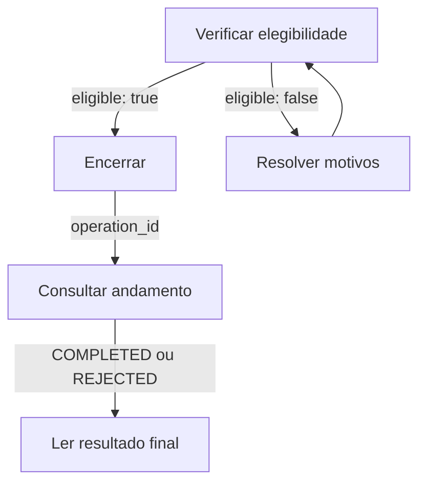
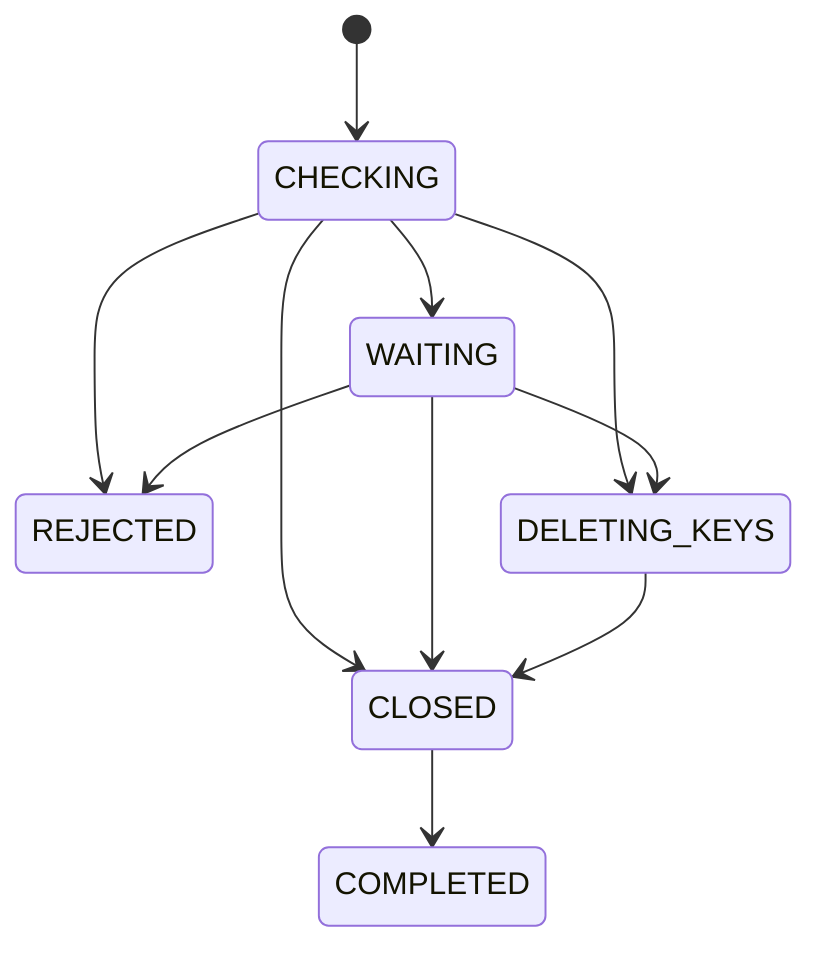

Encerre uma conta gerenciada verificando a elegibilidade, enviando uma solicitação e acompanhando seu ID de operação. Somente CLOSED ou COMPLETED confirma o encerramento da conta.

## Fluxo de encerramento

| Endpoint | O que faz |
| --- | --- |
| [Verificar elegibilidade](/pt-br/api-reference/accounts/close-account/check-eligibility) | Verifica as condições atuais sem alterar a conta. |
| [Encerrar conta](/pt-br/api-reference/accounts/close-account/close-account) | Registra uma operação idempotente de encerramento. |
| [Consultar andamento](/pt-br/api-reference/accounts/close-account/get-closure-progress) | Consulta o andamento sem executar ou repetir o encerramento. |

Mantenha a mesma conta e opção de exclusão na pré-verificação e na solicitação. A aprovação informa a elegibilidade atual, sem reservar ou confirmar o encerramento.

## Preparar o encerramento

O encerramento solicitado pelo comerciante aceita contas gerenciadas MOR, VA e PA com status bancário ACTIVE. Não aceita contas master (`MA_MOR`).

Use credenciais ACCOUNT para a conta autorizada ou USER com `X-ISPB` e `X-Account-Number` assinados. Credenciais PLATFORM não podem chamar esses endpoints.

Antes de solicitar, resolva saldos não zerados, fundos bloqueados, contas filhas abertas, MED do pagador pendentes, notificações de infração e cobranças de tarifas não pagas.

Durante o encerramento, a conta não pode enviar nem receber novos pagamentos, mesmo que seu status bancário continue ACTIVE.

Pagamentos, devoluções, disputas, aberturas de conta e cobranças de tarifas existentes podem adiar o encerramento. Verificações com falha ou sem confirmação exigem espera ou verificação, não aprovação.

O saldo total, o saldo disponível e os fundos bloqueados devem estar zerados. O encerramento verifica esses fundos; não transfere o saldo restante para você.

## Status do encerramento

| Status | Significado | O que comprova | Próximo passo |
| --- | --- | --- | --- |
| `1` CHECKING | Verificação de elegibilidade em andamento | Solicitação registrada | Leia motivos e próxima ação |
| `2` WAITING | Obrigações ou verificação pendentes | Encerramento não confirmado | Siga `next_action` |
| `3` DELETING_KEYS | Exclusão autorizada de chaves em andamento | Exclusão iniciada | Continue consultando esta operação |
| `4` CLOSED | Conta encerrada, limpeza pendente | Conta bancária encerrada | Aguarde a conclusão da limpeza |
| `5` COMPLETED | Encerramento e limpeza concluídos | Operação concluída | Guarde o registro final |
| `6` REJECTED | Elegibilidade impede encerramento | Esta operação não encerrou a conta | Confira o status atual da conta |

WAITING pode exigir análise da equipe de operações, além da espera por obrigações existentes. Leia `reasons[].kind` e `next_action` antes de aguardar ou contatar o suporte.

Quando há apenas motivos impeditivos, a operação passa para REJECTED antes da exclusão de chaves. Após o início da exclusão, novos problemas exigem verificação, não rejeição.

## Chaves Pix e encerramento irreversível

<Warning>O encerramento da conta é irreversível quando está CLOSED. A exclusão automática de chaves Pix pode começar antes de a conta chegar a CLOSED.</Warning>

Exclua as chaves ativas antes ou envie `auto_delete_active_pix_keys` igual a `true` ao solicitar o encerramento. A pré-verificação avalia a opção sem excluir chaves nem salvar a autorização.

O servidor verifica a elegibilidade novamente após excluir as chaves. Se a exclusão continuar sem confirmação após um timeout, a operação original permanece sob verificação.

Após CLOSED, a limpeza encerra a identidade gerenciada, atualiza a conta padrão, retira chaves Pix, zera os limites ativos da conta e remove configurações de tarifas.

Ela também desativa assinaturas de webhooks da conta e credenciais ACCOUNT. Falhas na limpeza não reabrem a conta; aguarde COMPLETED para confirmar a conclusão de todo o processamento.

## Novas tentativas e acesso após o encerramento

Mantenha a chave de idempotência e a intenção original após um timeout. Se guardou o ID da operação, consulte-o; caso contrário, reenvie a solicitação original.

REJECTED remove a restrição temporária desta operação. Não comprova o status atual da conta; outra operação pode já ter encerrado a conta.

Confira `account_status` na resposta de andamento. Solicite novamente com uma nova chave de idempotência somente se a conta continuar ACTIVE e elegível após resolver os motivos.

Use credenciais USER autorizadas para consultar após a desativação das credenciais ACCOUNT. Consultas históricas ainda exigem o mesmo titular e vínculos bancários válidos.

Resultados JSON de negócio retornam HTTP 200. Leia `code` antes da elegibilidade ou do status da operação e informe `xxx-log-id` ao suporte.

## Relacionados

<CardGroup cols={2}>
  <Card title="Verificar elegibilidade" icon="list-check" href="/pt-br/api-reference/accounts/close-account/check-eligibility">
    Identifique impedimentos sem alterar a conta.
  </Card>
  <Card title="Consultar andamento" icon="clock" href="/pt-br/api-reference/accounts/close-account/get-closure-progress">
    Confirme o encerramento e a limpeza.
  </Card>
</CardGroup>
