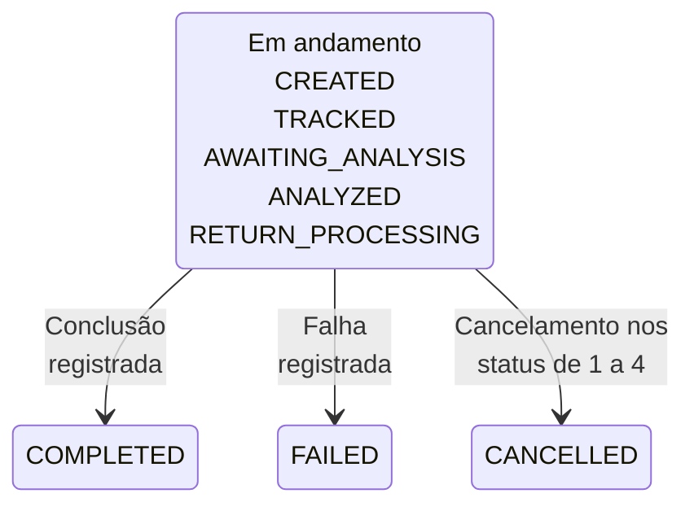

O MED trata contestações de um pagamento Pix original e acompanha a recuperação de recursos. O status do caso não comprova bloqueio nem devolução de dinheiro.

## Como o MED funciona

O <Tooltip tip="Mecanismo Especial de Devolução: mecanismo do Pix para tratar contestações por fraude.">MED</Tooltip> vincula o caso do pagador ao Pix original. As notificações de infração tratam da análise e do bloqueio de recursos na conta recebedora.

<Steps>
  <Step title="Identificar o pagamento Pix original">
    Confirme o pagamento contestado e seu `end_to_end_id`. Use a conta do pagador à qual o pagamento pertence.
  </Step>
  <Step title="Criar o caso">
    Envie a situação de fraude e a opção de processamento. Salve `data.med_case.case_id` da resposta.
  </Step>
  <Step title="Acompanhar o andamento e os recursos">
    Consulte o caso, leia o status e compare os montantes solicitados, bloqueados e devolvidos. Confira os resultados financeiros efetivos separadamente.
  </Step>
</Steps>

## Operações da API

| Endpoint | O que faz |
| --- | --- |
| [Criar caso MED](/pt-br/api-reference/med/create-med-case) | Abre um caso para o Pix original. |
| [Listar casos MED](/pt-br/api-reference/med/list-med-cases) | Localiza casos no contexto da conta selecionada. |
| [Consultar detalhes do caso MED](/pt-br/api-reference/med/get-med-case-details) | Consulta o status e os montantes de recuperação. |
| [Cancelar caso MED](/pt-br/api-reference/med/cancel-med-case) | Solicita o cancelamento de um caso elegível. |
| [Listar notificações de infração](/pt-br/api-reference/med/list-infraction-reports) | Localiza notificações para a conta recebedora. |
| [Consultar detalhes da notificação de infração](/pt-br/api-reference/med/get-infraction-report-details) | Consulta uma notificação acessível e informações de bloqueio. |

## Antes de chamar

<Tabs>
  <Tab title="ACCOUNT" icon="building-columns">
    Use a credencial vinculada à conta correspondente. Omita os cabeçalhos de conta ou envie `X-ISPB` e `X-Account-Number` com os dados dessa conta.
  </Tab>
  <Tab title="USER" icon="user">
    Envie `X-ISPB` e `X-Account-Number` de uma conta pertencente ao USER. Inclua ambos na [assinatura](/pt-br/environments-and-credentials#assinar-requisições).
  </Tab>
  <Tab title="PLATFORM" icon="server">
    <Warning>Credenciais PLATFORM não podem chamar estas operações. Use credenciais ACCOUNT ou USER da conta correspondente.</Warning>
  </Tab>
</Tabs>

A abertura exige um Pix original disponível para consulta com seu montante e ID de transação. A conta do pagador original não pode estar em encerramento nem encerrada.

O acesso ao caso não concede acesso às tarefas vinculadas da conta recebedora. As respostas de detalhes e cancelamento deixam `infractions`, `refunds` e `fund_dispositions` vazios.

Nessas respostas, `timeline` também fica vazio quando existem tarefas ou registros financeiros vinculados. Um array vazio não significa ausência de atividade relacionada.

## Ciclo de vida do caso

O diagrama agrupa os status disponíveis para o caso. Nem todo caso precisa passar por todos os status intermediários.

| Status | Significado | O que comprova | Próximo passo |
| --- | --- | --- | --- |
| `0` UNSPECIFIED | Sem status definido | Nenhum resultado do fluxo | Consulte o caso |
| `1` CREATED | Caso criado | O caso existe | Acompanhe o status |
| `2` TRACKED | Recuperação em acompanhamento | O processamento começou | Consulte o andamento |
| `3` AWAITING_ANALYSIS | Aguardando análise do recebedor | A análise está pendente | Aguarde e consulte |
| `4` ANALYZED | Análise concluída | A decisão pode prosseguir | Acompanhe a devolução |
| `5` RETURN_PROCESSING | Devoluções em processamento | O processamento está em andamento | Confira os montantes devolvidos |
| `6` COMPLETED | Fluxo concluído | O processamento do caso terminou | Verifique a recuperação efetiva |
| `7` CANCELLED | Fluxo cancelado | O cancelamento foi registrado | Verifique a liberação dos recursos |
| `8` FAILED | Falha no fluxo | O processamento do caso falhou | Confira o caso |

A elegibilidade para cancelamento não abrange todos os status em andamento. `can_cancel` é `true` somente para CREATED, TRACKED, AWAITING_ANALYSIS e ANALYZED.

Consulte os detalhes mais recentes antes de [cancelar](/pt-br/api-reference/med/cancel-med-case). A liberação de recursos bloqueados pode terminar após a resposta de cancelamento.

## Saldo e recuperação

O bloqueio restringe a disponibilidade dos recursos; não é uma devolução. Compare `requested_amount`, `blocked_amount_total` e `returned_amount_total`, que são strings decimais em BRL.

Nem o sucesso na abertura nem COMPLETED comprovam recuperação integral. A recuperação pode ser parcial mesmo com `automatic_refund` igual a `true`.

Quando restrições relacionadas ao MED impedem um pagamento, o `code` de negócio pode ser `4004003`, com esta mensagem:

> Your account has no available balance. Please check your MEDs or available balance.

Esse resultado usa HTTP 200. Confira seus casos MED e o [saldo da conta](/pt-br/api-reference/accounts/get-account-balance) antes de tentar outro pagamento.

## Relacionados

<CardGroup cols={2}>
  <Card title="Criar caso MED" icon="shield-halved" href="/pt-br/api-reference/med/create-med-case">
    Abra uma contestação vinculada ao Pix original.
  </Card>
  <Card title="Consultar detalhes do caso MED" icon="magnifying-glass" href="/pt-br/api-reference/med/get-med-case-details">
    Acompanhe o status e os montantes de recuperação.
  </Card>
  <Card title="Listar notificações de infração" icon="list" href="/pt-br/api-reference/med/list-infraction-reports">
    Consulte notificações no contexto da conta recebedora.
  </Card>
  <Card title="Devoluções Pix" icon="rotate-left" href="/pt-br/api-reference/refunds/overview">
    Use o fluxo separado para uma devolução Pix comum.
  </Card>
</CardGroup>
