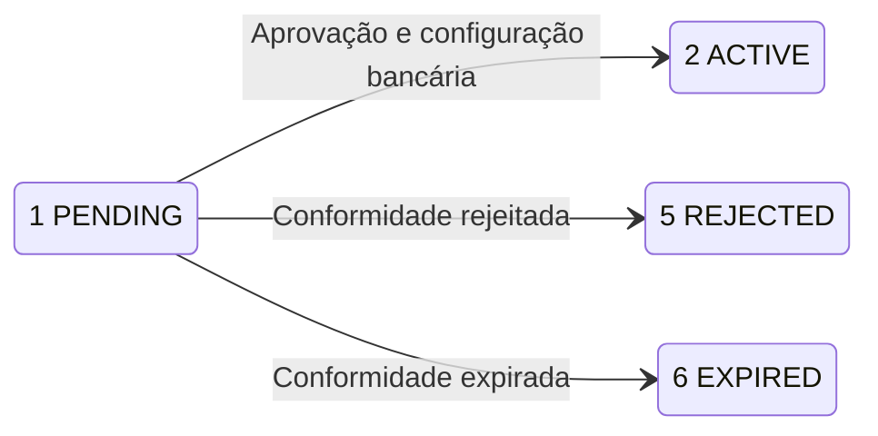

O onboarding de contas gerenciadas permite que você crie contas MOR, VA e PA vinculadas a um USER. Confirme o status atual e os dados bancários da conta antes de usá-la.

## Fluxo de abertura

<Steps>
  <Step title="Escolher o modelo de conta">
    Compare MOR, VA e PA em [Modelos de conta](/pt-br/account-models). Depois, use a variante correspondente em [Criar conta gerenciada](/pt-br/api-reference/onboarding/create-managed-account).
  </Step>
  <Step title="Criar a conta gerenciada">
    Assine a requisição com a credencial do USER titular. Guarde o `reference_id` retornado para consultar a conta depois.

    A criação de MOR reutiliza os dados de conformidade aprovados da MA superior, sem iniciar uma nova análise. VA e PA enviam dados de conformidade próprios.
  </Step>
  <Step title="Concluir o envio pelo link, se necessário">
    Se a criação retornar `verification_url`, encaminhe o solicitante para essa URL. O status de conformidade `PENDING_SUBMISSION` indica que o envio ainda é necessário.
  </Step>
  <Step title="Confirmar o estado da conta">
    Use [Consultar conta gerenciada](/pt-br/api-reference/onboarding/get-managed-account) para conferir o status atual e os dados bancários.

    Uma resposta de criação bem-sucedida ou um [callback KYB](/pt-br/api-reference/onboarding/kyb-callbacks) com `APPROVED` não substitui essa consulta. Confirme uma conta cujo `status` é `2` (ACTIVE).
  </Step>
</Steps>

## Operações da API

As três operações usam POST com corpo JSON. Seu escopo vem do USER titular, não de cabeçalhos de seleção da conta bancária.

| Endpoint | O que faz |
| --- | --- |
| [Criar conta gerenciada](/pt-br/api-reference/onboarding/create-managed-account) | Cria MOR, VA ou PA com `/v3/onboarding/managed_accounts/create`. |
| [Consultar conta gerenciada](/pt-br/api-reference/onboarding/get-managed-account) | Consulta uma conta com `/v3/onboarding/managed_accounts/detail`. |
| [Listar contas gerenciadas](/pt-br/api-reference/onboarding/list-managed-accounts) | Lista as contas gerenciadas visíveis ao USER com `/v3/onboarding/managed_accounts/list`. |

## Antes de chamar

<Tabs>
  <Tab title="USER" icon="user">
    Use a credencial do USER titular das contas. Omita `X-ISPB` e `X-Account-Number` nas operações de criação, consulta de detalhes e listagem.

    O USER precisa ter a criação de contas gerenciadas habilitada. A criação exige exatamente uma MA válida com status ACTIVE e conta bancária ativa.

    Siga [Assinar requisições](/pt-br/environments-and-credentials#assinar-requisições) para os cabeçalhos e a assinatura HMAC-SHA256.
  </Tab>
  <Tab title="ACCOUNT" icon="building-columns">
    <Warning>Credenciais ACCOUNT não podem chamar estas operações de onboarding de contas gerenciadas. Use a credencial do USER titular.</Warning>
  </Tab>
  <Tab title="PLATFORM" icon="server">
    <Warning>Credenciais PLATFORM não podem chamar estas operações de onboarding de contas gerenciadas. Use a credencial do USER titular.</Warning>
  </Tab>
</Tabs>

## Status do ciclo de vida da conta

O status da conta é numérico. O status de conformidade descreve a análise separadamente; a aprovação, por si só, não comprova a ativação da conta.

O diagrama mostra os resultados de uma abertura pendente. A criação pode retornar um resultado já alcançado; consulte os detalhes atuais para confirmá-lo.

| Status | Significado | O que comprova | Próximo passo |
| --- | --- | --- | --- |
| `0` UNSPECIFIED | Sem status de conta mapeado | Sem resultado utilizável do ciclo | Consulte detalhes e contate o suporte |
| `1` PENDING | KYB ou configuração pendente | Ativação não confirmada | Conclua o envio ou consulte detalhes |
| `2` ACTIVE | Conta ativada | Ativação registrada | Confira os dados bancários |
| `3` FROZEN | Conta bloqueada | Bloqueio registrado | Suspenda o uso e contate o suporte |
| `4` CLOSED | Conta encerrada | Encerramento registrado | Não considere a conta ativa |
| `5` REJECTED | Abertura da conta rejeitada | Rejeição registrada | Confira o resultado de conformidade |
| `6` EXPIRED | Abertura da conta expirada | Expiração registrada | Consulte detalhes e contate o suporte |

O estado de envio pendente pelo link pertence à conformidade: `PENDING_SUBMISSION`. Não use essa string como status numérico da conta.

## Relacionados

<CardGroup cols={2}>
  <Card title="Criar conta gerenciada" icon="plus" href="/pt-br/api-reference/onboarding/create-managed-account">
    Escolha a variante de requisição MOR, VA ou PA.
  </Card>
  <Card title="Callbacks KYB" icon="bell" href="/pt-br/api-reference/onboarding/kyb-callbacks">
    Receba e verifique atualizações de conformidade.
  </Card>
  <Card title="Consultar conta gerenciada" icon="magnifying-glass" href="/pt-br/api-reference/onboarding/get-managed-account">
    Confirme o status atual e os dados bancários.
  </Card>
  <Card title="Modelos de conta" icon="layer-group" href="/pt-br/account-models">
    Compare os modelos antes de criar uma conta.
  </Card>
</CardGroup>
