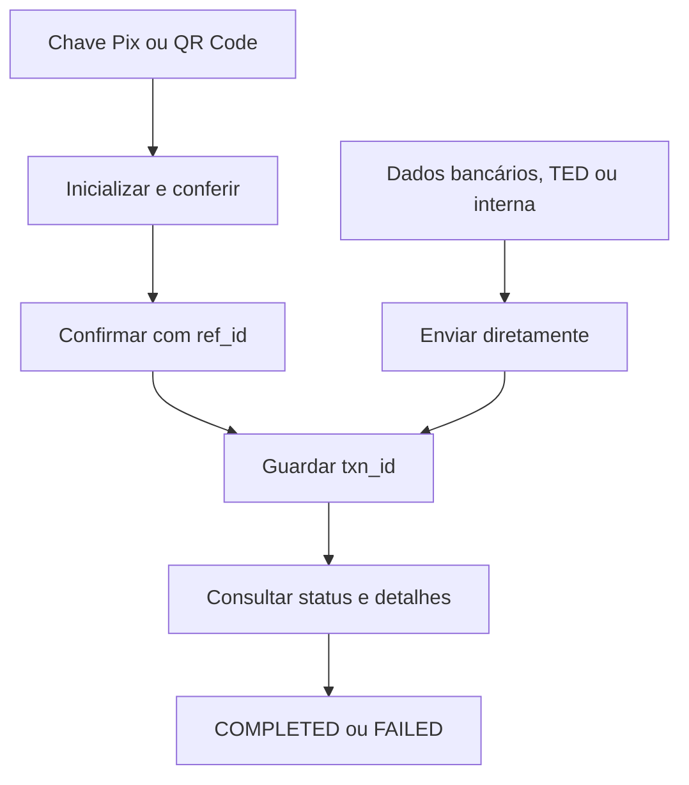

Envie pagamentos por Pix, TED ou transferência interna. Guarde o `txn_id` do pagamento enviado e confirme o resultado antes de enviar outro pagamento.

## Escolher um fluxo de pagamento

| Fluxo | O que você informa | Envio |
| --- | --- | --- |
| [Chave Pix](/pt-br/api-reference/payout/pix/initialize-pix-key-payment) | Chave Pix do recebedor | Inicialize e confirme |
| [QR Code Pix](/pt-br/api-reference/payout/pix/initialize-qr-code-payment) | Conteúdo do QR Code Pix | Inicialize e confirme |
| [Pix com dados bancários](/pt-br/api-reference/payout/pix/pay-with-bank-account-details) | Dados bancários do recebedor | Envie diretamente |
| [TED](/pt-br/api-reference/payout/ted/initiate-ted-payment) | Conta em outra instituição | Envie diretamente |
| [Transferência interna](/pt-br/api-reference/payout/book-transfer/initiate-internal-transfer) | Conta na mesma instituição | Envie diretamente |

A <Tooltip tip="Transferência Eletrônica Disponível, uma transferência bancária entre instituições.">TED</Tooltip> exige que o banco do recebedor seja diferente do banco do pagador. A transferência interna exige o mesmo banco.

Envie os valores monetários como strings decimais em BRL, por exemplo `"10.50"`. Cada endpoint de envio documenta os requisitos da conta e do valor.

## Antes de chamar

<Tabs>
  <Tab title="ACCOUNT" icon="building-columns">
    Use a conta vinculada à sua AK. Omita `X-ISPB` e `X-Account-Number`, ou envie os dois com valores correspondentes à conta vinculada.
  </Tab>
  <Tab title="USER" icon="user">
    Envie `X-ISPB` e `X-Account-Number` para selecionar uma conta de titularidade do USER. Inclua os dois cabeçalhos na [assinatura](/pt-br/environments-and-credentials#assinar-requisições).
  </Tab>
  <Tab title="PLATFORM" icon="server">
    <Warning>Credenciais PLATFORM não podem enviar esses pagamentos. Use credenciais ACCOUNT ou USER da conta do pagador.</Warning>
  </Tab>
</Tabs>

## Enviar e acompanhar

Os pagamentos por chave Pix e QR Code têm duas etapas. A inicialização retorna `ref_id` e os dados do recebedor; a confirmação envia o pagamento com essa referência.

Pix com dados bancários, TED e transferência interna não usam um endpoint separado de confirmação.

Uma resposta cujo `code` é `200` confirma a aceitação da requisição à API. Ela não comprova a conclusão do pagamento. Consulte `data.txn_status` e guarde `data.txn_id`.

## Interpretar o status do pagamento

| Status | Significado | O que comprova | Próximo passo |
| --- | --- | --- | --- |
| `1` TXN_STATUS_PENDING | Aguardando processamento | Não comprova conclusão | Consulte o pagamento original |
| `5` TXN_STATUS_PROCESSING | Em processamento | Não comprova conclusão | Consulte o pagamento original |
| `2` TXN_STATUS_COMPLETED | Pagamento concluído | Resultado de pagamento bem-sucedido | Concilie o lançamento correspondente |
| `3` TXN_STATUS_FAILED | Falha registrada | Falha registrada localmente | Concilie antes de substituir o pagamento |

O [endpoint de status](/pt-br/api-reference/payout/get-payment-status) retorna o status do pagamento. O [endpoint de detalhes](/pt-br/api-reference/payout/get-payment-details) retorna informações sobre o pagamento identificado.

Para Pix, `FAILED` indica uma falha registrada pela Pagsmile; não comprova que o banco deixou de movimentar os recursos. Concilie os detalhes do pagamento com o lançamento correspondente no extrato antes de criar um pagamento substituto. Veja a regra de duas horas em [Consultar status do pagamento](/pt-br/api-reference/payout/get-payment-status).

Para Pix, o [callback de resultado](/pt-br/api-reference/payout/pix/callbacks) também informa o resultado registrado do pagamento.

## Tratar um resultado desconhecido

Trate timeout, perda da resposta ou resposta HTTP 5xx como um resultado de pagamento desconhecido. Aplique a mesma regra a um erro de sistema que deixe o resultado do pagamento incerto.

Resultados de negócio em JSON, incluindo erros de sistema, retornam HTTP 200. Leia `code` e `message` do envelope; não confunda um código de erro de negócio com um status HTTP.

Preserve os identificadores originais do pedido e do pagamento. Consulte o [status do pagamento](/pt-br/api-reference/payout/get-payment-status) original antes de considerar outro envio. Não crie um novo pagamento enquanto o resultado original for desconhecido.

Use `data.txn_id` quando a resposta de envio o incluir. Se você usar o [extrato](/pt-br/api-reference/accounts/get-account-statement), selecione o lançamento correspondente ao pagamento, não o primeiro lançamento.

Se você não conseguir identificar o pagamento original, entre em contato com o suporte antes de considerar outro envio.

Ao solicitar suporte, informe o ambiente, o endpoint, os identificadores da requisição original e o cabeçalho de resposta `xxx-log-id`. Mascare dados sensíveis e nunca envie sua SK.

## Relacionados

<CardGroup cols={2}>
  <Card title="Fluxos de pagamento Pix" icon="qrcode" href="/pt-br/api-reference/payout/pix/overview">
    Compare os três fluxos de pagamento Pix.
  </Card>
  <Card title="Consultar status do pagamento" icon="clock" href="/pt-br/api-reference/payout/get-payment-status">
    Acompanhe a transação original.
  </Card>
  <Card title="Consultar detalhes do pagamento" icon="file-lines" href="/pt-br/api-reference/payout/get-payment-details">
    Confira o resultado do pagamento.
  </Card>
  <Card title="Conciliação" icon="scale-balanced" href="/pt-br/api-reference/reconciliation">
    Relacione os pagamentos aos lançamentos do extrato.
  </Card>
</CardGroup>
