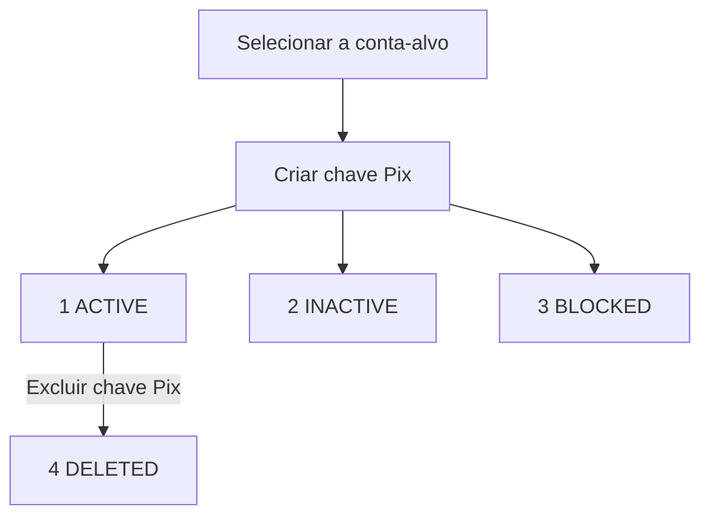

Uma chave Pix identifica a conta que recebe um pagamento. Crie e exclua chaves da conta-alvo. Compartilhe apenas chaves cujo `status` seja `1` (ACTIVE).

## Ciclo de vida das chaves

A criação retorna a chave registrada e seu status. Guarde a chave retornada, principalmente quando você solicita uma chave aleatória, e confira o status antes de compartilhá-la.

O diagrama mostra os resultados da criação e a exclusão de uma chave ativa. Ele não garante uma transição automática de INACTIVE ou BLOCKED para ACTIVE.

## Operações da API

| Endpoint | O que faz |
| --- | --- |
| [Criar chave Pix](/pt-br/api-reference/pix-keys/create-pix-key) | Registra uma chave na conta-alvo e retorna seu status. |
| [Excluir chave Pix](/pt-br/api-reference/pix-keys/delete-pix-key) | Verifica a titularidade atual e remove uma chave registrada. |
| [Consultar saldo da conta](/pt-br/api-reference/accounts/get-account-balance) | Retorna as chaves ACTIVE da conta em `data.pix_keys`. |

## Antes de chamar

<Tabs>
  <Tab title="ACCOUNT" icon="building-columns">
    Crie ou exclua chaves na conta vinculada à sua credencial. Você pode omitir `X-ISPB` e `X-Account-Number`. Se enviar esses cabeçalhos, envie os dois, e ambos devem corresponder à conta vinculada.
  </Tab>
  <Tab title="USER" icon="user">
    Envie `X-ISPB` e `X-Account-Number` para selecionar uma conta ativa que pertença ao USER. Inclua os dois cabeçalhos na [assinatura](/pt-br/environments-and-credentials#assinar-requisições).
  </Tab>
  <Tab title="PLATFORM" icon="server">
    <Warning>Credenciais PLATFORM não podem criar nem excluir chaves Pix. Use a credencial ACCOUNT ou USER da conta que possui a chave.</Warning>
  </Tab>
</Tabs>

## Tipos de chave e limites de formato

A criação recebe `pix_key_type`. A exclusão recebe `pix_key` e identifica o tipo pelo valor.

| `pix_key_type` | Tipo | Valor da chave |
| --- | --- | --- |
| `1` | <Tooltip tip="Cadastro de Pessoas Físicas, o documento de contribuinte pessoa física.">CPF</Tooltip> | 11 dígitos |
| `2` | <Tooltip tip="Cadastro Nacional da Pessoa Jurídica, o documento de contribuinte pessoa jurídica.">CNPJ</Tooltip> | 12 letras ou dígitos, depois 2 dígitos |
| `3` | E-mail | No máximo 77 caracteres |
| `4` | Telefone | Número brasileiro com `+55` |
| `5` | <Tooltip tip="Endereço Virtual de Pagamento, uma chave aleatória em formato UUID.">EVP</Tooltip> | UUID de 36 caracteres em minúsculas |

Para criar uma chave EVP, omita `pix_key_value` ou envie uma string vazia para gerar uma chave. Use `data.pix_key` nas requisições seguintes.

Veja as regras exatas em [formatos de criação](/pt-br/api-reference/pix-keys/create-pix-key#formatos-de-chave) e [formatos de exclusão](/pt-br/api-reference/pix-keys/delete-pix-key#formatos-de-chave). Os formatos de telefone diferem entre essas operações.

## Status

| Status | Significado | O que comprova | Próximo passo |
| --- | --- | --- | --- |
| `0` UNSPECIFIED | Status não especificado | Uso não confirmado | Confira o resultado da operação |
| `1` ACTIVE | Registro ativo | A chave pode receber Pix | Compartilhe a chave com pagadores |
| `2` INACTIVE | Registro inativo | A chave não pode ser usada | Não compartilhe |
| `3` BLOCKED | Pendente ou bloqueado | A chave não está ativa | Não compartilhe |
| `4` DELETED | Chave removida | O registro foi excluído | Remova das instruções de pagamento |

BLOCKED pode incluir registro pendente ou validação de identidade. Esse status, por si só, não indica bloqueio por fraude.

A resposta de exclusão não retorna um campo de status. Quando `code` é `200`, guarde a chave retornada e o horário de exclusão como resultado da operação.

## Consultar chaves e tratar resultados incertos

Use [Consultar saldo da conta](/pt-br/api-reference/accounts/get-account-balance) para ler `data.pix_keys`. Essa lista contém apenas chaves ACTIVE, portanto não é um histórico de todos os status das chaves.

<Note>A consulta da conta pode ser bem-sucedida com uma lista vazia quando a consulta das chaves falha. Uma lista vazia, por si só, não comprova que a criação falhou ou que a exclusão foi concluída.</Note>

Guarde a resposta de criação ou exclusão junto com a consulta da conta. Se um timeout impedir você de receber o resultado, consulte a conta antes de repetir a operação.

Nenhuma dessas operações tem chave de idempotência. Repetir a criação de uma chave EVP pode gerar outra chave aleatória. Uma exclusão repetida pode retornar outro resultado.

## Relacionados

<CardGroup cols={2}>
  <Card title="Criar chave Pix" icon="key" href="/pt-br/api-reference/pix-keys/create-pix-key">
    Registre uma chave e interprete o status da criação.
  </Card>
  <Card title="Excluir chave Pix" icon="trash-can" href="/pt-br/api-reference/pix-keys/delete-pix-key">
    Remova uma chave registrada e trate resultados incertos.
  </Card>
</CardGroup>
