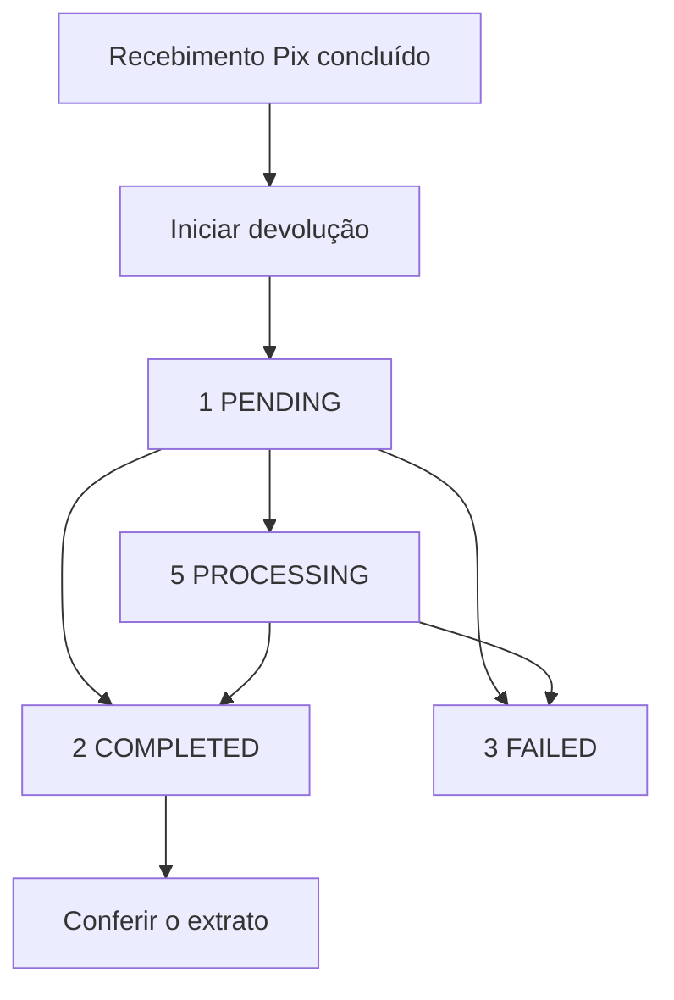

Você devolve um recebimento Pix pela conta do recebedor original. A aceitação da requisição não comprova a devolução dos recursos.

## Como funciona

Salve `refund_id`, `settlement_refund_id` e o ID de liquidação original antes de acompanhar o resultado. Mantenha um registro separado para cada devolução.

## Endpoints

| Endpoint | O que faz |
| --- | --- |
| [Iniciar devolução Pix](/pt-br/api-reference/refunds/initiate-pix-refund) | Solicita uma devolução total ou parcial |
| [Consultar detalhes](/pt-br/api-reference/refunds/get-refund-details) | Retorna o valor, participantes e status registrados |
| [Consultar status](/pt-br/api-reference/refunds/get-refund-status) | Consulta e pode atualizar status não finais |
| [Callbacks de devoluções](/pt-br/api-reference/refunds/callbacks) | Entrega resultados assinados às contas inscritas |

## Devoluções totais e parciais

O pagamento Pix original precisa estar concluído e ter um valor restante disponível para devolução maior que zero. A conta que devolve precisa ser a do recebedor original.

Você pode devolver o valor restante de uma vez ou fazer devoluções parciais. Cada solicitação precisa ter seu próprio `merchant_order_id`.

O valor restante desconta devoluções concluídas, valores retornados por chargebacks e valores reservados para devoluções pendentes. Resultados negativos são tratados como zero.

O prazo é de 90 dias contados do início da transação original. Solicitações após esse prazo são recusadas.

Envie `amount` como string decimal em BRL, maior que zero e exatamente representável com duas casas decimais. O valor não pode exceder o restante disponível.

## Credenciais e conta

Use ACCOUNT para a conta do recebedor original ou USER com `X-ISPB` e `X-Account-Number` dessa conta. Credenciais PLATFORM não são aceitas.

Ao acompanhar a devolução que você enviou, mantenha o contexto da mesma conta. A conta que recebe a devolução tem visibilidade limitada antes da conclusão.

## Ciclo de vida

| Status | Significado | O que comprova | Próximo passo |
| --- | --- | --- | --- |
| `0` UNSPECIFIED | Estado desconhecido | Não comprova conclusão | Verifique os detalhes |
| `1` PENDING | Requisição aceita | Apenas aceitação | Consulte a mesma devolução |
| `5` PROCESSING | Resultado ainda não confirmado | Não comprova conclusão | Consulte pela conta que envia |
| `2` COMPLETED | Devolução concluída | Conclusão registrada | Confira o valor no extrato |
| `3` FAILED | Falha na devolução | Falha registrada | Verifique detalhes e callback |

Uma devolução parcial concluída também tem status `2` (COMPLETED). Esse status confirma a conclusão daquela devolução, não a devolução integral do pagamento original.

A consulta pela conta que envia tenta atualizar estados não finais. Se a atualização falhar, uma resposta bem-sucedida ainda pode trazer o último status registrado.

Para a conta que recebe, toda devolução não concluída aparece como `5` (PROCESSING), inclusive devoluções com falha. Use a conta que envia para acompanhar o resultado real.

## Repetições e conciliação

Após timeout ou erro temporário, consulte a devolução existente. Não envie outra solicitação com um novo ID antes de esclarecer o resultado.

A verificação de duplicidade usa apenas `merchant_order_id`, sem escopo por conta ou USER. IDs ficam reservados por 48 horas, sem repetição da resposta original.

Não reutilize IDs após esse prazo. As regras de data UTC continuam valendo; veja [Iniciar devolução Pix](/pt-br/api-reference/refunds/initiate-pix-refund).

Um resultado de devolução não localizada logo após a aceitação pode ser temporário. Mantenha os identificadores e consulte a mesma devolução novamente.

Se você não recebeu identificadores, guarde o pedido, a conta, o valor e o horário. Inclua `xxx-log-id` ao solicitar ajuda ao suporte.

Confira a devolução no lançamento correspondente do [extrato](/pt-br/api-reference/accounts/get-account-statement). Use `parent_txn_id` e `parent_settlement_id` para vincular o pagamento original.

A resposta de detalhes não preenche `original_settlement_id`. Configure os [callbacks](/pt-br/api-reference/refunds/callbacks) ou consulte o status quando uma notificação não chegar.

## Relacionados

<CardGroup cols={2}>
  <Card title="Iniciar devolução Pix" icon="rotate-left" href="/pt-br/api-reference/refunds/initiate-pix-refund">
    Devolva um recebimento Pix concluído.
  </Card>
  <Card title="Conciliação" icon="list-check" href="/pt-br/api-reference/reconciliation">
    Confira a devolução no extrato.
  </Card>
</CardGroup>
