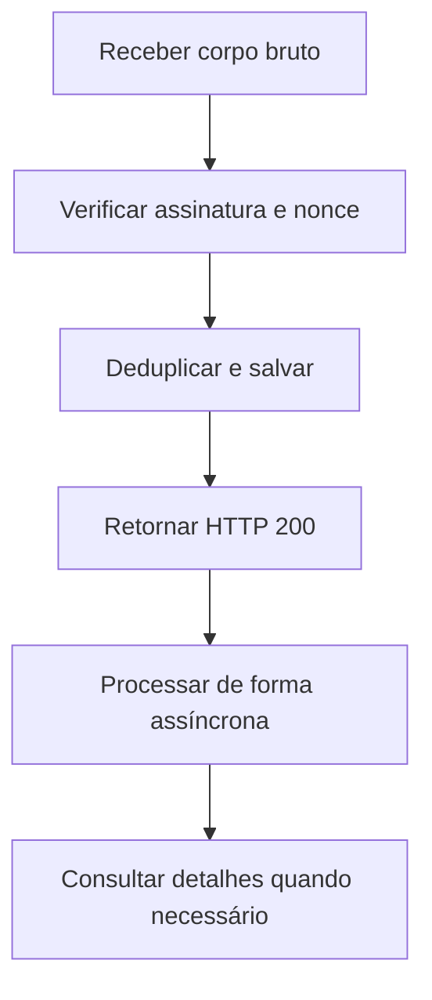

Webhooks enviam notificações assinadas para sua URL de callback. Verifique cada requisição, salve-a de forma confiável e retorne HTTP `200` antes do processamento assíncrono.

## Receber um evento

Siga [Verificar callbacks](/pt-br/environments-and-credentials#verificar-callbacks) para validar a assinatura e impedir replays. Preserve o corpo bruto até concluir a verificação.

## Assinaturas de eventos e credenciais

Uma assinatura de eventos associa um tipo de evento, uma URL de callback e uma credencial de assinatura ao seu titular. Mantenha a assinatura de eventos ativa e a credencial disponível.

<Tabs>
  <Tab title="ACCOUNT" icon="building-columns">
    As assinaturas de eventos de transações pertencem à conta vinculada à credencial. Se você enviar `account_number`, ele deve corresponder a essa conta.
  </Tab>
  <Tab title="USER" icon="user">
    Para eventos de transações, envie `account_number` no corpo JSON para identificar uma conta à qual você tem acesso. Não selecione a conta por cabeçalhos.

    A assinatura de eventos é compartilhada entre contas elegíveis; `account_number` não a vincula a uma única conta.

    As assinaturas de eventos KYB de contas gerenciadas usam o escopo USER, sem `account_number`.
  </Tab>
  <Tab title="PLATFORM" icon="server">
    Use credenciais PLATFORM para assinaturas de eventos KYB de contas master, sem `account_number`.

    <Warning>Credenciais PLATFORM não podem criar assinaturas de eventos de transações. Use credenciais ACCOUNT ou USER para eventos de pagamentos e devoluções.</Warning>
  </Tab>
</Tabs>

A API aceita os seguintes números em `event_type`. Os corpos dos callbacks usam nomes de enums de transação, não esses números de assinatura de eventos.

| `event_type` | Evento | Referência do corpo |
| --- | --- | --- |
| `1` PIX_IN | Pagamento recebido | [Callbacks de transações](/pt-br/api-reference/webhooks/transaction-callbacks) |
| `2` PIX_OUT | Pagamento enviado | [Callbacks de transações](/pt-br/api-reference/webhooks/transaction-callbacks) |
| `3` REFUND_IN | Devolução recebida | [Callbacks de devoluções](/pt-br/api-reference/refunds/callbacks) |
| `4` REFUND_OUT | Devolução enviada | [Callbacks de devoluções](/pt-br/api-reference/refunds/callbacks) |
| `5` VA_ACCOUNT_KYB | KYB de conta gerenciada | [Callbacks KYB](/pt-br/api-reference/onboarding/kyb-callbacks) |
| `6` MASTER_ACCOUNT_KYB | KYB de conta master | O guia de contas gerenciadas não cobre este contrato de payload. Solicite-o à Pagsmile. |

`0` significa UNSPECIFIED e não é aceito ao criar uma assinatura de eventos. Em transações, consulte `payment_method` para identificar o meio de pagamento.

## Gerenciar assinaturas de eventos

| Endpoint | O que faz |
| --- | --- |
| [Criar assinatura de eventos](/pt-br/api-reference/webhooks/create-event-subscription) | Cadastra um evento e uma URL de callback |
| [Listar assinaturas de eventos](/pt-br/api-reference/webhooks/list-event-subscriptions) | Localiza assinaturas de eventos no seu escopo |
| [Consultar assinatura de eventos](/pt-br/api-reference/webhooks/get-event-subscription) | Consulta uma assinatura de eventos |
| [Atualizar assinatura de eventos](/pt-br/api-reference/webhooks/update-event-subscription) | Altera a URL ou o status |
| [Desativar assinatura de eventos](/pt-br/api-reference/webhooks/deactivate-event-subscription) | Desativa uma assinatura de eventos |

## Confirmar o recebimento de callbacks de transações

Somente a resposta HTTP `200` final confirma o recebimento. HTTP `201`, `202`, `204` e outros status diferentes de `200` não confirmam a entrega.

O conteúdo do corpo da resposta não determina o sucesso. Um erro de leitura ou timeout ainda conta como falha, mesmo após HTTP `200`.

O timeout padrão dos callbacks de transações é de 3 segundos, incluindo a leitura da resposta. Responda após salvar o evento, sem aguardar o processamento.

## Entrega de transações e novas tentativas

Para a mesma conta e evento, a entrega seleciona apenas a primeira assinatura ACCOUNT `ACTIVE` entre as aplicações, em ordem de criação.

Criar outra assinatura ACCOUNT `ACTIVE` não distribui os callbacks para todas as assinaturas. Se faltar um callback, confira os receptores existentes dessa conta e evento.

As entregas de transações ACCOUNT e USER permitem até 8 tentativas HTTP por padrão: um envio inicial e 7 novas tentativas.

Os intervalos normais são `5`, `10`, `20`, `30`, `60`, `120` e `240` segundos, nessa ordem. São intervalos de agendamento; a entrega pode ocorrer depois.

<AccordionGroup>
  <Accordion title="Respostas que interrompem novas tentativas" icon="ban">
    HTTP `400`, `401`, `403`, `404`, `405`, `406`, `410`, `414`, `415`, `422`, `431` e `451` interrompem as novas tentativas.

    HTTP `413` também interrompe as tentativas, exceto com um cabeçalho `Retry-After` válido. Outros status diferentes de `200` e falhas de rede mantêm tentativas limitadas.
  </Accordion>
  <Accordion title="Usar Retry-After em sobrecarga temporária" icon="clock">
    Com HTTP `413` ou `429`, envie `Retry-After` como segundos inteiros de `0` a `900`, ou uma data HTTP até 900 segundos no futuro.

    Um cabeçalho válido aumenta o intervalo apenas quando supera o intervalo normal. Valores ausentes ou inválidos não aumentam o intervalo.
  </Accordion>
  <Accordion title="Manter válidas as entregas USER pendentes" icon="sliders">
    Uma entrega pendente de transação USER é cancelada se a assinatura de eventos ficar inativa ou sua configuração salva mudar.

    Isso inclui a URL de callback, a revisão da assinatura de eventos e a credencial.

    Se a verificação de acesso à conta for negada, a entrega é cancelada. A assinatura USER compartilhada pode ser desativada. A desativação também interrompe callbacks de outras contas elegíveis.

    Consulte o status da assinatura de eventos, resolva o problema de acesso e reative a assinatura quando apropriado.
  </Accordion>
</AccordionGroup>

Se não houver uma URL correspondente ao preparar uma notificação de transação ACCOUNT, novas tentativas HTTP não serão agendadas automaticamente.

Essas regras descrevem entregas de transações. Consulte a [referência de callbacks KYB de contas gerenciadas](/pt-br/api-reference/onboarding/kyb-callbacks) para os payloads de `VA_ACCOUNT_KYB`.

## Duplicidades, ordem e recuperação

Para transações USER, deduplique por `delivery_id`. Para transações ACCOUNT, use o tipo de evento da assinatura e `txn_id`, no escopo da conta destinatária.

Retorne HTTP `200` para duplicidades já salvas. Garanta também a idempotência do processamento, sobretudo se você assinar eventos com credenciais ACCOUNT e USER.

Não dependa da ordem de chegada. Consulte os detalhes da transação ou devolução quando faltar um callback ou ele divergir do resultado salvo.

Não recrie um pagamento ou uma devolução para recuperar um callback ausente. Use o identificador original da transação para consultar os detalhes.

Em falhas de entrega, confira a URL, a credencial, o caminho da assinatura, o armazenamento e a resposta HTTP final. Peça ao suporte investigação ou auxílio com reenvio.

## Relacionados

<CardGroup cols={2}>
  <Card title="Callbacks de transações" icon="arrows-rotate" href="/pt-br/api-reference/webhooks/transaction-callbacks">
    Consulte os corpos ACCOUNT e USER e as diferenças no caminho usado na assinatura.
  </Card>
  <Card title="Criar assinatura de eventos" icon="plus" href="/pt-br/api-reference/webhooks/create-event-subscription">
    Cadastre os eventos necessários.
  </Card>
  <Card title="Verificar callbacks" icon="shield-check" href="/pt-br/environments-and-credentials#verificar-callbacks">
    Valide o corpo bruto e impeça replays.
  </Card>
  <Card title="Conciliação" icon="list-check" href="/pt-br/api-reference/reconciliation">
    Relacione notificações com detalhes de transações e extratos.
  </Card>
</CardGroup>
