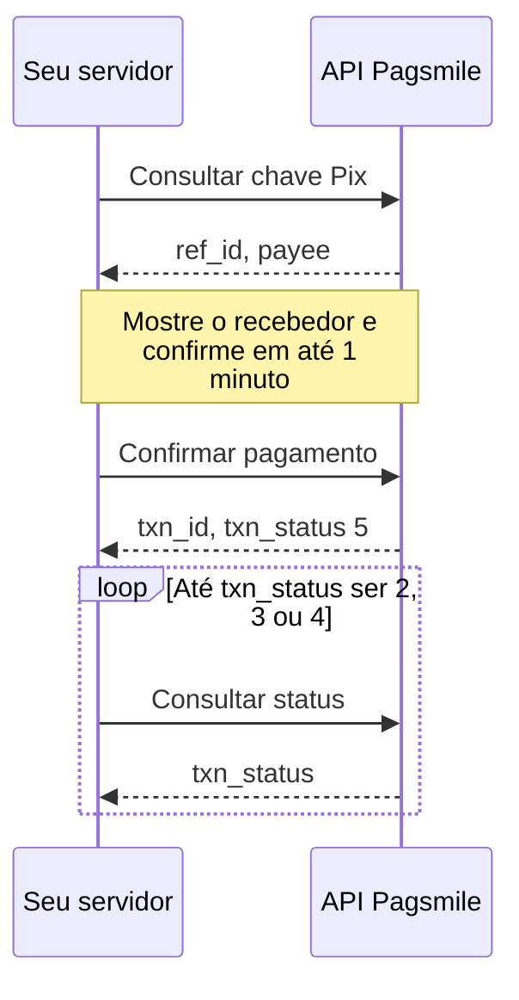
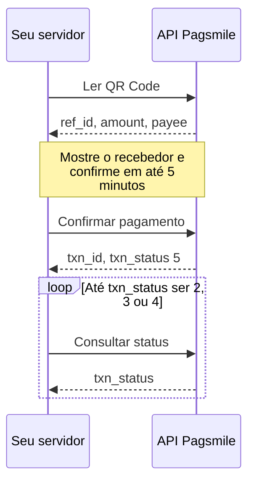
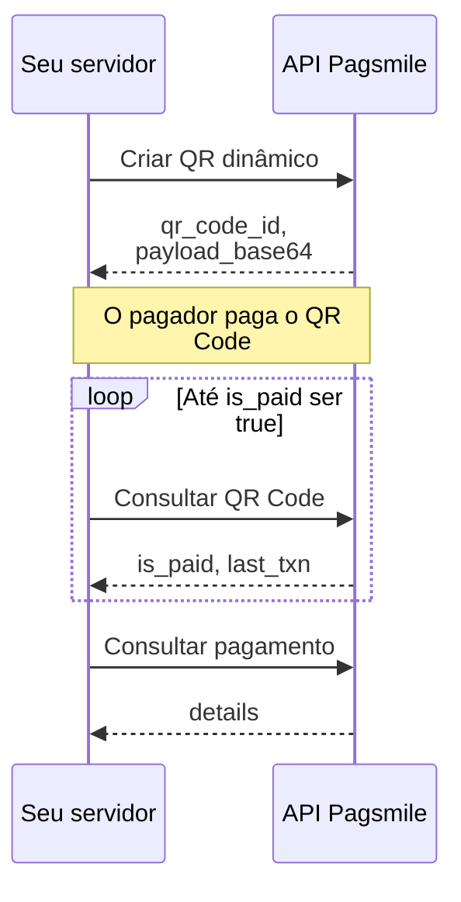
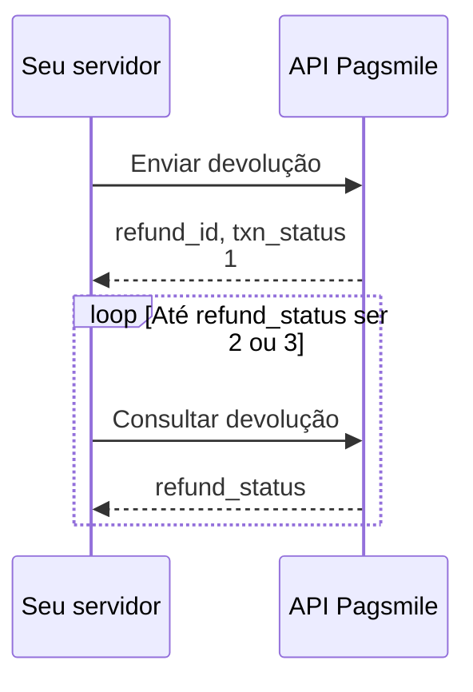
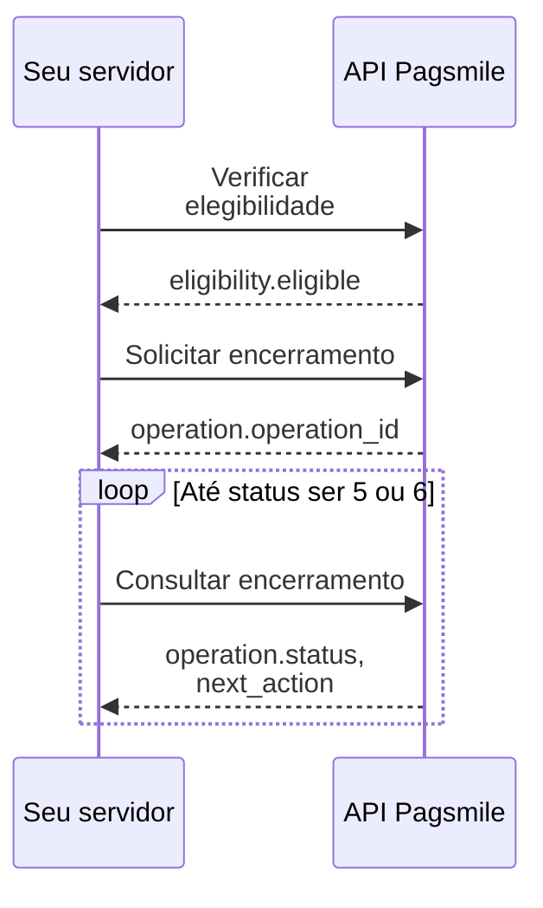

Estes fluxos mostram a ordem das chamadas em tarefas comuns da Pagsmile Open API e o campo que cada etapa passa para a seguinte. Cada um também está definido em um arquivo [Arazzo 1.0](https://spec.openapis.org/arazzo/latest.html) legível por máquina, que aponta para a descrição OpenAPI 3.2 pelo `operationId`.

## Arquivos legíveis por máquina

O repositório da documentação contém os arquivos OpenAPI e Arazzo abaixo. Cada arquivo Arazzo referencia a descrição OpenAPI no mesmo idioma; carregue os dois em uma ferramenta de execução ou de teste compatível com Arazzo. Os arquivos não contêm credenciais: a sua ferramenta precisa [assinar cada requisição](/pt-br/environments-and-credentials#assinar-requisições).

<Tree>
  <Tree.Folder name="openapi" defaultOpen>
    <Tree.File name="en.json" />
    <Tree.File name="pt-br.json" />
  </Tree.Folder>
  <Tree.Folder name="arazzo" defaultOpen>
    <Tree.File name="pagsmile-workflows.en.arazzo.yaml" />
    <Tree.File name="pagsmile-workflows.pt-br.arazzo.yaml" highlight />
  </Tree.Folder>
</Tree>

| Arquivo | Conteúdo |
| --- | --- |
| `openapi/en.json` | Descrição OpenAPI 3.2 em inglês |
| `openapi/pt-br.json` | Descrição OpenAPI 3.2 em português do Brasil |
| `arazzo/pagsmile-workflows.pt-br.arazzo.yaml` | Os cinco fluxos desta página |

<Accordion title="Arquivo Arazzo completo" icon="file-arrow-down">

```yaml pagsmile-workflows.pt-br.arazzo.yaml
arazzo: 1.0.1
info:
  title: Fluxos da Pagsmile Open API
  summary: Fluxos de várias etapas para pagamentos Pix, recebimentos, devoluções e encerramento de conta.
  description: Cada etapa chama uma operação da descrição da Pagsmile Open API. Assine cada requisição como descrito em Ambientes
    e credenciais; estes arquivos não contêm credenciais. Erros de negócio retornam HTTP 200, por isso os critérios de sucesso
    também verificam o `code` do corpo.
  version: 1.0.0
sourceDescriptions:
- name: pagsmileOpenApi
  url: ../openapi/pt-br.json
  type: openapi
workflows:
- workflowId: pixKeyPayout
  summary: Consultar uma chave Pix, confirmar o pagamento e aguardar um status final.
  description: Use este fluxo quando o pagador informar uma chave Pix. Mostre o recebedor retornado ao pagador antes de confirmar.
    Para pagamentos Pix, `3` FAILED indica uma falha registrada pela Pagsmile; não comprova que o banco deixou de movimentar
    os recursos. Concilie os detalhes do pagamento com o lançamento correspondente no extrato antes de criar um pagamento
    substituto. Veja a regra de duas horas em [Consultar status do pagamento](/pt-br/api-reference/payout/get-payment-status).
    Se o envio exceder o tempo limite, a consulta de status falhar ou as tentativas de consulta se esgotarem, não reinicie
    o pagamento ou a devolução com um novo `merchant_order_id`. Preserve os identificadores originais e o contexto da conta.
    Continue consultando a operação existente ou concilie o callback ou o lançamento no extrato. Se o envio não retornar identificadores,
    preserve a requisição original e contate o suporte com o `xxx-log-id`. O esgotamento das tentativas significa que o resultado
    continua indefinido. Encerrar este fluxo não causa falha nem cancelamento de uma operação financeira aceita.
  inputs:
    type: object
    required:
    - pix_key
    - amount
    - merchant_order_id
    properties:
      pix_key:
        type: string
        description: Chave Pix do recebedor.
      amount:
        type: string
        description: Valor em BRL, string decimal.
      merchant_order_id:
        type: string
        description: O seu ID de pedido único.
  steps:
  - stepId: lookUpPixKey
    description: Consulta a chave. O `ref_id` vale por um minuto.
    operationId: initializePixKeyPayment
    requestBody:
      contentType: application/json
      payload:
        pix_key: $inputs.pix_key
        amount: $inputs.amount
    successCriteria:
    - condition: $statusCode == 200
    - condition: $response.body#/code == 200
    onFailure:
    - name: stop
      type: end
    outputs:
      ref_id: $response.body#/data/ref_id
      payee_name: $response.body#/data/payee/name
  - stepId: confirmPixKeyPayout
    description: Envia o pagamento. Quando `txn_status` é `5` (`PROCESSING`), o pagamento foi aceito, mas esse status não
      comprova a liquidação.
    operationId: confirmPixKeyPayment
    requestBody:
      contentType: application/json
      payload:
        ref_id: $steps.lookUpPixKey.outputs.ref_id
        merchant_order_id: $inputs.merchant_order_id
        amount: $inputs.amount
    successCriteria:
    - condition: $statusCode == 200
    - condition: $response.body#/code == 200
    onFailure:
    - name: stop
      type: end
    outputs:
      txn_id: $response.body#/data/txn_id
      txn_status: $response.body#/data/txn_status
  - stepId: waitForPixKeyPayout
    description: 'Consulta até o `txn_status` ser final: `2` COMPLETED, `3` FAILED ou `4` CANCELLED.'
    operationId: getPaymentStatus
    requestBody:
      contentType: application/json
      payload:
        txn_id: $steps.confirmPixKeyPayout.outputs.txn_id
    successCriteria:
    - condition: $statusCode == 200
    - condition: $response.body#/code == 200
    - condition: $response.body#/data/txn_status >= 2 && $response.body#/data/txn_status <= 4
    onFailure:
    - name: retryWhileNotFinal
      type: retry
      retryAfter: 5
      retryLimit: 12
      criteria:
      - condition: $response.body#/code == 200
    - name: stop
      type: end
    outputs:
      txn_status: $response.body#/data/txn_status
  outputs:
    txn_id: $steps.confirmPixKeyPayout.outputs.txn_id
    txn_status: $steps.waitForPixKeyPayout.outputs.txn_status
- workflowId: qrCodePayout
  summary: Ler o payload de um QR Code Pix, confirmar o pagamento e aguardar um status final.
  description: Use este fluxo quando o pagador ler ou colar um QR Code Pix. As regras de valor dependem do tipo de QR Code;
    veja [Confirmar pagamento por QR Code](/pt-br/api-reference/payout/pix/confirm-qr-code-payment). Para pagamentos Pix,
    `3` FAILED indica uma falha registrada pela Pagsmile; não comprova que o banco deixou de movimentar os recursos. Concilie
    os detalhes do pagamento com o lançamento correspondente no extrato antes de criar um pagamento substituto. Veja a regra
    de duas horas em [Consultar status do pagamento](/pt-br/api-reference/payout/get-payment-status). Se o envio exceder o
    tempo limite, a consulta de status falhar ou as tentativas de consulta se esgotarem, não reinicie o pagamento ou a devolução
    com um novo `merchant_order_id`. Preserve os identificadores originais e o contexto da conta. Continue consultando a operação
    existente ou concilie o callback ou o lançamento no extrato. Se o envio não retornar identificadores, preserve a requisição
    original e contate o suporte com o `xxx-log-id`. O esgotamento das tentativas significa que o resultado continua indefinido.
    Encerrar este fluxo não causa falha nem cancelamento de uma operação financeira aceita.
  inputs:
    type: object
    required:
    - qr_code_payload
    - amount
    - merchant_order_id
    properties:
      qr_code_payload:
        type: string
        description: Payload do QR Code Pix em Base64.
      amount:
        type: string
        description: Valor em BRL, string decimal.
      merchant_order_id:
        type: string
        description: O seu ID de pedido único.
  steps:
  - stepId: readQrCode
    description: Lê o QR Code. O `ref_id` vale por cinco minutos.
    operationId: initializeQrCodePayment
    requestBody:
      contentType: application/json
      payload:
        qr_code_payload: $inputs.qr_code_payload
    successCriteria:
    - condition: $statusCode == 200
    - condition: $response.body#/code == 200
    onFailure:
    - name: stop
      type: end
    outputs:
      ref_id: $response.body#/data/ref_id
      qr_amount: $response.body#/data/amount
      payee_name: $response.body#/data/payee/name
  - stepId: confirmQrCodePayout
    description: Envia o pagamento com a mesma conta pagadora.
    operationId: confirmQrCodePayment
    requestBody:
      contentType: application/json
      payload:
        ref_id: $steps.readQrCode.outputs.ref_id
        amount: $inputs.amount
        merchant_order_id: $inputs.merchant_order_id
    successCriteria:
    - condition: $statusCode == 200
    - condition: $response.body#/code == 200
    onFailure:
    - name: stop
      type: end
    outputs:
      txn_id: $response.body#/data/txn_id
      txn_status: $response.body#/data/txn_status
  - stepId: waitForQrCodePayout
    description: Consulta até o `txn_status` ser `2`, `3` ou `4`.
    operationId: getPaymentStatus
    requestBody:
      contentType: application/json
      payload:
        txn_id: $steps.confirmQrCodePayout.outputs.txn_id
    successCriteria:
    - condition: $statusCode == 200
    - condition: $response.body#/code == 200
    - condition: $response.body#/data/txn_status >= 2 && $response.body#/data/txn_status <= 4
    onFailure:
    - name: retryWhileNotFinal
      type: retry
      retryAfter: 5
      retryLimit: 12
      criteria:
      - condition: $response.body#/code == 200
    - name: stop
      type: end
    outputs:
      txn_status: $response.body#/data/txn_status
  outputs:
    txn_id: $steps.confirmQrCodePayout.outputs.txn_id
    txn_status: $steps.waitForQrCodePayout.outputs.txn_status
- workflowId: dynamicQrPayin
  summary: Criar um QR Code Pix dinâmico, aguardar o pagamento e ler os detalhes.
  description: Use este fluxo para cobrar um valor fixo. Decodifique `data.payload_base64` de Base64 para o texto de pagamento
    Pix em UTF-8. Apresente o texto resultante como código Pix Copia e Cola ou use esse mesmo texto para gerar a imagem do
    QR Code localmente. Se o envio exceder o tempo limite, a consulta de status falhar ou as tentativas de consulta se esgotarem,
    não reinicie o pagamento ou a devolução com um novo `merchant_order_id`. Preserve os identificadores originais e o contexto
    da conta. Continue consultando a operação existente ou concilie o callback ou o lançamento no extrato. Se o envio não
    retornar identificadores, preserve a requisição original e contate o suporte com o `xxx-log-id`. O esgotamento das tentativas
    significa que o resultado continua indefinido. Encerrar este fluxo não causa falha nem cancelamento de uma operação financeira
    aceita.
  inputs:
    type: object
    required:
    - amount
    - city
    - pix_key
    - merchant_order_id
    properties:
      amount:
        type: string
        description: Valor em BRL, com no máximo duas casas decimais.
      city:
        type: string
        description: Cidade do recebedor exibida no QR Code.
      pix_key:
        type: string
        description: A sua chave Pix de recebimento.
      merchant_order_id:
        type: string
        description: O seu ID de pedido único.
  steps:
  - stepId: generate
    description: Cria o QR Code e guarda o `qr_code_id`. Decodifique `data.payload_base64` de Base64 para o texto de pagamento
      Pix em UTF-8, usado no Pix Copia e Cola e na imagem do QR Code gerada localmente.
    operationId: generateDynamicQrCode
    requestBody:
      contentType: application/json
      payload:
        amount: $inputs.amount
        city: $inputs.city
        pix_key: $inputs.pix_key
        merchant_order_id: $inputs.merchant_order_id
    successCriteria:
    - condition: $statusCode == 200
    - condition: $response.body#/code == 200
    onFailure:
    - name: stop
      type: end
    outputs:
      qr_code_id: $response.body#/data/qr_code_id
      payload_base64: $response.body#/data/payload_base64
  - stepId: waitForPayment
    description: Consulta até `is_paid` ser `true`. `false` não prova que nenhum pagamento chegou.
    operationId: getQrCodeDetails
    requestBody:
      contentType: application/json
      payload:
        qr_code_id: $steps.generate.outputs.qr_code_id
    successCriteria:
    - condition: $statusCode == 200
    - condition: $response.body#/code == 200
    - condition: $response.body#/data/is_paid == true
    onFailure:
    - name: retryWhileNotFinal
      type: retry
      retryAfter: 10
      retryLimit: 30
      criteria:
      - condition: $response.body#/code == 200
    - name: stop
      type: end
    outputs:
      txn_id: $response.body#/data/last_txn/txn_id
  - stepId: readPayment
    description: Lê o pagamento recebido, com pagador e tarifas.
    operationId: getTransactionDetails
    requestBody:
      contentType: application/json
      payload:
        txn_id: $steps.waitForPayment.outputs.txn_id
    successCriteria:
    - condition: $statusCode == 200
    - condition: $response.body#/code == 200
    onFailure:
    - name: stop
      type: end
    outputs:
      txn_status: $response.body#/data/details/txn_status
      amount: $response.body#/data/details/amount
  outputs:
    qr_code_id: $steps.generate.outputs.qr_code_id
    txn_id: $steps.waitForPayment.outputs.txn_id
- workflowId: pixRefund
  summary: Devolver um Pix recebido e aguardar um status final da devolução.
  description: Use este fluxo para devolver, integral ou parcialmente, o valor de um Pix recebido. Identifique o pagamento
    pelo ID de liquidação. Se o envio exceder o tempo limite, a consulta de status falhar ou as tentativas de consulta se
    esgotarem, não reinicie o pagamento ou a devolução com um novo `merchant_order_id`. Preserve os identificadores originais
    e o contexto da conta. Continue consultando a operação existente ou concilie o callback ou o lançamento no extrato. Se
    o envio não retornar identificadores, preserve a requisição original e contate o suporte com o `xxx-log-id`. O esgotamento
    das tentativas significa que o resultado continua indefinido. Encerrar este fluxo não causa falha nem cancelamento de
    uma operação financeira aceita.
  inputs:
    type: object
    required:
    - original_settlement_id
    - amount
    - merchant_order_id
    properties:
      original_settlement_id:
        type: string
        description: ID de liquidação do pagamento recebido.
      amount:
        type: string
        description: Valor da devolução em BRL, string decimal.
      merchant_order_id:
        type: string
        description: O seu ID de pedido único para a devolução.
  steps:
  - stepId: submitRefund
    description: Envia a devolução. Quando `txn_status` é `1` (`PENDING`), a devolução foi aceita, mas esse status não comprova
      que o valor foi devolvido.
    operationId: initiatePixRefund
    requestBody:
      contentType: application/json
      payload:
        original_settlement_id: $inputs.original_settlement_id
        merchant_order_id: $inputs.merchant_order_id
        amount: $inputs.amount
    successCriteria:
    - condition: $statusCode == 200
    - condition: $response.body#/code == 200
    onFailure:
    - name: stop
      type: end
    outputs:
      refund_id: $response.body#/data/refund_id
  - stepId: waitForRefund
    description: Consulta até o `refund_status` ser `2` COMPLETED ou `3` FAILED.
    operationId: getRefundStatus
    requestBody:
      contentType: application/json
      payload:
        refund_id: $steps.submitRefund.outputs.refund_id
    successCriteria:
    - condition: $statusCode == 200
    - condition: $response.body#/code == 200
    - condition: $response.body#/data/refund_status == 2 || $response.body#/data/refund_status == 3
    onFailure:
    - name: retryWhileNotFinal
      type: retry
      retryAfter: 5
      retryLimit: 12
      criteria:
      - condition: $response.body#/code == 200
    - name: stop
      type: end
    outputs:
      refund_status: $response.body#/data/refund_status
  outputs:
    refund_id: $steps.submitRefund.outputs.refund_id
    refund_status: $steps.waitForRefund.outputs.refund_status
- workflowId: accountClosure
  summary: Verificar a elegibilidade, solicitar o encerramento e acompanhá-lo até um status final.
  description: Use este fluxo para encerrar uma conta que você gerencia. Pare após a verificação se `eligible` for `false`
    e resolva antes os motivos retornados.
  inputs:
    type: object
    required:
    - account_number
    - reason
    - idempotency_key
    properties:
      account_number:
        type: string
        description: Conta a encerrar, com zeros à esquerda.
      reason:
        type: integer
        description: 'Motivo do encerramento: 1, 2 ou 3.'
      idempotency_key:
        type: string
        description: A sua chave de idempotência, até 128 bytes.
  steps:
  - stepId: checkClosureEligibility
    description: Continue só quando `eligible` for `true`.
    operationId: checkEligibility
    requestBody:
      contentType: application/json
      payload:
        account_number: $inputs.account_number
        auto_delete_active_pix_keys: false
    successCriteria:
    - condition: $statusCode == 200
    - condition: $response.body#/code == 200
    - condition: $response.body#/data/eligibility/eligible == true
    onFailure:
    - name: stop
      type: end
    outputs:
      eligible: $response.body#/data/eligibility/eligible
  - stepId: requestClosure
    description: Solicita o encerramento e guarda o `operation_id`. Reusar a chave retorna a mesma operação.
    operationId: closeAccount
    requestBody:
      contentType: application/json
      payload:
        account_number: $inputs.account_number
        reason: $inputs.reason
        idempotency_key: $inputs.idempotency_key
    successCriteria:
    - condition: $statusCode == 200
    - condition: $response.body#/code == 200
    onFailure:
    - name: stop
      type: end
    outputs:
      operation_id: $response.body#/data/operation/operation_id
  - stepId: waitForClosure
    description: Consulta até o `status` ser `5` COMPLETED ou `6` REJECTED. `4` CLOSED ainda pode ter limpeza pendente.
    operationId: getClosureProgress
    requestBody:
      contentType: application/json
      payload:
        account_number: $inputs.account_number
        operation_id: $steps.requestClosure.outputs.operation_id
    successCriteria:
    - condition: $statusCode == 200
    - condition: $response.body#/code == 200
    - condition: $response.body#/data/operation/status == 5 || $response.body#/data/operation/status == 6
    onFailure:
    - name: retryWhileNotFinal
      type: retry
      retryAfter: 30
      retryLimit: 20
      criteria:
      - condition: $response.body#/code == 200
    - name: stop
      type: end
    outputs:
      status: $response.body#/data/operation/status
      next_action: $response.body#/data/operation/next_action
  outputs:
    operation_id: $steps.requestClosure.outputs.operation_id
    status: $steps.waitForClosure.outputs.status
```

</Accordion>

## Como as etapas decidem

Cada etapa só tem sucesso quando a resposta é HTTP 200 **e** o `code` do corpo é `200`, porque erros de negócio também retornam HTTP 200. As etapas de consulta acrescentam uma condição de status final. Quando a chamada funciona mas o status ainda não é final, a etapa tenta de novo. Qualquer outra falha encerra a execução do fluxo; leia `code` e `message` antes de decidir como recuperar o resultado.

Se o envio exceder o tempo limite, a consulta de status falhar ou as tentativas de consulta se esgotarem, não reinicie o pagamento ou a devolução com um novo `merchant_order_id`. Preserve os identificadores originais e o contexto da conta. Continue consultando a operação existente ou concilie o callback ou o lançamento no extrato. Se o envio não retornar identificadores, preserve a requisição original e contate o suporte com o `xxx-log-id`. O esgotamento das tentativas significa que o resultado continua indefinido. Encerrar este fluxo não causa falha nem cancelamento de uma operação financeira aceita.

<Note>
  Os intervalos de nova tentativa são exemplos. Em produção, use intervalos maiores e crescentes, e pare de consultar quando receber o callback.
</Note>

## Pagar para uma chave Pix

Use este fluxo quando o pagador informar uma chave Pix. Mostre o recebedor retornado ao pagador antes de confirmar.

Para pagamentos Pix, `3` FAILED indica uma falha registrada pela Pagsmile; não comprova que o banco deixou de movimentar os recursos. Concilie os detalhes do pagamento com o lançamento correspondente no extrato antes de criar um pagamento substituto. Veja a regra de duas horas em [Consultar status do pagamento](/pt-br/api-reference/payout/get-payment-status).



<Steps>
  <Step title="Inicializar pagamento via chave Pix">
    [`POST /v3/transfers/pix/key-initiate`](/pt-br/api-reference/payout/pix/initialize-pix-key-payment). Consulta a chave. O `ref_id` vale por um minuto.

    - **Envia:** `pix_key`, `amount`
    - **Guarda:** `ref_id`, `payee_name`
    - **Avança quando:** HTTP 200 e `code` é `200`.
  </Step>
  <Step title="Confirmar pagamento via chave Pix">
    [`POST /v3/transfers/pix/key-confirm`](/pt-br/api-reference/payout/pix/confirm-pix-key-payment). Envia o pagamento. Quando `txn_status` é `5` (`PROCESSING`), o pagamento foi aceito, mas esse status não comprova a liquidação.

    - **Envia:** `ref_id`, `merchant_order_id`, `amount`
    - **Guarda:** `txn_id`, `txn_status`
    - **Avança quando:** HTTP 200 e `code` é `200`.
  </Step>
  <Step title="Consultar status do pagamento">
    [`POST /v3/transfers/status/check`](/pt-br/api-reference/payout/get-payment-status). Consulta até o `txn_status` ser final: `2` COMPLETED, `3` FAILED ou `4` CANCELLED.

    - **Envia:** `txn_id`
    - **Guarda:** `txn_status`
    - **Avança quando:** HTTP 200 e `code` é `200`, e `txn_status` é `2`, `3` ou `4`.
    - **Novas tentativas (exemplo):** A cada 5 s, até 12 vezes, enquanto `code` for `200` e a condição de conclusão não for atendida.
  </Step>
</Steps>

Os callbacks são o principal sinal do resultado final: [Callbacks de pagamentos Pix](/pt-br/api-reference/payout/pix/callbacks). Mantenha a etapa de consulta como alternativa.

<Accordion title="Definição Arazzo: pixKeyPayout" icon="file-code">

```yaml pixKeyPayout.arazzo.yaml
workflowId: pixKeyPayout
summary: Consultar uma chave Pix, confirmar o pagamento e aguardar um status final.
description: Use este fluxo quando o pagador informar uma chave Pix. Mostre o recebedor retornado ao pagador antes
  de confirmar. Para pagamentos Pix, `3` FAILED indica uma falha registrada pela Pagsmile; não comprova que o banco
  deixou de movimentar os recursos. Concilie os detalhes do pagamento com o lançamento correspondente no extrato
  antes de criar um pagamento substituto. Veja a regra de duas horas em [Consultar status do pagamento](/pt-br/api-reference/payout/get-payment-status).
  Se o envio exceder o tempo limite, a consulta de status falhar ou as tentativas de consulta se esgotarem, não
  reinicie o pagamento ou a devolução com um novo `merchant_order_id`. Preserve os identificadores originais e o
  contexto da conta. Continue consultando a operação existente ou concilie o callback ou o lançamento no extrato.
  Se o envio não retornar identificadores, preserve a requisição original e contate o suporte com o `xxx-log-id`.
  O esgotamento das tentativas significa que o resultado continua indefinido. Encerrar este fluxo não causa falha
  nem cancelamento de uma operação financeira aceita.
inputs:
  type: object
  required:
  - pix_key
  - amount
  - merchant_order_id
  properties:
    pix_key:
      type: string
      description: Chave Pix do recebedor.
    amount:
      type: string
      description: Valor em BRL, string decimal.
    merchant_order_id:
      type: string
      description: O seu ID de pedido único.
steps:
- stepId: lookUpPixKey
  description: Consulta a chave. O `ref_id` vale por um minuto.
  operationId: initializePixKeyPayment
  requestBody:
    contentType: application/json
    payload:
      pix_key: $inputs.pix_key
      amount: $inputs.amount
  successCriteria:
  - condition: $statusCode == 200
  - condition: $response.body#/code == 200
  onFailure:
  - name: stop
    type: end
  outputs:
    ref_id: $response.body#/data/ref_id
    payee_name: $response.body#/data/payee/name
- stepId: confirmPixKeyPayout
  description: Envia o pagamento. Quando `txn_status` é `5` (`PROCESSING`), o pagamento foi aceito, mas esse status
    não comprova a liquidação.
  operationId: confirmPixKeyPayment
  requestBody:
    contentType: application/json
    payload:
      ref_id: $steps.lookUpPixKey.outputs.ref_id
      merchant_order_id: $inputs.merchant_order_id
      amount: $inputs.amount
  successCriteria:
  - condition: $statusCode == 200
  - condition: $response.body#/code == 200
  onFailure:
  - name: stop
    type: end
  outputs:
    txn_id: $response.body#/data/txn_id
    txn_status: $response.body#/data/txn_status
- stepId: waitForPixKeyPayout
  description: 'Consulta até o `txn_status` ser final: `2` COMPLETED, `3` FAILED ou `4` CANCELLED.'
  operationId: getPaymentStatus
  requestBody:
    contentType: application/json
    payload:
      txn_id: $steps.confirmPixKeyPayout.outputs.txn_id
  successCriteria:
  - condition: $statusCode == 200
  - condition: $response.body#/code == 200
  - condition: $response.body#/data/txn_status >= 2 && $response.body#/data/txn_status <= 4
  onFailure:
  - name: retryWhileNotFinal
    type: retry
    retryAfter: 5
    retryLimit: 12
    criteria:
    - condition: $response.body#/code == 200
  - name: stop
    type: end
  outputs:
    txn_status: $response.body#/data/txn_status
outputs:
  txn_id: $steps.confirmPixKeyPayout.outputs.txn_id
  txn_status: $steps.waitForPixKeyPayout.outputs.txn_status
```

</Accordion>

## Pagar um QR Code Pix

Use este fluxo quando o pagador ler ou colar um QR Code Pix. As regras de valor dependem do tipo de QR Code; veja [Confirmar pagamento por QR Code](/pt-br/api-reference/payout/pix/confirm-qr-code-payment).

Para pagamentos Pix, `3` FAILED indica uma falha registrada pela Pagsmile; não comprova que o banco deixou de movimentar os recursos. Concilie os detalhes do pagamento com o lançamento correspondente no extrato antes de criar um pagamento substituto. Veja a regra de duas horas em [Consultar status do pagamento](/pt-br/api-reference/payout/get-payment-status).



<Steps>
  <Step title="Inicializar pagamento via QR Code">
    [`POST /v3/transfers/pix/qr-code-initiate`](/pt-br/api-reference/payout/pix/initialize-qr-code-payment). Lê o QR Code. O `ref_id` vale por cinco minutos.

    - **Envia:** `qr_code_payload`
    - **Guarda:** `ref_id`, `qr_amount`, `payee_name`
    - **Avança quando:** HTTP 200 e `code` é `200`.
  </Step>
  <Step title="Confirmar pagamento via QR Code">
    [`POST /v3/transfers/pix/qr-code-confirm`](/pt-br/api-reference/payout/pix/confirm-qr-code-payment). Envia o pagamento com a mesma conta pagadora.

    - **Envia:** `ref_id`, `amount`, `merchant_order_id`
    - **Guarda:** `txn_id`, `txn_status`
    - **Avança quando:** HTTP 200 e `code` é `200`.
  </Step>
  <Step title="Consultar status do pagamento">
    [`POST /v3/transfers/status/check`](/pt-br/api-reference/payout/get-payment-status). Consulta até o `txn_status` ser `2`, `3` ou `4`.

    - **Envia:** `txn_id`
    - **Guarda:** `txn_status`
    - **Avança quando:** HTTP 200 e `code` é `200`, e `txn_status` é `2`, `3` ou `4`.
    - **Novas tentativas (exemplo):** A cada 5 s, até 12 vezes, enquanto `code` for `200` e a condição de conclusão não for atendida.
  </Step>
</Steps>

Os callbacks são o principal sinal do resultado final: [Callbacks de pagamentos Pix](/pt-br/api-reference/payout/pix/callbacks). Mantenha a etapa de consulta como alternativa.

<Accordion title="Definição Arazzo: qrCodePayout" icon="file-code">

```yaml qrCodePayout.arazzo.yaml
workflowId: qrCodePayout
summary: Ler o payload de um QR Code Pix, confirmar o pagamento e aguardar um status final.
description: Use este fluxo quando o pagador ler ou colar um QR Code Pix. As regras de valor dependem do tipo de
  QR Code; veja [Confirmar pagamento por QR Code](/pt-br/api-reference/payout/pix/confirm-qr-code-payment). Para
  pagamentos Pix, `3` FAILED indica uma falha registrada pela Pagsmile; não comprova que o banco deixou de movimentar
  os recursos. Concilie os detalhes do pagamento com o lançamento correspondente no extrato antes de criar um pagamento
  substituto. Veja a regra de duas horas em [Consultar status do pagamento](/pt-br/api-reference/payout/get-payment-status).
  Se o envio exceder o tempo limite, a consulta de status falhar ou as tentativas de consulta se esgotarem, não
  reinicie o pagamento ou a devolução com um novo `merchant_order_id`. Preserve os identificadores originais e o
  contexto da conta. Continue consultando a operação existente ou concilie o callback ou o lançamento no extrato.
  Se o envio não retornar identificadores, preserve a requisição original e contate o suporte com o `xxx-log-id`.
  O esgotamento das tentativas significa que o resultado continua indefinido. Encerrar este fluxo não causa falha
  nem cancelamento de uma operação financeira aceita.
inputs:
  type: object
  required:
  - qr_code_payload
  - amount
  - merchant_order_id
  properties:
    qr_code_payload:
      type: string
      description: Payload do QR Code Pix em Base64.
    amount:
      type: string
      description: Valor em BRL, string decimal.
    merchant_order_id:
      type: string
      description: O seu ID de pedido único.
steps:
- stepId: readQrCode
  description: Lê o QR Code. O `ref_id` vale por cinco minutos.
  operationId: initializeQrCodePayment
  requestBody:
    contentType: application/json
    payload:
      qr_code_payload: $inputs.qr_code_payload
  successCriteria:
  - condition: $statusCode == 200
  - condition: $response.body#/code == 200
  onFailure:
  - name: stop
    type: end
  outputs:
    ref_id: $response.body#/data/ref_id
    qr_amount: $response.body#/data/amount
    payee_name: $response.body#/data/payee/name
- stepId: confirmQrCodePayout
  description: Envia o pagamento com a mesma conta pagadora.
  operationId: confirmQrCodePayment
  requestBody:
    contentType: application/json
    payload:
      ref_id: $steps.readQrCode.outputs.ref_id
      amount: $inputs.amount
      merchant_order_id: $inputs.merchant_order_id
  successCriteria:
  - condition: $statusCode == 200
  - condition: $response.body#/code == 200
  onFailure:
  - name: stop
    type: end
  outputs:
    txn_id: $response.body#/data/txn_id
    txn_status: $response.body#/data/txn_status
- stepId: waitForQrCodePayout
  description: Consulta até o `txn_status` ser `2`, `3` ou `4`.
  operationId: getPaymentStatus
  requestBody:
    contentType: application/json
    payload:
      txn_id: $steps.confirmQrCodePayout.outputs.txn_id
  successCriteria:
  - condition: $statusCode == 200
  - condition: $response.body#/code == 200
  - condition: $response.body#/data/txn_status >= 2 && $response.body#/data/txn_status <= 4
  onFailure:
  - name: retryWhileNotFinal
    type: retry
    retryAfter: 5
    retryLimit: 12
    criteria:
    - condition: $response.body#/code == 200
  - name: stop
    type: end
  outputs:
    txn_status: $response.body#/data/txn_status
outputs:
  txn_id: $steps.confirmQrCodePayout.outputs.txn_id
  txn_status: $steps.waitForQrCodePayout.outputs.txn_status
```

</Accordion>

## Receber com QR Code dinâmico

Use este fluxo para cobrar um valor fixo. Decodifique `data.payload_base64` de Base64 para o texto de pagamento Pix em UTF-8. Apresente o texto resultante como código Pix Copia e Cola ou use esse mesmo texto para gerar a imagem do QR Code localmente.



<Steps>
  <Step title="Gerar QR Code dinâmico">
    [`POST /v3/qr_code/generate/dynamic`](/pt-br/api-reference/payin/generate-dynamic-qr-code). Cria o QR Code e guarda o `qr_code_id`. Decodifique `data.payload_base64` de Base64 para o texto de pagamento Pix em UTF-8, usado no Pix Copia e Cola e na imagem do QR Code gerada localmente.

    - **Envia:** `amount`, `city`, `pix_key`, `merchant_order_id`
    - **Guarda:** `qr_code_id`, `payload_base64`
    - **Avança quando:** HTTP 200 e `code` é `200`.
  </Step>
  <Step title="Consultar detalhes do QR Code">
    [`POST /v3/qr_code/details`](/pt-br/api-reference/payin/get-qr-code-details). Consulta até `is_paid` ser `true`. `false` não prova que nenhum pagamento chegou.

    - **Envia:** `qr_code_id`
    - **Guarda:** `txn_id`
    - **Avança quando:** HTTP 200 e `code` é `200`, e `is_paid` é `true`.
    - **Novas tentativas (exemplo):** A cada 10 s, até 30 vezes, enquanto `code` for `200` e a condição de conclusão não for atendida.
  </Step>
  <Step title="Consultar detalhes da transação">
    [`POST /v3/charges/details`](/pt-br/api-reference/payin/get-transaction-details). Lê o pagamento recebido, com pagador e tarifas.

    - **Envia:** `txn_id`
    - **Guarda:** `txn_status`, `amount`
    - **Avança quando:** HTTP 200 e `code` é `200`.
  </Step>
</Steps>

Os callbacks são o principal sinal do resultado final: [Callbacks de recebimentos](/pt-br/api-reference/payin/callbacks). Mantenha a etapa de consulta como alternativa.

<Accordion title="Definição Arazzo: dynamicQrPayin" icon="file-code">

```yaml dynamicQrPayin.arazzo.yaml
workflowId: dynamicQrPayin
summary: Criar um QR Code Pix dinâmico, aguardar o pagamento e ler os detalhes.
description: Use este fluxo para cobrar um valor fixo. Decodifique `data.payload_base64` de Base64 para o texto
  de pagamento Pix em UTF-8. Apresente o texto resultante como código Pix Copia e Cola ou use esse mesmo texto para
  gerar a imagem do QR Code localmente. Se o envio exceder o tempo limite, a consulta de status falhar ou as tentativas
  de consulta se esgotarem, não reinicie o pagamento ou a devolução com um novo `merchant_order_id`. Preserve os
  identificadores originais e o contexto da conta. Continue consultando a operação existente ou concilie o callback
  ou o lançamento no extrato. Se o envio não retornar identificadores, preserve a requisição original e contate
  o suporte com o `xxx-log-id`. O esgotamento das tentativas significa que o resultado continua indefinido. Encerrar
  este fluxo não causa falha nem cancelamento de uma operação financeira aceita.
inputs:
  type: object
  required:
  - amount
  - city
  - pix_key
  - merchant_order_id
  properties:
    amount:
      type: string
      description: Valor em BRL, com no máximo duas casas decimais.
    city:
      type: string
      description: Cidade do recebedor exibida no QR Code.
    pix_key:
      type: string
      description: A sua chave Pix de recebimento.
    merchant_order_id:
      type: string
      description: O seu ID de pedido único.
steps:
- stepId: generate
  description: Cria o QR Code e guarda o `qr_code_id`. Decodifique `data.payload_base64` de Base64 para o texto
    de pagamento Pix em UTF-8, usado no Pix Copia e Cola e na imagem do QR Code gerada localmente.
  operationId: generateDynamicQrCode
  requestBody:
    contentType: application/json
    payload:
      amount: $inputs.amount
      city: $inputs.city
      pix_key: $inputs.pix_key
      merchant_order_id: $inputs.merchant_order_id
  successCriteria:
  - condition: $statusCode == 200
  - condition: $response.body#/code == 200
  onFailure:
  - name: stop
    type: end
  outputs:
    qr_code_id: $response.body#/data/qr_code_id
    payload_base64: $response.body#/data/payload_base64
- stepId: waitForPayment
  description: Consulta até `is_paid` ser `true`. `false` não prova que nenhum pagamento chegou.
  operationId: getQrCodeDetails
  requestBody:
    contentType: application/json
    payload:
      qr_code_id: $steps.generate.outputs.qr_code_id
  successCriteria:
  - condition: $statusCode == 200
  - condition: $response.body#/code == 200
  - condition: $response.body#/data/is_paid == true
  onFailure:
  - name: retryWhileNotFinal
    type: retry
    retryAfter: 10
    retryLimit: 30
    criteria:
    - condition: $response.body#/code == 200
  - name: stop
    type: end
  outputs:
    txn_id: $response.body#/data/last_txn/txn_id
- stepId: readPayment
  description: Lê o pagamento recebido, com pagador e tarifas.
  operationId: getTransactionDetails
  requestBody:
    contentType: application/json
    payload:
      txn_id: $steps.waitForPayment.outputs.txn_id
  successCriteria:
  - condition: $statusCode == 200
  - condition: $response.body#/code == 200
  onFailure:
  - name: stop
    type: end
  outputs:
    txn_status: $response.body#/data/details/txn_status
    amount: $response.body#/data/details/amount
outputs:
  qr_code_id: $steps.generate.outputs.qr_code_id
  txn_id: $steps.waitForPayment.outputs.txn_id
```

</Accordion>

## Devolver um pagamento Pix

Use este fluxo para devolver, integral ou parcialmente, o valor de um Pix recebido. Identifique o pagamento pelo ID de liquidação.



<Steps>
  <Step title="Iniciar devolução Pix">
    [`POST /v3/refunds/pix`](/pt-br/api-reference/refunds/initiate-pix-refund). Envia a devolução. Quando `txn_status` é `1` (`PENDING`), a devolução foi aceita, mas esse status não comprova que o valor foi devolvido.

    - **Envia:** `original_settlement_id`, `merchant_order_id`, `amount`
    - **Guarda:** `refund_id`
    - **Avança quando:** HTTP 200 e `code` é `200`.
  </Step>
  <Step title="Consultar status da devolução">
    [`POST /v3/refunds/status/check`](/pt-br/api-reference/refunds/get-refund-status). Consulta até o `refund_status` ser `2` COMPLETED ou `3` FAILED.

    - **Envia:** `refund_id`
    - **Guarda:** `refund_status`
    - **Avança quando:** HTTP 200 e `code` é `200`, e `refund_status` é `2` ou `3`.
    - **Novas tentativas (exemplo):** A cada 5 s, até 12 vezes, enquanto `code` for `200` e a condição de conclusão não for atendida.
  </Step>
</Steps>

Os callbacks são o principal sinal do resultado final: [Callbacks de devoluções](/pt-br/api-reference/refunds/callbacks). Mantenha a etapa de consulta como alternativa.

<Accordion title="Definição Arazzo: pixRefund" icon="file-code">

```yaml pixRefund.arazzo.yaml
workflowId: pixRefund
summary: Devolver um Pix recebido e aguardar um status final da devolução.
description: Use este fluxo para devolver, integral ou parcialmente, o valor de um Pix recebido. Identifique o pagamento
  pelo ID de liquidação. Se o envio exceder o tempo limite, a consulta de status falhar ou as tentativas de consulta
  se esgotarem, não reinicie o pagamento ou a devolução com um novo `merchant_order_id`. Preserve os identificadores
  originais e o contexto da conta. Continue consultando a operação existente ou concilie o callback ou o lançamento
  no extrato. Se o envio não retornar identificadores, preserve a requisição original e contate o suporte com o
  `xxx-log-id`. O esgotamento das tentativas significa que o resultado continua indefinido. Encerrar este fluxo
  não causa falha nem cancelamento de uma operação financeira aceita.
inputs:
  type: object
  required:
  - original_settlement_id
  - amount
  - merchant_order_id
  properties:
    original_settlement_id:
      type: string
      description: ID de liquidação do pagamento recebido.
    amount:
      type: string
      description: Valor da devolução em BRL, string decimal.
    merchant_order_id:
      type: string
      description: O seu ID de pedido único para a devolução.
steps:
- stepId: submitRefund
  description: Envia a devolução. Quando `txn_status` é `1` (`PENDING`), a devolução foi aceita, mas esse status
    não comprova que o valor foi devolvido.
  operationId: initiatePixRefund
  requestBody:
    contentType: application/json
    payload:
      original_settlement_id: $inputs.original_settlement_id
      merchant_order_id: $inputs.merchant_order_id
      amount: $inputs.amount
  successCriteria:
  - condition: $statusCode == 200
  - condition: $response.body#/code == 200
  onFailure:
  - name: stop
    type: end
  outputs:
    refund_id: $response.body#/data/refund_id
- stepId: waitForRefund
  description: Consulta até o `refund_status` ser `2` COMPLETED ou `3` FAILED.
  operationId: getRefundStatus
  requestBody:
    contentType: application/json
    payload:
      refund_id: $steps.submitRefund.outputs.refund_id
  successCriteria:
  - condition: $statusCode == 200
  - condition: $response.body#/code == 200
  - condition: $response.body#/data/refund_status == 2 || $response.body#/data/refund_status == 3
  onFailure:
  - name: retryWhileNotFinal
    type: retry
    retryAfter: 5
    retryLimit: 12
    criteria:
    - condition: $response.body#/code == 200
  - name: stop
    type: end
  outputs:
    refund_status: $response.body#/data/refund_status
outputs:
  refund_id: $steps.submitRefund.outputs.refund_id
  refund_status: $steps.waitForRefund.outputs.refund_status
```

</Accordion>

## Encerrar uma conta

Use este fluxo para encerrar uma conta que você gerencia. Pare após a verificação se `eligible` for `false` e resolva antes os motivos retornados.



<Steps>
  <Step title="Verificar elegibilidade para encerramento da conta">
    [`POST /v3/bank_account/close/precheck`](/pt-br/api-reference/accounts/close-account/check-eligibility). Continue só quando `eligible` for `true`.

    - **Envia:** `account_number`, `auto_delete_active_pix_keys`
    - **Guarda:** `eligible`
    - **Avança quando:** HTTP 200 e `code` é `200`, e `eligible` é `true`.
  </Step>
  <Step title="Encerrar conta">
    [`POST /v3/bank_account/close`](/pt-br/api-reference/accounts/close-account/close-account). Solicita o encerramento e guarda o `operation_id`. Reusar a chave retorna a mesma operação.

    - **Envia:** `account_number`, `reason`, `idempotency_key`
    - **Guarda:** `operation_id`
    - **Avança quando:** HTTP 200 e `code` é `200`.
  </Step>
  <Step title="Consultar andamento do encerramento da conta">
    [`POST /v3/bank_account/close/query`](/pt-br/api-reference/accounts/close-account/get-closure-progress). Consulta até o `status` ser `5` COMPLETED ou `6` REJECTED. `4` CLOSED ainda pode ter limpeza pendente.

    - **Envia:** `account_number`, `operation_id`
    - **Guarda:** `status`, `next_action`
    - **Avança quando:** HTTP 200 e `code` é `200`, e `status` é `5` ou `6`.
    - **Novas tentativas (exemplo):** A cada 30 s, até 20 vezes, enquanto `code` for `200` e a condição de conclusão não for atendida.
  </Step>
</Steps>

Este fluxo não tem callback; consulte o endpoint de progresso.

<Accordion title="Definição Arazzo: accountClosure" icon="file-code">

```yaml accountClosure.arazzo.yaml
workflowId: accountClosure
summary: Verificar a elegibilidade, solicitar o encerramento e acompanhá-lo até um status final.
description: Use este fluxo para encerrar uma conta que você gerencia. Pare após a verificação se `eligible` for
  `false` e resolva antes os motivos retornados.
inputs:
  type: object
  required:
  - account_number
  - reason
  - idempotency_key
  properties:
    account_number:
      type: string
      description: Conta a encerrar, com zeros à esquerda.
    reason:
      type: integer
      description: 'Motivo do encerramento: 1, 2 ou 3.'
    idempotency_key:
      type: string
      description: A sua chave de idempotência, até 128 bytes.
steps:
- stepId: checkClosureEligibility
  description: Continue só quando `eligible` for `true`.
  operationId: checkEligibility
  requestBody:
    contentType: application/json
    payload:
      account_number: $inputs.account_number
      auto_delete_active_pix_keys: false
  successCriteria:
  - condition: $statusCode == 200
  - condition: $response.body#/code == 200
  - condition: $response.body#/data/eligibility/eligible == true
  onFailure:
  - name: stop
    type: end
  outputs:
    eligible: $response.body#/data/eligibility/eligible
- stepId: requestClosure
  description: Solicita o encerramento e guarda o `operation_id`. Reusar a chave retorna a mesma operação.
  operationId: closeAccount
  requestBody:
    contentType: application/json
    payload:
      account_number: $inputs.account_number
      reason: $inputs.reason
      idempotency_key: $inputs.idempotency_key
  successCriteria:
  - condition: $statusCode == 200
  - condition: $response.body#/code == 200
  onFailure:
  - name: stop
    type: end
  outputs:
    operation_id: $response.body#/data/operation/operation_id
- stepId: waitForClosure
  description: Consulta até o `status` ser `5` COMPLETED ou `6` REJECTED. `4` CLOSED ainda pode ter limpeza pendente.
  operationId: getClosureProgress
  requestBody:
    contentType: application/json
    payload:
      account_number: $inputs.account_number
      operation_id: $steps.requestClosure.outputs.operation_id
  successCriteria:
  - condition: $statusCode == 200
  - condition: $response.body#/code == 200
  - condition: $response.body#/data/operation/status == 5 || $response.body#/data/operation/status == 6
  onFailure:
  - name: retryWhileNotFinal
    type: retry
    retryAfter: 30
    retryLimit: 20
    criteria:
    - condition: $response.body#/code == 200
  - name: stop
    type: end
  outputs:
    status: $response.body#/data/operation/status
    next_action: $response.body#/data/operation/next_action
outputs:
  operation_id: $steps.requestClosure.outputs.operation_id
  status: $steps.waitForClosure.outputs.status
```

</Accordion>

## Relacionados

<CardGroup cols={2}>
  <Card title="Ambientes e credenciais" icon="key" href="/pt-br/environments-and-credentials">Assine cada etapa e escolha a conta.</Card>
  <Card title="Catálogo de erros" icon="triangle-exclamation" href="/pt-br/api-reference/error-catalog">O que cada `code` significa e se vale tentar de novo.</Card>
</CardGroup>
